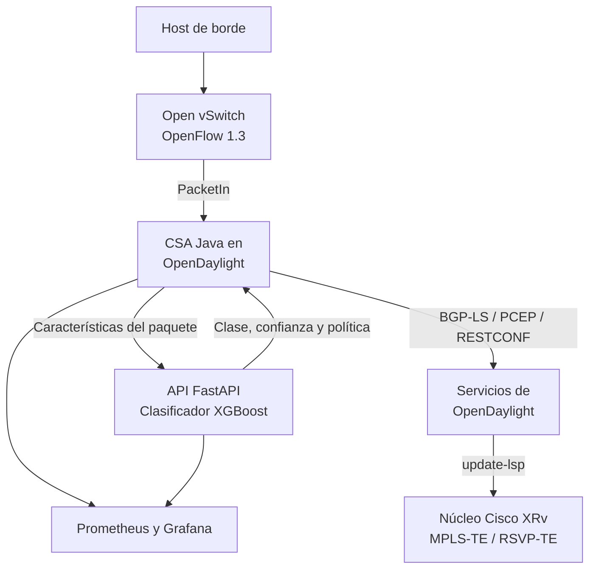

# SDN-MPLS-ML Technology Demonstrator

Proyecto integrador basado en un demostrador tecnológico de una arquitectura de *Software Defined Networking* (SDN) que combina clasificación supervisada de tráfico y control adaptativo de túneles MPLS-TE en una arquitectura híbrida entre dispositivos de red virutalizados *Cisco IOS XR XRv*, y dispositivos de red virtuales basados en *Open vSwitch*. El proyecto reproduce un entorno de laboratorio en el que un evento *OpenFlow* `Packet-In` se transforma en una decisión de política. Dicha decisión, posteriormente, puede actualizar un par de *LSPs RSVP-TE* delegados mediante *OpenDaylight* y *PCEP*.

## Documentación técnica

La referencia de implementación, despliegue, contratos *RESTCONF*, observabilidad, y validación está publicada de forma permanente en:

> [Documentación SDN-MPLS-ML Technology Demonstrator](https://volv1t3.github.io/SDN-Thesis-Project/sdn-mpls-ml-tech-demo-documentation-overview.html)

La documentación publicada complementa este README. Por su parte, el README ofrece una orientación de entrada y una guía de ubicación de los artefactos y ejecución, mientras que *Writerside* explica los mecanismos internos, las configuraciones por dispositivo y los procedimientos de validación. Su fuente se mantiene en [`Writerside/`](Writerside/), cuyo punto de inicio local es [`Writerside/topics/sdn-mpls-ml-tech-demo-documentation-overview.md`](Writerside/topics/sdn-mpls-ml-tech-demo-documentation-overview.md).

## Propósito y flujo de control

La topología de referencia contiene cuatro routers *Cisco IOS XR XRv* que forman el núcleo *MPLS-TE*, dos *switches* *Open vSwitch* en los extremos y dos hosts de tráfico. El controlador *OpenDaylight* recibe notificaciones desde los *switches*, consulta a la *API* de clasificación y conserva el estado operativo necesario para decidir si una política nueva debe sustituir la política activa del par bidireccional. Cuando la política lo permite, la aplicación calcula o reutiliza una ruta y solicita la actualización de *LSP* delegados a través de *PCEP*.



## Componentes principales

| Capa | Implementación | Responsabilidad en el demostrador |
| --- | --- | --- |
| Red de datos y control | *Containerlab*, *Cisco IOS XR XRv*, *Open vSwitch* y hosts *Ubuntu 24.04* | Define el núcleo *MPLS-TE*, las interfaces de acceso, los enlaces de control y la generación de `Packet-In`. |
| Controlador *SDN* | *OpenDaylight 0.23.1* y aplicación *Java* empaquetada como *feature* de *Apache Karaf* | Obtiene estado *BGP-LS/PCEP*, procesa eventos *OpenFlow*, coordina políticas bidireccionales, calcula caminos y actualiza *LSP* delegados. |
| Inferencia | *FastAPI*, *XGBoost*, *Pydantic* y *Uvicorn* | Valida características de paquetes, ejecuta la inferencia, aplica el mapeo determinista de política y publica salud, métricas y registros estructurados. |
| Observabilidad | *Prometheus*, *Grafana* y exportador *SNMP* | Recolecta métricas de las aplicaciones y de la red para validar el ciclo de control y diagnosticar fallos. |
| Ciencia de datos | Cuadernos, conjunto de datos y artefactos del modelo | Contiene la exploración, el entrenamiento y los archivos de modelo consumidos por la *API*. |
| Evidencia y documentación | Writerside, registros de experimentación y scripts de captura | Describe la implementación, conserva evidencia de experimentos y permite recopilar estado y métricas de una ejecución. |

## Estructura del repositorio

```text
.
├── Writerside/                         # Fuente de la documentación técnica publicada
├── docs/
│   ├── experimentation/                # Registros y evidencia de experimentos E1, E2 y E3
├── src/
│   ├── main/
│   │   ├── containerlab/
│   │   │   ├── topologies/main/        # Topología integrada de referencia
│   │   │   ├── configurations/         # Configuración XRv, Prometheus, Grafana y SNMP
│   │   │   └── custom-images/          # Imágenes auxiliares para hosts y OVS
│   │   ├── java/
│   │   │   ├── baseline-odl/           # Dockerfile y entrada del controlador
│   │   │   └── sdn-mpls-ml-odl-cs-app/ # Módulos Maven impl y features
│   │   ├── python/
│   │   │   ├── api/                    # API FastAPI, pruebas, modelo y políticas
│   │   │   └── model/                  # Cuadernos de EDA, entrenamiento y comparación
│   │   └── postman/                    # Solicitudes HTTP para explorar RESTCONF
│   └── res/                            # Figuras y recursos de resultados
```

La topología que integra los servicios se encuentra en [`src/main/containerlab/topologies/main/sdn-mpls-ai-tech-demo-baseline.clab.yaml`](src/main/containerlab/topologies/main/sdn-mpls-ai-tech-demo-baseline.clab.yaml). Este archivo es la *source of truth* de las imágenes, interfaces, enlaces, variables de entorno, puertos publicados y volúmenes de la ejecución de laboratorio.

## Requisitos

### Despliegue completo de la topología

El despliegue integrado se documentó para un host **Ubuntu 24.04 o posterior, amd64**, con acceso de usuario *root*. Se requieren *Docker Engine*, *Containerlab* y *nested y hardware virtualization*. Los routers *Cisco IOS XR XRv* se ejecutan mediante `vrnetlab`, por lo que la ausencia de extensiones *VT-x/AMD-V* o de `/dev/kvm` impide una ejecución representativa.

También se necesita una imagen *Cisco IOS XR XRv* compatible y obtenida con la licencia correspondiente. La topología declara `vrnetlab/cisco_xrv:6.6.3`, pero el repositorio no distribuye la imagen de *Cisco* ni sustituye sus condiciones de licencia.

Antes de desplegar, se debe comprobar las dependencias del host mediante,

```bash
docker version
containerlab version
kvm-ok
```

EL procedimiento detallado de instalación de *Docker*, *Containerlab* y `vrnetlab` se puede revisar y seguir desde la [documentación técnica publicada](https://volv1t3.github.io/SDN-Thesis-Project/sdn-mpls-ml-tech-demo-documentation-overview.html), dentro de la sección de implementación de la topología.

### Desarrollo de componentes

| Componente | Requisitos respaldados por el repositorio |
| --- | --- |
| *API* de inferencia | Python, `pip` y las dependencias de [`requirements.txt`](src/main/python/api/requirements.txt). La configuración estática de prueba usa *Python 3.12*. El Dockerfile actual construye la imagen sobre *Python 3.14*. |
| *API*: pruebas y análisis | Dependencias de [`requirements-dev.txt`](src/main/python/api/requirements-dev.txt): `pytest`, `pytest-cov`, `httpx`, *Ruff* y *mypy*. |
| Aplicación *Java* | *JDK 21* y *Maven*. El POM raíz compila con `maven.compiler.release` *21* y agrupa los módulos `impl` y `features`. |
| Imagen del controlador | *Docker* con acceso a *Maven* y a los repositorios de *OpenDaylight* durante la construcción. El *Dockerfile* instala la aplicación en una distribución *OpenDaylight 0.23.1 Vanadium*. |
| Documentación | *Writerside*, si se desea compilar localmente el sitio. Esta misma documentación se encuentra publicada en la web. |

## Inicio rápido del laboratorio

Estos pasos despliegan la *topología* integrada de *Containerlab*.

1. Se debe preparar la imagen de los *routers Cisco IOS XR XRv* para `vrnetlab` y definir su etiqueta para que coincida con la declarada por la topología.
2. Se debe crear los directorios persistentes exigidos por los volúmenes de *Containerlab* para almacenar la información de los *logs* de los sistemas, series de tiempo de *Prometheus* y *Grafana*.

   ```bash
   mkdir -p src/main/containerlab/data-folders/{grafana-data,prometheus-data,ml-api-logs,karaf-csa-logs}
   ```

3. Se debe utilizar el *script* [`sdn-mpls-ai-tech-demo-prepare-res-folders.sh`](src/main/containerlab/topologies/main/sdn-mpls-ai-tech-demo-prepare-res-folders.sh) antes de ejecutar la topología y revisar que los GIDs y UIDs de los usuarios de los contenedores de la topología sean los registrados en el documento. Por la restricción de acceso de los contenedores a los directorios de *data*, el script ajusta propietarios y ACL de los cuatro directorios y contiene un nombre de usuario específico del entorno de desarrollo para que los contenedores puedan escribir en ellos. Si se ejecuta en un entorno distinto, se debe revisar y adaptar el script antes de su ejecución.
4. Desde el directorio de la topología, se puede desplegar el laboratorio mediante,

   ```bash
   cd src/main/containerlab/topologies/main
   sudo containerlab deploy --topo sdn-mpls-ai-tech-demo-baseline.clab.yaml
   ```

5. Para inspeccionar la topología y validar que los contenedores y enlaces se hayan creado correctamente, se puede usar,

   ```bash
   sudo containerlab inspect --topo sdn-mpls-ai-tech-demo-baseline.clab.yaml
   ```

6. Después de validar la topología, se puede evaluar la disponibilidad de los servicios expuestos por el archivo de topología en cada uno de sus puertos e interfaces, la *API* publica el puerto `33761` y *Grafana* el puerto `34761` en el host. La *API* ofrece, entre otras, las rutas `/health/live`, `/health/ready`, `/api/v1/classify` y `/metrics`.

Para detener y eliminar el laboratorio cuando ya no sea necesario, se puede usar el mismo archivo de topología:

```bash
sudo containerlab destroy --topo sdn-mpls-ai-tech-demo-baseline.clab.yaml
```

> **Atención:** `destroy` elimina los contenedores y redes del laboratorio. Los directorios montados desde `src/main/containerlab/data-folders/` se conservan en el host, por lo que deben gestionarse explícitamente si contienen registros o datos que se desean preservar.

## Ejecución y validación de la *API*

La *API* puede ejecutarse de forma aislada para validar el contrato de clasificación y el modelo entrenado. El archivo [`.env.example`](src/main/python/api/.env.example) contiene valores de referencia para el modelo, las políticas, los registros y los límites operativos, se debe ajustar estos valores para poder ejecutar la *API* de manera local.

```bash
cd src/main/python/api
python -m venv .venv
source .venv/bin/activate
pip install -r requirements-dev.txt
cp .env.example .env
uvicorn app.sdn_mpls_ml_main:app --host 0.0.0.0 --port 8000
```

En otra terminal, las pruebas de la *API* se ejecutan desde ese mismo directorio,

```bash
pytest
```

La aplicación carga el modelo y los archivos de política desde las rutas configuradas por `MODEL_DIR` y `CONFIG_DIR`. Por ello, un resultado de salud positiva no sustituye la validación funcional del modelo ni demuestra que exista conectividad con *OpenDaylight*, las pruebas que se pueden ejecutar corresponden en su totalidad al estado de la topología.

## Construcción y pruebas de la aplicación *Java*

La *Controller-Side Application* se organiza como un proyecto de *Java 21* bajo *Maven* con los módulos `impl` y `features`. Las pruebas y la construcción local pueden iniciarse desde su raíz:

```bash
cd src/main/java/sdn-mpls-ml-odl-cs-app
mvn test
mvn clean install -Pq -DskipTests -Dcheckstyle.skip=true
```

## Configuración y observabilidad

La topología concentra las variables de entorno de la *API* y de la *Controller-Side Application*. Entre ellas se encuentran las *URL* del clasificador, los identificadores de topología *BGP-LS* y *PCEP*, los nombres de los *LSP* y túneles delegados, los tiempos de caché, los límites de reintento y los parámetros de *OpenFlow*. 

La observabilidad se distribuye en tres fuentes complementarias:

- La *API* y la *Controller-Side Application* publican métricas compatibles con *Prometheus* quien hace un *scraping* de estos *endpoints* cada cierto tiempo y registra los valores expuestos por estos *endpoints* en su base de datos de series de tiempo.
- *Grafana* aprovisiona paneles desde `src/main/containerlab/configurations/tech-demonstrator/services/provisioning/`.
- *OpenDaylight* expone el estado operativo de la *Controller-Side Application* bajo el repositorio de *MD-SAL* expuesto a través de *RESTCONF* con el árbol definido por un modelo *YANG* propio `csa:controller-state`.
