# Model Exploration and Training — Exploratory Data Analysis

<show-structure for="chapter" depth="2"/>

This chapter documents the exploratory data analysis (EDA) performed on the normal-traffic subset of the SDNFlow dataset, using the notebook `SDN-MPLS-ML-TechDemonstrator-Dataset-EDA.ipynb`.

The analysis establishes the data preparation and feature-selection requirements for the machine learning subsystem of the SDN-MPLS-ML Technology Demonstrator. Its principal objective is to determine whether network traffic can be classified using information available immediately upon receiving a packet, rather than statistics collected throughout the lifetime of a network flow.

The classification mechanism is intended to operate alongside OpenDaylight and its Controller-Side Application (CSA). When an unknown packet reaches an Open vSwitch device and triggers a `PacketIn` notification, the controller extracts the corresponding packet-header fields and requests a classification from the Python inference API. Consequently, the features used during training must also be available at this particular stage of packet processing.

The EDA evaluates a dataset containing 221,564 observations and 39 original columns. It investigates source integrity, column structure, data quality, class imbalance, protocol distributions, transport-port behavior, and statistical relationships between selected features and traffic categories.

The analysis ultimately establishes a reduced five-column dataset containing four input features—`eth_type`, `ip_proto`, `src_port`, and `dst_port`—and the supervised target `Category`.

<note>
The source dataset originates from the SDNFlow research work described by Buzzio-García and colleagues. The original dataset contains flow-level statistics obtained in an SDN environment. This implementation uses the normal-traffic subset to formulate a seven-class traffic classification problem constrained by first-packet feature availability.

The original research is available in the <a href="https://doi.org/10.1109/ACCESS.2024.3378271">IEEE Access publication</a>.
</note>

The chapter examines the analytical procedures implemented in the EDA notebook and their relationship to the subsequent XGBoost training notebook. Model optimization and final evaluation are addressed in the separate training documentation.

## Analytical Story {id="eda-analytical-story"}

The exploratory analysis is organized into successive stages that verify the integrity of the source dataset, evaluate its original structure, identify admissible packet-header characteristics, and determine whether those characteristics exhibit useful relationships with the expected traffic categories.  The notebook is not designed merely to obtain descriptive statistics. Its central purpose is to establish an appropriate relationship between the statistical representation of traffic and the operational limitations of the demonstrator.

In a conventional offline classification scenario, a model may use accumulated packet counts, average packet sizes, flow duration, byte rates, or interval statistics. Such measurements may improve predictive performance because they describe behavior observed across several packets or an entire communication. However, the proposed inference mechanism operates when the first relevant packet reaches the controller. At that moment, completed-flow statistics are unavailable. Using them during training would produce a mismatch between the information provided to the model in development and the information available during inference.

The EDA therefore evaluates two complementary requirements:

- **Statistical relevance:** Determine whether selected packet-header fields exhibit relationships with the traffic classes.
- **Operational availability:** Ensure that every selected field can be extracted at the intended inference point without waiting for later packets.

The first requirement is explored through frequency distributions, cross-tabulations, descriptive statistics, and 
correlation diagnostics. The second is established through the definition of a restricted feature contract.

The following diagram summarizes the analytical sequence.

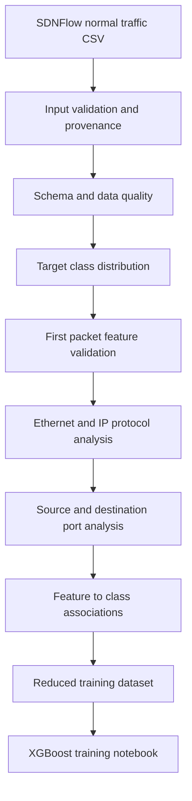

Each stage contributes evidence to a specific design decision.

| Analytical stage | Principal question | Resulting contribution |
|---|---|---|
| Source validation | Is the input file identifiable and structurally readable? | Establishes dataset provenance and loading requirements. |
| Schema inspection | Which variables and data types are present? | Identifies identifiers, constants, selected fields, and statistical attributes. |
| Data quality | Do the required variables satisfy their expected domains? | Establishes whether the observations can be retained for analysis. |
| Target distribution | How many examples are available for each traffic category? | Characterizes the class imbalance that must be addressed during training. |
| Protocol analysis | How are traffic categories distributed across network protocols? | Evaluates the contribution of protocol identifiers. |
| Port analysis | Which relationships exist between port values and traffic classes? | Evaluates service-related and directional information. |
| Correlation diagnostics | How are the selected fields statistically associated with individual classes? | Provides supplementary evidence about feature-class relationships. |
| Dataset preparation | Can the validated data be reduced to the inference contract? | Produces the data structure expected by the training subsystem. |

The resulting methodology prioritizes consistency between training and inference over maximizing the number of available predictors.

<tip>
The notebook distinguishes between an informative feature and an operationally admissible feature. A variable may exhibit a strong statistical relationship with `Category` and still be unsuitable for first-packet inference if its value is only known after observing subsequent traffic.
</tip>

## Reproducible Input Boundary {id="eda-reproducible-input-boundary"}

### Execution environment and configuration

The notebook begins by importing its analytical dependencies and recording the Python environment. This makes it possible to distinguish changes in the analytical code from changes introduced by the execution environment.

The finalized EDA notebook contains the following recorded environment information.

| Component | Recorded version |
|---|---|
| Python | 3.13.16 |
| pandas | 3.0.5 |
| NumPy | 2.5.1 |
| Matplotlib | 3.11.1 |
| seaborn | 0.13.2 |
| SciPy | 1.18.0 |
| scikit-learn | 1.9.0 |

These versions correspond to the stored EDA execution and should not be interpreted as mandatory minimum versions for every future reproduction.

The configuration cell establishes the paths used for the input dataset, the processed outputs, and the analytical figures.

<code-block lang="python">
DATA_PATH = Path(
    "../../../res/data/raw/SDNFlow_Dataset_Normal.csv"
)

OUTPUT_DIR = Path("../../../res/data/processed")

EDA_FIGURES_DIR = Path("../../../res/figures/EDA")

RANDOM_STATE = 42
SAMPLE_SIZE_FOR_EXPENSIVE_PLOTS = 50_000

TOP_N_PORTS = 20
PORT_HEATMAP_TOP_N = 15
</code-block>

<warning>
The paths are interpreted relative to the notebook's execution environment. Therefore, reproducing the analysis 
requires maintaining the expected project directory structure or adjusting the configured paths. 
</warning>

The `RANDOM_STATE` value determines reproducible random sampling. This is particularly relevant for graphical operations 
performed over large subsets of the source data. Sampling is applied selectively. The notebook distinguishes between 
calculations performed on the full validated dataset and potentially expensive visualizations created from bounded samples.

Consequently, a histogram generated from 50,000 sampled observations should not be interpreted as a direct count of the 
complete dataset unless its axis and interpretation explicitly account for that sample.

### Configuration and execution controls

The notebook declares several behavioral switches.

| Setting | Finalized configuration | Purpose |
|---|---|---|
| `SAVE_FIGURES` | `True` | Enables persistence of generated PNG figures and exported analytical CSV tables. |
| `EXPORT_ANALYSIS` | Environment-dependent; defaults to `False` | Controls writing the reduced training dataset in the final section. |
| `REMOVE_EXACT_DUPLICATES` | `True` | Declared duplicate-removal preference; not applied by the current export path. |
| `REMOVE_CONFLICTING_LABEL_GROUPS` | `False` | Declared option for conflicting-label handling; not executed by the current path. |
| `REQUIRE_ALL_EXPECTED_CLASSES` | `False` | Declared option for class-presence enforcement; not used as an export gate. |
| `EXPORT_FEATURES_ONLY` | `True` | Declared option for a features-only output; no corresponding executed export is implemented. |

These settings must be interpreted according to the actual code path.

In particular, declaring a preprocessing switch does not establish that the associated operation is performed. The finalized implementation does not invoke a duplicate-removal pipeline or generate an independent features-only CSV from the final export cell.

The `EXPORT_ANALYSIS` environment variable determines whether the final reduced dataset is written to disk. Its default is disabled, allowing the notebook to execute exploratory operations without automatically replacing an existing training dataset.

### Input provenance and integrity

Before loading the source CSV, the notebook verifies that the configured input exists and corresponds to a regular file.

It also checks that the declared output paths do not coincide with the source path. This prevents an accidental export operation from overwriting the raw dataset.

The source file is characterized using its byte size and SHA-256 digest.

| Property | Recorded result |
|---|---|
| Source file | `SDNFlow_Dataset_Normal.csv` |
| File size | 36,914,686 bytes |
| SHA-256 | `9b35c490b2a40e42de4151cfcdeb788be9a3cbf2f0fe8eead6f35f409fc36dfb` |
| Observations | 221,564 |
| Original columns | 39 |
| pandas memory usage | 98.43 MB |

The cryptographic digest provides a reproducible identifier for the exact source-file contents. Two datasets with identical filenames and dimensions may contain different observations, whereas matching SHA-256 digests provide evidence that the underlying bytes are identical.

The relevant loading sequence is summarized below.

```python
source_size_bytes = DATA_PATH.stat().st_size
source_sha256 = sha256_of_file(DATA_PATH)

df_raw = pd.read_csv(
    DATA_PATH,
    encoding=CSV_ENCODING,
    sep=CSV_SEPARATOR,
)

df = df_raw.copy(deep=True)
```

The loader also handles decoding failures, empty CSV files, parser errors, and duplicate column names.

After successfully loading the source, the notebook creates a deep copy named `df`. This separates the working dataset from the initial parser output and establishes a stable analytical object for subsequent operations.

The notebook displays the initial records, the final records, and a reproducible sample. These inspections help detect unexpected column values, ordering, or parsing behavior before more extensive analysis.

<note>
The SHA-256 digest identifies the input CSV, not the reduced training dataset. Establishing byte-level provenance of the exported training CSV would require separately hashing that output after its creation.
</note>

## First-Packet Feature Contract {id="eda-first-packet-feature-contract"}

### Operational motivation

The main architectural constraint of the classification subsystem is the temporal boundary imposed by first-packet inference.

When Open vSwitch encounters a packet requiring controller processing, OpenDaylight can receive a `PacketReceived` notification containing the packet data. The CSA extracts the required header fields, constructs an inference request, and submits those values to the Python API.

The model must therefore operate using information contained in the received packet rather than statistics collected from the complete flow.

The notebook defines four features satisfying this intended extraction boundary.

```python
FEATURE_COLUMNS = [
    "eth_type",
    "ip_proto",
    "src_port",
    "dst_port",
]

TARGET_COLUMN = "Category"

TRAINING_COLUMNS = FEATURE_COLUMNS + [TARGET_COLUMN]
```

The ordering of these fields is significant. It establishes the canonical order used when constructing the training matrix and, subsequently, the inference vector.

### Selected feature semantics

| Feature | Accepted range | Description | Operational relevance |
|---|---:|---|---|
| `eth_type` | 0–65535 | Ethernet payload protocol identifier. | Identifies the network-layer protocol carried by the Ethernet frame. |
| `ip_proto` | 0–255 | IP protocol or next-header identifier. | Differentiates broad protocol families such as ICMP, TCP, and UDP. |
| `src_port` | 0–65535 | Source transport port when applicable. | Preserves service and communication-direction information. |
| `dst_port` | 0–65535 | Destination transport port when applicable. | Identifies service-related port values in the destination position. |

All four selected features are represented numerically, but their values are protocol identifiers rather than continuous physical measurements.

For example, the numerical distance between TCP protocol number `6` and UDP protocol number `17` has no intrinsic meaning as a measure of traffic similarity.

Similarly, the difference between destination ports `80` and `443` does not describe the magnitude of a network measurement. Instead, these numbers identify transport endpoints commonly associated with particular services.

### Features excluded from training

The original dataset contains numerous additional attributes describing the behavior of a network flow.

Several could be useful in a conventional offline classification problem but are incompatible with the first-packet decision point.

| Feature family | Examples | Reason for exclusion |
|---|---|---|
| Flow duration | `flow_duration` | Requires observing the flow over time. |
| Packet volume | `tot_pkts`, `tot_len_pkts` | Represents accumulated traffic unavailable at first-packet arrival. |
| Traffic rates | `flow_byts_s`, `flow_pkts_s` | Requires an observation interval and accumulated measurements. |
| Packet-size statistics | `pkt_size_average` | Describes an aggregate instead of a single header field. |
| Interval statistics | `Byts_mean_interval_2s`, `Pkts_max_interval_2s` | Requires measurements over a time window. |
| Activity statistics | `active_mean`, `idle_max` | Depends on behavior observed during the flow lifetime. |
| Historical flow aggregates | `TnBPDstIP`, `TnPPDstIP`, related columns | Depends on accumulated or historical traffic measurements. |
| Addresses | `ipv4_src`, `ipv4_dst` | Excluded by the chosen feature contract to reduce dependence on specific endpoint addressing. |
| Record identifiers | `flow_ID` | Identifies observations without providing a deployable traffic characteristic. |
| Supervised targets | `Category`, `Attack` | Cannot be used as input features for the intended classification task. |

The address fields require a distinction from completed-flow statistics.

Source and destination IP addresses can be available from the first packet. Their exclusion is therefore a methodological choice rather than a temporal requirement.

By avoiding these addresses, the selected feature contract reduces the risk that the classifier learns relationships specific to the source dataset's endpoint identities.

Nevertheless, this choice also removes potentially useful information about endpoint communication patterns.

<warning>
Including completed-flow statistics during training would introduce a form of temporal information leakage relative to the intended deployment scenario.

The model would learn from information unavailable at the moment of inference, potentially producing misleading offline evaluation results.
</warning>

### Handling protocols without transport ports

TCP and UDP contain source and destination port fields. ICMP does not use these transport-port identifiers.

The dataset represents ICMP observations using zero in both `src_port` and `dst_port`.

This convention is retained in the model contract and must be reproduced consistently by the inference subsystem whenever those fields are not applicable.

The value zero should therefore be interpreted according to the protocol context, rather than automatically treated as an invalid observation.

For example:

```text
EtherType: IPv4       -> eth_type = 2048
IP protocol: ICMP     -> ip_proto = 1
Source port: absent   -> src_port = 0
Destination: absent   -> dst_port = 0
```

This representation allows the four-feature input structure to remain fixed across the supported protocol categories.

The first-packet contract assumes that the relevant packet headers are available for parsing. Additional handling is required for malformed, truncated, or fragmented packets when the required transport information cannot be extracted reliably.

## Utility Layer {id="eda-utility-layer"}

The notebook implements a collection of helper functions responsible for source validation, data normalization, statistical profiling, plotting, and artifact generation.

Their purpose is to make the analytical operations reusable and prevent each notebook section from implementing independent versions of the same validation logic.

Rather than functioning as an isolated collection of utilities, these functions support several stages of the analytical workflow.

### Source and output management

The functions `sha256_of_file()` and `assert_no_output_overwrite()` establish the input-integrity boundary.

The first calculates the source digest using chunked binary reads, avoiding the need to load the entire file into memory solely for hashing.

The second resolves input and output paths before comparing them. It rejects both an output path equal to the source path and repeated output paths within the supplied list.

These controls protect the original dataset while preserving traceability of subsequent transformations.

### Text and category normalization

The notebook provides two related functions:

- `normalize_text_series()` converts values to pandas nullable strings and removes surrounding whitespace.
- `normalize_category_series()` additionally converts class names to uppercase and replaces configured textual missing-value markers with `pd.NA`.

For example, labels represented as `http`, `HTTP`, or values with surrounding whitespace can be normalized to `HTTP`.

The normalization procedure does not infer new classes or merge semantically different application labels. It addresses representational inconsistencies in the existing values.

The same normalization logic is applied during exploratory analysis and final dataset preparation.

### Schema inspection

The `build_schema_table()` function calculates a descriptive profile for every original column.

Its output includes:

| Property | Purpose |
|---|---|
| Data type | Identifies the representation loaded by pandas. |
| Non-null count | Measures the number of present observations. |
| Null count and percentage | Quantifies missing values. |
| Cardinality | Counts distinct non-null values. |
| Unique percentage | Helps identify highly variable fields. |
| Example values | Provides a bounded sample for inspection. |
| Constant flag | Identifies columns without observed variation. |
| Selected-feature flag | Marks variables included in the first-packet contract. |
| Target flag | Identifies the supervised label. |

The function uses `sanitize_values()` to prepare bounded, printable examples of column values.

This prevents columns with large numbers of unique values from producing excessively long displays.

The notebook also uses `classify_identifier_like()` to identify fields resembling record identifiers.

The detection combines column-name patterns with a uniqueness heuristic. Consequently, the result is an analytical diagnostic rather than proof of a field's original semantic purpose.

### Data validity

The `feature_validity_report()` function is the central validation utility.

It processes each feature using the rules defined in `FEATURE_RULES` and produces three related outputs.

| Output | Structure | Purpose |
|---|---|---|
| `summary` | DataFrame | Counts each detected validity condition by feature. |
| `numeric_frame` | DataFrame | Stores numeric conversions aligned with the original observations. |
| `detail` | Dictionary of Series and masks | Preserves row-level evidence supporting the validity report. |

The function distinguishes several kinds of potentially problematic values:

- Genuine missing values and empty strings.
- Textual missing-value markers.
- Numeric strings and nonnumeric strings.
- Boolean values.
- Infinite values.
- Failed numeric conversions.
- Values below or above the permitted ranges.
- Nonintegral values.

These categories are important because a successful numeric conversion alone does not guarantee protocol validity.

For example, a negative port number may be numeric but invalid, while a fractional protocol identifier is incompatible with the expected integer representation.

<note>
The finalized notebook's combined `invalid_mask` includes boolean values, nonnumeric strings, infinities, range violations, and nonintegral values.

However, genuine nulls, empty strings, textual null markers, and all conversion-to-null conditions are not explicitly included in that combined mask.

They are reported separately, but the final export path does not reject every such condition through `invalid_mask` alone. This is a current implementation limitation, rather than evidence that the source dataset contains those problems.
</note>

### Statistical and graphical utilities

The notebook also implements functions for descriptive calculations and graphical presentation.

| Function | Responsibility |
|---|---|
| `random_sample_frame()` | Produces a reproducible sample when the dataset exceeds the configured plotting limit. |
| `describe_numeric_series()` | Calculates descriptive statistics for valid numeric observations. |
| `port_bucket()` | Classifies ports into administrative ranges. |
| `analyze_port_feature()` | Performs the complete source-port or destination-port analysis. |
| `finalize_figure()` | Displays and optionally exports figures. |
| `export_table()` | Exports analytical DataFrames as CSV files. |

The function `analyze_port_feature()` is particularly important because it combines validity checks, descriptive statistics, frequency analysis, and multiple visualization types within a reusable procedure.

It is invoked independently for `src_port` and `dst_port`.

### Figure and table persistence

The notebook separates visual artifacts from the processed dataset.

When `SAVE_FIGURES` is enabled, `finalize_figure()` saves named PNG files under the configured figures directory using a resolution of 180 DPI.

Similarly, `export_table()` saves CSV representations of analytical results under the `tables` subdirectory.

The CSV export supports an optional `keep_index` parameter. This is useful for preserving the row identifiers of correlation matrices and cross-tabulations.

A relevant distinction is that **both functions currently depend on `SAVE_FIGURES`**, despite the setting's name suggesting that it exclusively controls image files.

The current `finalize_figure()` also invokes `plt.tight_layout()`. When an individual figure has already reserved space for titles and subtitles, this additional layout adjustment can alter the intended formatting.

These details do not affect the analytical calculations, but they matter when reproducing the publication-ready figures.

### Additional analytical scaffolding

The notebook defines several functions not invoked by its final output-producing sequence.

These include `cramers_v()`, `classify_leakage_risk()`, `prepare_top_counts()`, and `add_audit_row()`.

Their existence provides potential support for additional association diagnostics or cleaning audits, but the current execution does not produce findings based on these helpers.

Accordingly, they are not treated as completed analytical procedures in the following sections.

## Schema and Data Quality {id="eda-schema-and-data-quality"}

### Original dataset structure

The source dataset contains 221,564 rows and 39 columns.

The schema inspection identifies 36 numeric columns and three textual columns:

- `ipv4_src`
- `ipv4_dst`
- `Category`

The remaining fields contain protocol identifiers, ports, traffic counters, packet statistics, interval measurements, activity information, and other flow-level attributes.

The notebook identifies two constant columns: `eth_type` and `Attack`.

A constant column contains only one observed non-null value and therefore provides no variability for separating different target categories within this dataset.

The `eth_type` column contains only the value `2048`, corresponding to IPv4.

The `Attack` column is also constant because the selected source consists of normal-traffic observations.

The schema audit additionally identifies `flow_ID` as an identifier-like field with high cardinality.

These findings have different consequences for the analysis.

The absence of variation in `eth_type` limits its predictive usefulness in the current dataset, although it remains part of the selected operational input contract.

The constant `Attack` field is excluded because the task is application-category classification rather than binary attack detection.

The identifier-like `flow_ID` field is excluded because it identifies individual observations rather than describing packet-header characteristics.

### Missing-value analysis

The first quality audit evaluates missing values across the complete original dataset.

The notebook calculates the number of missing entries per column and identifies rows containing at least one missing value.

The recorded results are:

| Metric | Result |
|---|---:|
| Total observations | 221,564 |
| Total columns | 39 |
| Missing cells | 0 |
| Rows containing missing values | 0 |
| Missing selected-feature values | 0 |
| Missing target values | 0 |

The results demonstrate that the source dataset contains no values recognized as missing by the pandas missing-value checks.

This does not automatically guarantee that every field is semantically valid. For example, an out-of-range integer is present from pandas' perspective but may still violate the expected protocol representation.

For this reason, the notebook performs separate textual and numeric validity checks.

### Textual-value validation

The textual audit examines `ipv4_src`, `ipv4_dst`, and `Category`.

In addition to genuine missing values, it checks for empty strings, whitespace-only strings, and configured textual null markers.

The recorded source contains no such invalid textual representations.

This is particularly relevant for `Category`, because a missing or malformed target value would prevent a supervised training observation from being assigned to an expected class.

The normalization function nevertheless remains necessary to establish a consistent representation for class names.

### Selected-feature validity

The four input fields undergo stricter validation than the general schema audit.

For each feature, the notebook evaluates whether observations can be represented as finite integers within the configured bounds.

The resulting validity report is summarized below.

| Feature | Missing | Nonnumeric | Infinite | Out of range | Nonintegral | Reported invalid rows |
|---|---:|---:|---:|---:|---:|---:|
| `eth_type` | 0 | 0 | 0 | 0 | 0 | 0 |
| `ip_proto` | 0 | 0 | 0 | 0 | 0 | 0 |
| `src_port` | 0 | 0 | 0 | 0 | 0 | 0 |
| `dst_port` | 0 | 0 | 0 | 0 | 0 | 0 |

The original data satisfies the configured numeric domains for all four selected features.

Consequently, no feature-level correction is required for the recorded source.

### Construction of the analytical subset

After inspecting the original dataset, the notebook creates an analytical copy named `df_analysis`.

The target is normalized, and the four selected features are converted to numeric representations.

A Boolean mask is then constructed to retain observations satisfying the expected class membership and feature-domain constraints.

The essential logic is:

```python
analysis_valid_mask = df_analysis[TARGET_COLUMN].isin(
    EXPECTED_CLASSES
)

for feature, bounds in FEATURE_RULES.items():
    analysis_valid_mask &= df_analysis[feature].notna()

    analysis_valid_mask &= np.isclose(
        df_analysis[feature] % 1,
        0
    )

    analysis_valid_mask &= df_analysis[feature].between(
        bounds["min"],
        bounds["max"]
    )
```

The mask begins by evaluating whether each observation belongs to one of the seven expected categories.

It then evaluates each selected feature using three conditions: presence, integral representation, and membership within the permitted range.

Because the conditions are combined with logical AND operations, an observation is retained only when it satisfies all configured requirements.

The filtered DataFrame is constructed using:

```python
df_analysis_valid = df_analysis.loc[
    analysis_valid_mask,
    TRAINING_COLUMNS
].copy()
```

This operation also reduces the analytical dataset to the four input features and the target.

The stored execution reports:

| Property | Result |
|---|---:|
| Original observations | 221,564 |
| Valid analytical observations | 221,564 |
| Observations excluded | 0 |
| Analytical columns | 5 |

Therefore, every source observation remains eligible for the subsequent first-packet feature analysis.

<note>
The mask used to construct `df_analysis_valid` explicitly checks for non-null values, integral representation, and valid ranges.

This analytical filtering step should not be confused with the later `feature_validity_report()` invalidity mask used during final export preparation. The two procedures are related but do not implement identical validation conditions.
</note>

### Interpretation of the quality results

The recorded results establish that the source data is compatible with the reduced feature representation without requiring removal of observations for missing or invalid selected fields.

However, the absence of missing values does not prove the absence of duplicate records, conflicting labels, or other forms of dataset bias.

The notebook declares options related to duplicate removal and conflicting-label handling, but the finalized execution does not apply those operations.

The quality findings should therefore be interpreted as evidence of structural and selected-feature validity, not as a comprehensive guarantee that every possible data-quality issue has been eliminated.

## The Target Distribution {id="eda-target-distribution"}

### Normalization and frequency calculation

The supervised target `Category` identifies the traffic class assigned to each source observation.

The notebook normalizes these labels before constructing the class distribution.

The distribution is calculated using `value_counts()`, followed by relative-frequency and ranking calculations.

```python
category_distribution = (
    category_normalized
    .value_counts(dropna=False)
    .rename_axis("Class")
    .reset_index(name="Count")
)

category_distribution["Percentage"] = (
    category_distribution["Count"] / len(df) * 100.0
)
```

The resulting table establishes both the absolute number of observations and the proportional representation of each category.

### Observed distribution

| Rank | Class | Records | Share |
|---:|---|---:|---:|
| 1 | HTTP | 164,974 | 74.458847% |
| 2 | DNS | 53,551 | 24.169540% |
| 3 | STREAMING | 1,487 | 0.671138% |
| 4 | SSH | 1,133 | 0.511365% |
| 5 | ICMP | 305 | 0.137658% |
| 6 | FTP | 91 | 0.041072% |
| 7 | NTP | 23 | 0.010381% |

All seven expected traffic categories are present.

However, the distribution is strongly imbalanced.

HTTP represents approximately three-quarters of the dataset, while DNS accounts for nearly another quarter. Together, these two categories represent approximately 98.63% of the source observations.

The remaining five classes account for approximately 1.37% of the dataset.

The imbalance is particularly severe for NTP, which contains only 23 observations, compared with 164,974 HTTP observations.

The ratio between the majority and minority classes is approximately 7,172.78 to 1.

### Absolute class frequency

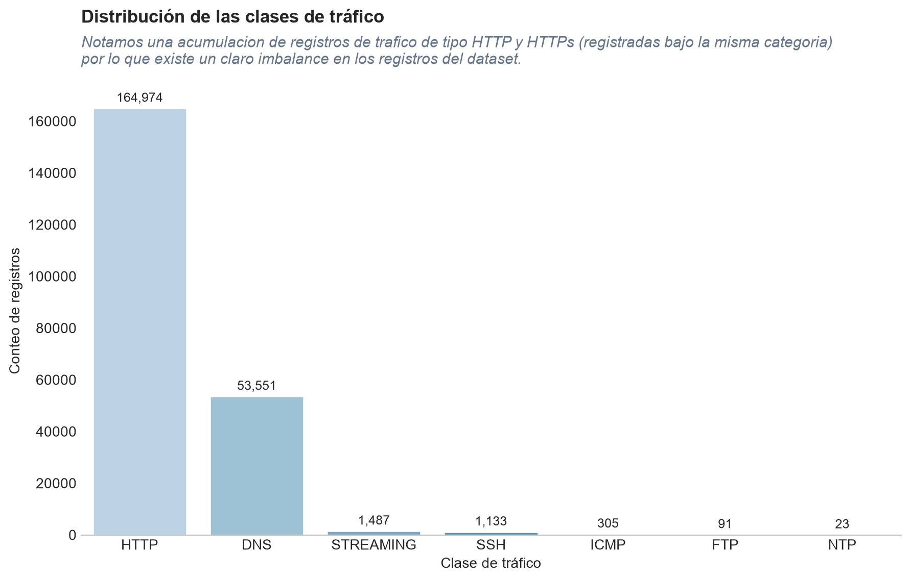{width="700" thumbnail="true"}

The absolute-frequency figure illustrates the disparity between the number of examples available for the majority classes and those available for the minority classes.

This matters because supervised models learn patterns from the available training observations. A class represented by only a few records provides substantially less evidence about the variability of its packet-header characteristics.

The figure also demonstrates why a model could obtain high overall accuracy by correctly predicting HTTP and DNS while performing poorly on smaller categories.

### Relative class representation

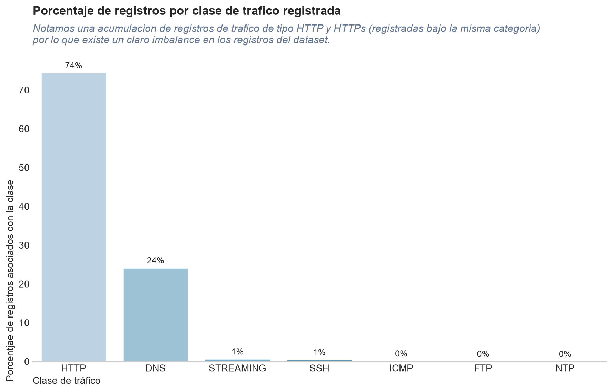{width="700" thumbnail="true"}

The percentage representation complements the absolute counts by expressing the same distribution independently of the total number of records.

The small proportions of FTP and NTP are particularly important when interpreting evaluation metrics.

Because those classes contribute very few observations, a small number of incorrect predictions can produce large changes in their individual precision, recall, and F1-scores.

### Consequences for model development

The class distribution motivates the training notebook's use of stratified dataset partitioning, balanced sample weights, and macro-averaged evaluation metrics.

Stratification is intended to preserve approximately the same category proportions in the training and evaluation partitions.

Balanced sample weights increase the relative contribution of observations belonging to less frequent classes during model fitting.

Macro-F1 assigns equal importance to the F1-score of each class when calculating the aggregate result, rather than weighting each class by its number of observations.

These measures address different aspects of the imbalance and should not be interpreted as equivalent operations.

The associated training notebook confirms the importance of these decisions.

In its recorded 70/30 stratified split, NTP contributes 16 observations to training and seven to the held-out test partition.

The recorded test evaluation obtains an NTP F1-score of `0.16`, despite an overall accuracy of approximately `0.999654`.

This illustrates the difference between high aggregate accuracy and consistent performance across every category.

<warning>
Class weighting and stratification cannot create information absent from the original dataset.

The very small support of NTP remains a limitation on the reliability of conclusions concerning that category. Per-class results should always be interpreted together with their support counts.
</warning>

## Ethernet and Network-Layer Structure {id="eda-ethernet-network-layer"}

### EtherType distribution

The `eth_type` field identifies the protocol carried by the Ethernet frame.

The notebook calculates the frequency of each EtherType using the validated analytical dataset and maps recognized values to descriptive labels.

The stored result contains a single EtherType:

| EtherType | Protocol | Records | Percentage |
|---:|---|---:|---:|
| 2048 | IPv4 | 221,564 | 100% |

No IPv6 observations are present in the analyzed source.

This finding has two consequences for the classification system.

First, the available data does not permit the model to learn differences between IPv4 and IPv6 traffic.

Second, although `eth_type` is retained in the inference contract, its constant value contributes no discriminatory information within the recorded training distribution.

The field is preserved primarily because it belongs to the intended packet-header representation and helps maintain a consistent input schema.

It should not be assumed that the trained model will correctly generalize to unseen EtherTypes solely because the accepted numeric range includes their values.

### IP protocol distribution

The `ip_proto` feature identifies the protocol carried at the relevant IP protocol layer.

Within the source dataset, the observed values correspond to ICMP, TCP, and UDP.

| Protocol number | Protocol | Records | Percentage |
|---:|---|---:|---:|
| 6 | TCP | 166,475 | 75.136304% |
| 17 | UDP | 54,784 | 24.726039% |
| 1 | ICMP | 305 | 0.137658% |

The distribution indicates that TCP accounts for approximately three-quarters of the observations, followed by UDP with approximately one-quarter.

ICMP contributes a much smaller proportion of records.

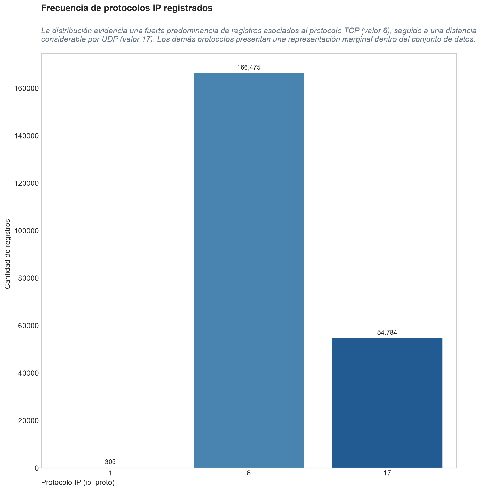{width="700" thumbnail="true"}

This distribution establishes that the source dataset primarily consists of traffic carried over TCP and UDP.

However, protocol frequency alone does not establish the relationship between the protocol identifier and the supervised traffic class.

To examine that relationship, the notebook constructs a normalized cross-tabulation.

### Protocol-category cross-tabulation

The following expression groups observations by IP protocol and target category:

```python
proto_by_class = pd.crosstab(
    df_analysis_valid["ip_proto"],
    df_analysis_valid[TARGET_COLUMN],
    normalize="index"
)
```

The `normalize="index"` argument is essential.

It causes each protocol row to represent the relative distribution of traffic categories within that protocol.

Consequently, the resulting values describe the observed proportion of a category given an IP protocol.

They do not describe the probability of observing an IP protocol given a particular category.

The following selected values summarize the relationship.

| IP protocol | Dominant category | Approximate share |
|---|---|---:|
| ICMP (1) | ICMP | 100% |
| TCP (6) | HTTP | 98.24% |
| UDP (17) | DNS | 96.56% |

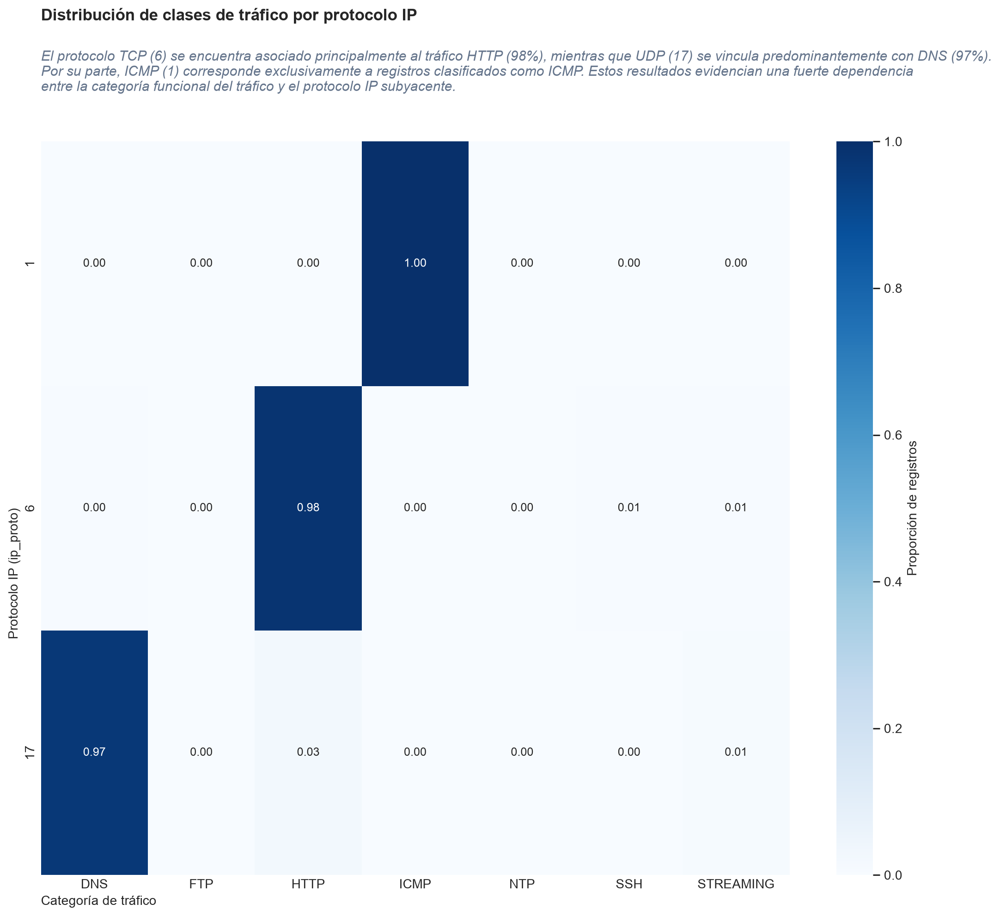{width="700" thumbnail="true"}

The heatmap indicates that protocol `1` is exclusively associated with ICMP-classified observations in this dataset.

TCP is predominantly associated with HTTP, although the protocol also carries FTP, SSH, and STREAMING records.

UDP is predominantly associated with DNS, while also containing HTTP, NTP, and STREAMING observations.

This shows that the protocol identifier provides a useful initial separation between traffic families, but is insufficient to distinguish every application category independently.

For example, SSH and HTTP can both use TCP, meaning that protocol `6` does not uniquely determine which of those categories is present.

Additional packet-header evidence is therefore required.

### Implications for first-packet classification

Unlike completed-flow statistics, the IP protocol field is available through packet-header inspection at the intended decision point.

Its inclusion is therefore operationally compatible with the classifier.

The observed relationships also establish that `ip_proto` contributes useful structure to the dataset.

Nevertheless, a classifier should not interpret protocol numbers as a continuous scale. They are identifiers describing protocol categories.

Tree-based models can learn partitions over these values without assuming that their numerical differences correspond to physical distances.

<tip>
The dataset's protocol-category associations are empirical properties of the analyzed records. They should not be interpreted as universal statements that TCP traffic is necessarily HTTP or that UDP traffic is necessarily DNS.
</tip>

## Port Structure {id="eda-port-structure"}

### Analytical objectives

The source and destination port fields are investigated because they contain information about transport endpoints and conventional network service assignments.

Unlike flow-level counters, these fields can be extracted from an individual TCP or UDP packet.

The notebook analyzes both directions independently to determine whether the corresponding values provide useful class information.

The investigation is implemented through `analyze_port_feature()`, a reusable function invoked once for `src_port` and once for `dst_port`.

The function combines field validation, descriptive statistics, frequency distributions, administrative port ranges, and graphical diagnostics.

### Validation and preparation

The port-analysis function first verifies that the requested column exists and that the plotting configuration is valid.

It then attempts numeric conversion and constructs masks for malformed or out-of-range values.

A port is retained for numerical analysis only when it can be represented as a finite integer between 0 and 65535.

This explicitly rejects negative values, values above the maximum port number, and nonintegral numeric values.

The function retains port zero as a valid value because the dataset uses it to represent the absence of transport ports in ICMP observations.

The recorded analysis finds no invalid source or destination port values.

As a result, all 221,564 observations are available for the corresponding descriptive statistics.

### Descriptive statistics

The port-summary procedure computes conventional numerical descriptors, including the minimum, maximum, mean, median, standard deviation, quartiles, skewness, and kurtosis.

It also calculates the number of distinct port values and the number of values occurring only once.

The principal results are summarized below.

| Statistic | `src_port` | `dst_port` |
|---|---:|---:|
| Valid observations | 221,564 | 221,564 |
| Minimum | 0 | 0 |
| Maximum | 60,999 | 60,999 |
| Mean | 23,283.625 | 23,806.910 |
| Median | 443 | 33,076 |
| Standard deviation | 23,922.476 | 23,929.102 |
| Unique values | 22,369 | 21,964 |
| Values appearing once | 6,397 | 5,823 |
| Zero-port observations | 305 | 305 |
| IQR outliers | 0 | 0 |

The difference between the source and destination medians demonstrates that the numerical distributions are not identical.

However, this difference should not be interpreted as a direct measure of application behavior.

Port numbers are discrete identifiers, and their numerical magnitude does not represent a continuous property such as bandwidth or packet size.

The median and quartiles are useful for characterizing the observed distribution, but they do not establish that two nearby port numbers correspond to similar applications.

### IQR analysis

The notebook calculates the interquartile range:

```text
IQR = Q3 - Q1

Lower limit = Q1 - 1.5 × IQR
Upper limit = Q3 + 1.5 × IQR
```

These bounds are used to identify numerically extreme values according to the conventional IQR rule.

The recorded analysis reports zero observations outside the calculated limits for either port field.

This result should not be interpreted as a guarantee that unusual service ports do not exist.

The IQR method is based on numerical dispersion and is not inherently designed to identify unusual categorical protocol values.

A port may be statistically uncommon and still be perfectly valid.

For this reason, the notebook does not remove records based on the IQR diagnostic.

### Raw and logarithmic distributions

The notebook generates histograms of the observed port values.

These visualizations show the separation between common low-numbered service ports and larger port values.

Because the distribution contains concentrations in substantially different numerical regions, the notebook also generates logarithmic histograms using `log10()`.

The logarithmic transformation is applied only to positive port values, since the logarithm of zero is undefined.

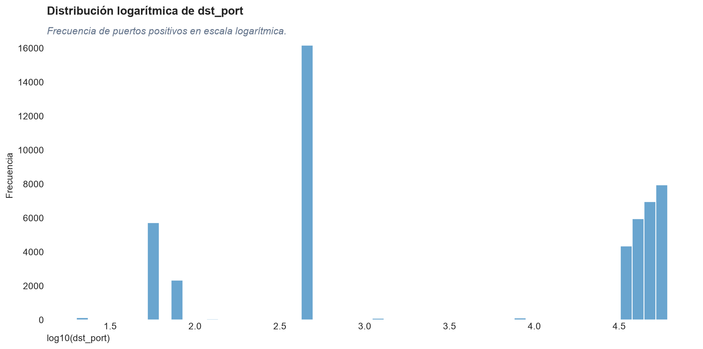{width="700" thumbnail="true"}

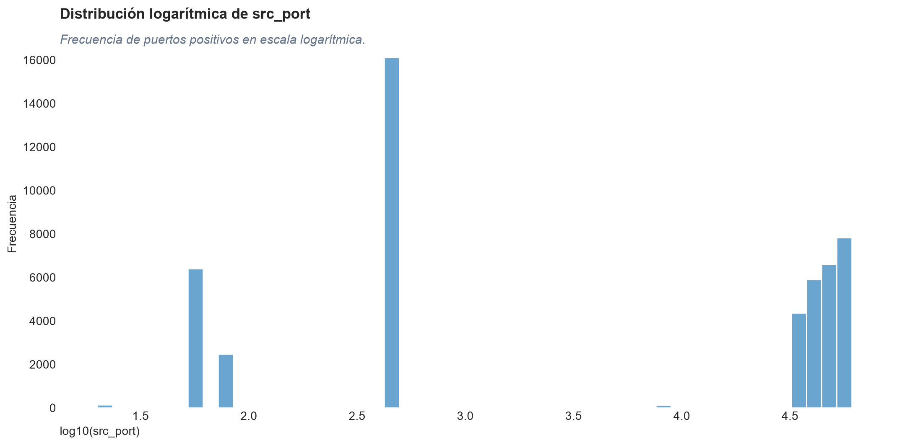{width="700" thumbnail="true"}

The logarithmic views improve the visual separation of low-numbered service-port concentrations and larger port ranges.

These histograms are produced from the reproducibly sampled plotting DataFrame, rather than necessarily from every observation in the original dataset.

Therefore, their primary purpose is to characterize distribution shape.

Exact counts should be obtained from the full-dataset frequency tables generated separately by the notebook.

### Administrative port ranges

The notebook classifies source and destination ports according to three conventional administrative ranges.

| Range | Values |
|---|---|
| Privileged / well-known | 0–1023 |
| Registered | 1024–49151 |
| Dynamic / private | 49152–65535 |

The `port_bucket()` helper performs this grouping using `pd.cut()`.

The resulting distribution is calculated from the full validated port series.

| Administrative range | `src_port` | `dst_port` |
|---|---:|---:|
| Privileged | 111,604 | 108,760 |
| Registered | 64,691 | 66,595 |
| Dynamic / private | 45,269 | 46,209 |
| Total | 221,564 | 221,564 |

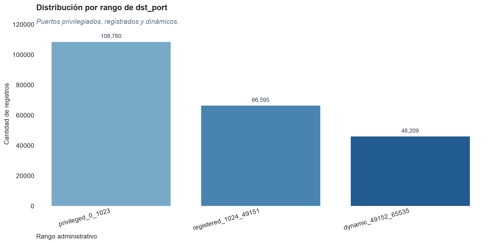{width="700" thumbnail="true"}

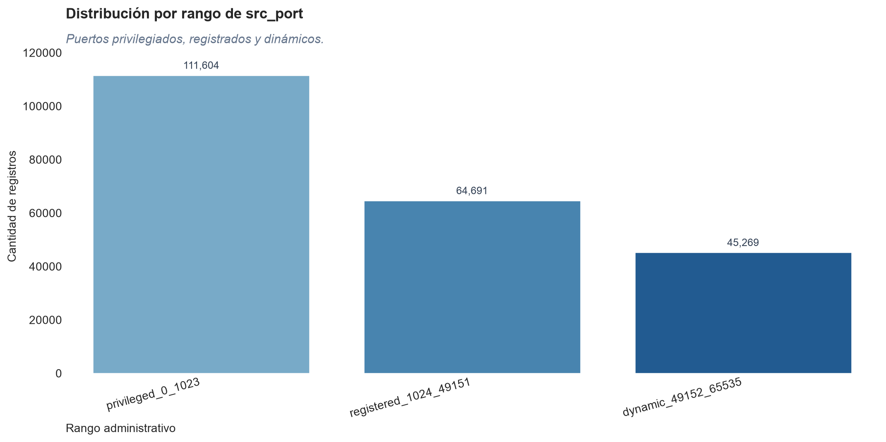{width="700" thumbnail="true"}

The results show that all three administrative ranges are represented in both source and destination fields.

The presence of privileged ports in both directions is compatible with the observation of service-originated and client-originated packets.

However, administrative ranges do not uniquely identify traffic roles. Registered and dynamic ports may also be used by applications in ways that differ from conventional expectations.

The range analysis is therefore descriptive rather than a classification rule.

### Most frequent destination ports

The notebook calculates the 20 most frequent destination-port values using `value_counts()`.

This operation is performed over the complete validated port series.

The most frequent destination ports include:

| Port | Records | Conventional association |
|---:|---:|---|
| 443 | 71,787 | HTTPS |
| 53 | 25,357 | DNS |
| 80 | 10,331 | HTTP |

{width="700" thumbnail="true"}

The ranking reveals substantial concentration around ports conventionally associated with common services.

For example, destination port `53` exhibits a strong relationship with DNS-classified traffic, while ports `80` and `443` are predominantly associated with HTTP-classified observations.

These patterns provide an empirical basis for retaining `dst_port` as a model input.

Nevertheless, conventional port assignments alone cannot guarantee application identity.

An application may operate over a nonstandard port, and several application protocols may share the same transport-port value.

Consequently, the model must learn the observed relationships between features and classes rather than assume that port identifiers provide universally valid labels.

### Most frequent source ports

The notebook performs an equivalent frequency analysis for `src_port`.

The most frequent values include conventional service ports as well as higher-numbered ports.

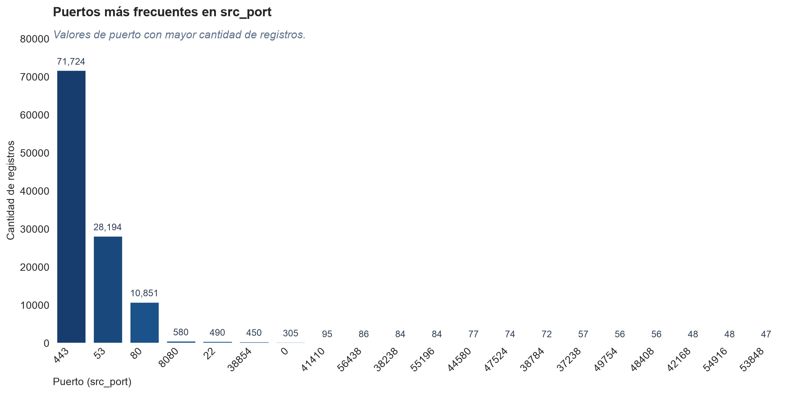{width="700" thumbnail="true"}

The presence of service-associated ports among source values is relevant to bidirectional communications.

For example, a request directed toward an HTTP service may contain the service port as its destination, whereas a corresponding response may contain that same service port as its source.

This relationship is particularly important when a classifier receives individual packets instead of reconstructing complete bidirectional conversations.

A destination-only model would discard part of this directional information.

Retaining both fields allows the classifier to consider service-related port values regardless of which transport-port position contains them.

### Port-category aggregation

To study the relationship between port values and the supervised target, the notebook groups observations by destination port and `Category`.

The aggregation is calculated using:

```python
port_class_top = (
    df_analysis_valid
    .groupby(["dst_port", TARGET_COLUMN])
    .size()
    .rename("count")
    .reset_index()
    .sort_values("count", ascending=False)
)
```

This operation creates counts for observed combinations of destination port and traffic category.

Unlike the global port-frequency ranking, the grouped table distinguishes different target labels associated with the same port value.

The complete aggregation provides a numerical basis for identifying dominant associations and examining unusual combinations.

Because this table contains many combinations, the main documentation uses normalized heatmaps focused on the most frequent ports.

### Destination-port/category heatmap

The destination-port heatmap selects the 15 most frequently observed destination ports.

A cross-tabulation then calculates the distribution of traffic categories within each selected port.

```python
heatmap_frame = pd.crosstab(
    selected_dst_ports,
    selected_categories,
    normalize="index"
)
```

The code above represents the analytical operation; the actual notebook constructs the selected Series from `df_analysis_valid` before calling `pd.crosstab()`.

Row normalization ensures that each port is evaluated according to its own category composition.

For a particular port, the values across the available categories sum to approximately 1, subject to display rounding.

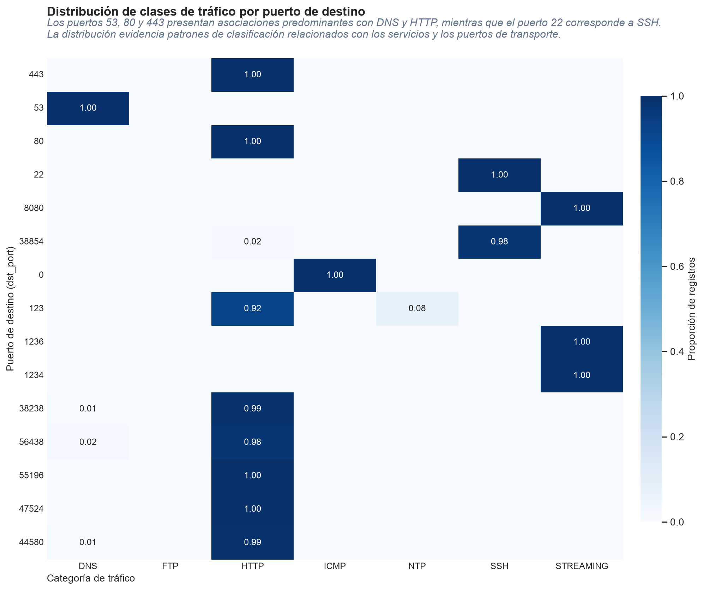{width="700" thumbnail="true"}

Several expected service relationships appear in the resulting figure.

Destination port `53` is strongly associated with DNS, while ports `80` and `443` are predominantly associated with HTTP.

Port `22` is associated with SSH, and port zero corresponds to ICMP in the observed records.

Other ports exhibit relationships that differ from conventional service assignments.

One notable example is destination port `123`.

Although port `123` is conventionally associated with NTP, approximately 92% of the selected observations associated with this destination port are classified as HTTP, while approximately 8% are classified as NTP.

This finding is useful because it demonstrates the difference between a conventional protocol assignment and the empirical category distribution of a dataset.

The classifier is expected to learn relationships from its training data, not reproduce a fixed table of standardized port names.

<note>
The row-normalized heatmap describes the category distribution conditional on a particular port value.

A value of `0.99` in a port-category cell does not mean that 99% of all observations belonging to that category use the port. It means that approximately 99% of the observations represented by that port's row belong to the indicated category.

It also does not describe the number of observations supporting the relationship.
</note>

### Source-port/category heatmap

The source-port analysis applies the same method to the 15 most frequently observed source ports.

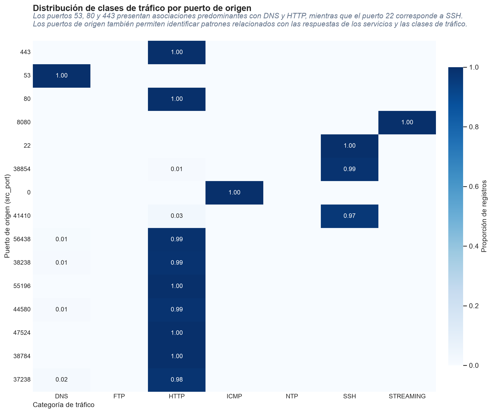{width="700" thumbnail="true"}

The resulting matrix demonstrates that source-port values can also exhibit strong category associations.

Several service ports preserve recognizable relationships with DNS, HTTP, and SSH.

Additional higher-numbered ports display strong associations with individual traffic categories, reflecting the communication patterns represented in the original dataset.

The source and destination heatmaps use the same class ordering and normalization approach, making their values comparable.

However, their selected rows are obtained independently. Consequently, the 15 most frequent source ports are not necessarily identical to the 15 most frequent destination ports.

### Combined interpretation

The port analysis provides three principal findings.

First, transport-port values contain substantial information about the traffic categories represented in the dataset.

Second, service-associated port values appear in both source and destination positions, supporting the decision to retain both fields.

Third, the relationship between a port and an application category is not universally deterministic.

These findings justify using `src_port` and `dst_port` as complementary predictors while recognizing that the resulting classifier operates over statistical patterns learned from the source data.

The analysis also demonstrates why a combined feature representation is preferable to interpreting each field independently.

The pair of port fields, together with the IP protocol identifier, provides a more complete representation of the available packet-header information.

## Correlation Diagnostics {id="eda-correlation-diagnostics"}

### Analytical objective

The finalized EDA notebook evaluates statistical associations between the four selected input features and the seven expected traffic categories.

Unlike the original broad correlation analysis across the numeric flow-level statistics, the finalized implementation concentrates on variables included in the first-packet contract.

This produces a smaller and more directly relevant analytical result.

The purpose is to inspect whether the selected fields exhibit linear or monotonic statistical relationships with individual class indicators.

Correlation analysis is complementary to the preceding frequency distributions and cross-tabulations. It does not replace them.

### Representation of the categorical target

The target `Category` is nominal.

Its labels do not possess a natural numerical order, meaning that assigning an integer identifier to DNS, FTP, HTTP, and the remaining classes does not create a meaningful continuous variable.

Directly calculating Pearson or Spearman correlation between the original features and arbitrarily encoded class IDs would therefore introduce relationships dependent on the chosen numerical encoding.

To avoid that particular problem, the finalized notebook represents each class using a binary indicator.

```python
target_indicators = pd.get_dummies(
    df_analysis_valid[TARGET_COLUMN],
    dtype=int
).reindex(
    columns=EXPECTED_CLASSES,
    fill_value=0
)
```

Each indicator takes the value `1` when an observation belongs to the corresponding category and `0` otherwise.

The transformation produces seven indicator columns:

```text
DNS
FTP
HTTP
ICMP
NTP
SSH
STREAMING
```

For example, an observation classified as SSH is represented by `1` in the SSH indicator and `0` in the remaining indicators.

This representation makes it possible to calculate associations between each numeric feature and each individual class indicator without assigning an artificial ordering to the class labels.

### Correlation matrix construction

The four selected features are extracted from the validated analytical dataset and converted to numeric values.

The feature DataFrame is then concatenated with the binary target indicators.

```python
feature_frame = df_analysis_valid[
    FEATURE_COLUMNS
].apply(pd.to_numeric, errors="coerce")

corr_frame = pd.concat(
    [feature_frame, target_indicators],
    axis=1
)
```

The notebook calculates Pearson and Spearman correlation matrices over this combined DataFrame.

It then extracts only the relationships between the four features and the seven class indicators.

```python
pearson_selected = pearson_corr.loc[
    FEATURE_COLUMNS,
    EXPECTED_CLASSES
]

spearman_selected = spearman_corr.loc[
    FEATURE_COLUMNS,
    EXPECTED_CLASSES
]
```

The resulting matrices contain four rows and seven columns.

This compact representation focuses the figures on the feature-selection question rather than displaying unrelated correlations among the original flow statistics.

### Pearson correlation

Pearson correlation measures linear association between two numerical variables.

For a feature and a binary class indicator, the coefficient describes the linear relationship between the numerical feature values and membership in that category.

A positive coefficient indicates that larger numerical feature values tend to be associated with membership in the indicated class.

A negative coefficient indicates the opposite tendency.

However, this interpretation has important limitations for protocol identifiers and port numbers.

Because the selected features are primarily categorical identifiers stored numerically, larger values do not necessarily represent greater quantities of an underlying physical property.

For that reason, Pearson coefficients should be treated as descriptive diagnostics rather than definitive measures of feature importance.

{width="700" thumbnail="true"}

The Pearson heatmap shows the calculated feature-to-class coefficients using a diverging color scale centered at zero.

The sign distinguishes positive and negative linear relationships, while the magnitude reflects the strength of the measured association under the chosen numeric representation.

The figure does not establish causation, nor does it demonstrate that a feature can independently classify a category.

### Spearman correlation

Spearman correlation evaluates monotonic association using the ranks of the observed values.

A monotonic relationship preserves a consistent direction of association without necessarily following a linear function.

The notebook calculates this relationship for the same selected features and binary class indicators.

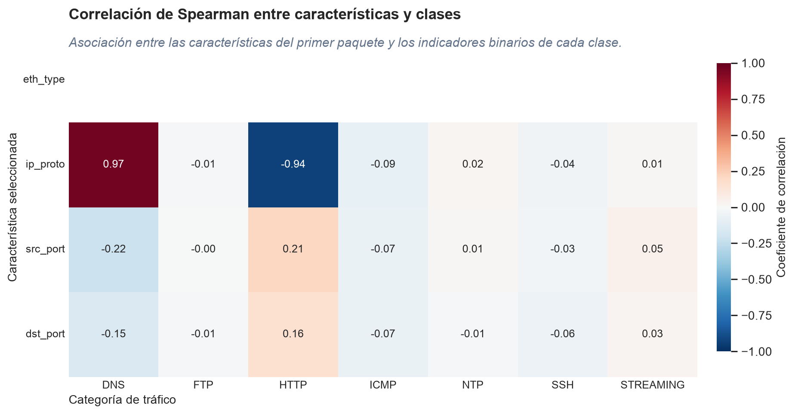{width="700" thumbnail="true"}

The resulting figure provides a complementary perspective on the selected variables.

However, the same caution concerning numeric identifiers remains applicable.

Ranking port numbers and protocol identifiers does not transform them into continuous quantities with meaningful distances or ordering relationships.

Therefore, Spearman coefficients do not fully resolve the limitations of applying conventional correlation measures to these variables.

### Constant-feature behavior

The `eth_type` field contains the same value across every observation.

Because a constant feature has zero variance, its Pearson correlation with other variables is undefined.

The corresponding coefficients appear as missing or undefined values.

The same limitation applies to rank correlation when all observations receive the same rank.

This behavior is mathematically expected and does not indicate a data-loading failure.

The resulting empty coefficients provide additional evidence that `eth_type` does not contribute class-separating variability within the source dataset.

### Interpretation and methodological limitations

The correlation figures provide supplementary evidence about relationships between the selected inputs and individual target categories.

However, they are not sufficient for ranking the overall predictive usefulness of categorical packet-header fields.

In particular, a feature may contain useful information through combinations of discrete values without exhibiting a strong linear or monotonic relationship.

For example, individual port values may identify different application patterns even when the full numerical range does not follow a consistent increasing or decreasing association with class membership.

Consequently, the preceding cross-tabulations provide a more direct interpretation of protocol-category and port-category relationships.

Additional categorical-association methods, such as Cramér's V or mutual information, could be used in future analyses.

The notebook contains a Cramér's V helper, but the finalized execution does not calculate or export a corresponding result.

<note>
The finalized correlation implementation does not evaluate redundancy among all original flow-statistical columns.

Its principal output is the association of four selected first-packet features with seven binary class indicators. Earlier descriptions of large Pearson and Spearman matrices over completed-flow statistics are not applicable to this version.
</note>

## Exported Training Dataset {id="eda-exported-training-dataset"}

### Purpose of the final preparation stage

The final notebook section prepares the reduced dataset required by the XGBoost training subsystem.

This stage is separate from the exploratory analyses performed earlier.

Its purpose is to reconstruct the selected feature contract from the original source, validate the relevant fields, normalize the target, and establish a consistent output schema.

The final dataset contains exactly five columns.

```text
eth_type
ip_proto
src_port
dst_port
Category
```

The first four columns are model inputs. The final column contains the supervised traffic category.

### Selection and normalization

The notebook begins by verifying that every required output column exists in the original DataFrame.

It then constructs a new DataFrame containing only the selected features and target.

```python
OUTPUT_COLUMNS = FEATURE_COLUMNS + [TARGET_COLUMN]

df_clean = df[OUTPUT_COLUMNS].copy()

df_clean[TARGET_COLUMN] = normalize_category_series(
    df_clean[TARGET_COLUMN]
)
```

This operation intentionally returns to the original loaded DataFrame rather than exporting an arbitrary intermediate analytical object.

It establishes the final output independently of the presentation-focused transformations performed during exploratory analysis.

The target is normalized using the same category-normalization function employed previously.

### Final feature validation

The final preparation stage invokes `feature_validity_report()` again.

It then combines the function's reported invalidity masks across the four selected features.

If an observation is marked invalid, the notebook raises an exception instead of silently removing that observation.

This is an important distinction from the exploratory subset, which is constructed through filtering.

The final output is intended to preserve the source observations when they satisfy the selected feature contract, rather than silently modifying the dataset composition.

Nevertheless, the combined invalidity mask has the limitations described in the data-quality section.

In particular, the current mask does not explicitly include every missing-value condition detected by the helper.

The final preparation also does not apply a separate strict check requiring every target value to belong to `EXPECTED_CLASSES`.

For the recorded source, these limitations do not change the observed result because the data-quality analysis reports no missing selected fields and all seven expected categories are present.

For future input datasets, additional validation would be necessary to establish the stronger rejection guarantees.

### Final type conversion and column ordering

After validation, the notebook converts each selected feature to pandas nullable `Int64`.

This establishes an integer representation compatible with the permitted packet-header domains.

The final DataFrame is reordered according to `OUTPUT_COLUMNS`, and its index is reset.

```python
for feature in FEATURE_COLUMNS:
    df_clean[feature] = (
        numeric_features[feature].astype("Int64")
    )

df_clean = (
    df_clean[OUTPUT_COLUMNS]
    .reset_index(drop=True)
)
```

The fixed column order is part of the interface between the EDA notebook and the training subsystem.

Although CSV headers identify the fields by name, the training notebook subsequently constructs a numerical matrix using the canonical feature ordering.

Maintaining this order avoids introducing differences between the representation used during training and the representation expected during inference.

### Conditional export

The finalized notebook does not automatically write the training dataset after preparation.

Instead, the export operation is controlled by `EXPORT_ANALYSIS`.

```python
if EXPORT_ANALYSIS:
    training_output_path = (
        OUTPUT_DIR / TRAINING_OUTPUT_FILENAME
    )

    df_clean.to_csv(
        training_output_path,
        index=False,
        encoding="utf-8",
    )
```

When this control is disabled, the notebook retains and displays the prepared DataFrame but skips writing the corresponding CSV.

The intended output path is:

```text
src/res/data/processed/SDNFlow_Training_Sample_Dataset.csv
```

The exported CSV excludes the pandas index and uses UTF-8 encoding.

The final section also displays the resulting dimensions, column names, and data types for inspection.

### Expected output structure

The recorded analytical results establish the following expected dataset structure.

| Property | Value |
|---|---|
| Output filename | `SDNFlow_Training_Sample_Dataset.csv` |
| Observations | 221,564 |
| Columns | 5 |
| Input features | `eth_type`, `ip_proto`, `src_port`, `dst_port` |
| Target | `Category` |
| Feature representation | Nullable `Int64` in the prepared DataFrame |
| Target representation | Nullable string |
| Source observations excluded during recorded analytical filtering | 0 |

The finalized EDA notebook's last cell has no stored execution output. Therefore, the attached notebook does not independently demonstrate that this final export cell was executed successfully in its current version.

However, the separate model-training notebook contains an executed load of a five-column dataset with exactly 221,564 observations and the expected schema.

### Verification against the training notebook

The training notebook identifies the reduced dataset through:

```python
DATA_PATH = Path(
    "../../../res/data/processed/"
    "SDNFlow_Training_Sample_Dataset.csv"
)
```

Its recorded execution loads the expected 221,564 rows and five columns.

The training preparation stage independently normalizes `Category`, converts the selected features to numeric values, removes records failing its missing-value and range checks, and validates expected class membership.

For the recorded training dataset, all removal counts are zero.

| Training validation | Removed observations |
|---|---:|
| Missing required values | 0 |
| Values outside permitted ranges | 0 |
| Nonintegral feature values | 0 |
| Unexpected target classes | 0 |

The resulting class distribution also matches the distribution established by the EDA.

This provides consistency evidence between the datasets used in the two recorded notebook executions.

However, it is not equivalent to a cryptographic verification that the training CSV was generated by the current final EDA cell. Such a verification would require the corresponding output provenance.

### Transition to model training

The training notebook uses the same canonical feature order:

```python
FEATURE_COLUMNS = [
    "eth_type",
    "ip_proto",
    "src_port",
    "dst_port",
]
```

It also defines a stable mapping between the seven category labels and their integer identifiers.

| Class | Identifier |
|---|---:|
| DNS | 0 |
| FTP | 1 |
| HTTP | 2 |
| ICMP | 3 |
| NTP | 4 |
| SSH | 5 |
| STREAMING | 6 |

The training matrix contains 221,564 observations and four features.

The associated target vector contains 221,564 encoded class identifiers.

The notebook then performs a stratified 70/30 split.

| Partition | Observations |
|---|---:|
| Training | 155,094 |
| Held-out test | 66,470 |

The subsequent optimization uses Optuna with five-fold stratified cross-validation on the training partition.

Balanced sample weights are calculated during model fitting, and macro-F1 is used as the optimization objective.

These training procedures are described in the corresponding model-training topic. They are mentioned here to clarify how the reduced dataset and the exploratory findings are consumed by the next stage.

### Model metadata and inference consistency

The training notebook exports model metadata that includes the canonical feature order, feature types, and class-identifier mappings.

The relevant metadata fields include:

```json
{
  "feature_order": [
    "eth_type",
    "ip_proto",
    "src_port",
    "dst_port"
  ],
  "feature_types": {
    "eth_type": "integer",
    "ip_proto": "integer",
    "src_port": "integer",
    "dst_port": "integer"
  },
  "class_to_id": {
    "DNS": 0,
    "FTP": 1,
    "HTTP": 2,
    "ICMP": 3,
    "NTP": 4,
    "SSH": 5,
    "STREAMING": 6
  }
}
```

This metadata provides the information required to reconstruct the model's input representation outside the training notebook.

The operational inference subsystem must supply the selected fields using compatible types, ordering, and value conventions.

This requirement is commonly described as training-serving consistency.

In the demonstrator, the CSA and Python API must agree on the meaning and representation of every field supplied to the classifier.

The model metadata makes this contract explicit and reduces reliance on undocumented assumptions about input ordering or class identifiers.

<warning>
A model exported successfully from the training notebook is not, by itself, evidence that every possible runtime packet can be classified correctly.

The operational system must still validate packet parsing, handle missing or unsupported header structures, enforce the inference schema, and interpret the predicted class according to the controller's network-policy logic.
</warning>

## Interpretation and Limits {id="eda-interpretation-and-limits"}

### Principal findings

The exploratory analysis establishes a reduced dataset suitable for the intended first-packet classification architecture.

The recorded source contains 221,564 observations, all of which satisfy the analytical subset's selected-feature validity checks.

The seven expected traffic categories are present, and their labels can be represented consistently through normalization.

The dataset contains only IPv4 observations, making `eth_type` constant and eliminating its discriminatory variability within the observed sample.

The IP protocol identifier provides useful coarse separation among protocol families.

Source and destination ports exhibit strong empirical associations with several traffic categories, supporting their inclusion as complementary predictors.

These results establish a reasonable basis for constructing a classifier around the four selected packet-header fields.

### Statistical limitations

The most significant statistical limitation is the severe imbalance among traffic classes.

HTTP and DNS dominate the dataset, while NTP and FTP contain comparatively few observations.

Consequently, aggregate performance measures may conceal weaknesses affecting minority categories.

Stratified partitioning, sample weighting, and macro-averaged metrics mitigate different consequences of this imbalance, but cannot eliminate the limited evidence available for rare classes.

The recorded training results reinforce this limitation, particularly for NTP.

### Feature limitations

The selected features represent only a small portion of the information potentially available in network traffic.

This restriction is deliberate: the classifier must operate without waiting for a complete flow.

However, the same restriction limits the kinds of application behavior that can be distinguished.

Applications may use shared protocols and ports, dynamic port assignments, encrypted transport, tunneling, or nonstandard service configurations.

A first-packet header-based classifier cannot necessarily distinguish those cases from header information alone.

The observed protocol and port associations should therefore be treated as properties of the analyzed dataset, rather than universal rules describing all network environments.

### Dataset coverage and generalization

Because every recorded observation uses EtherType `2048`, the dataset provides no direct evidence about classification performance over IPv6 traffic.

The source also represents a particular experimental traffic-generation environment.

Its service conventions, communication patterns, endpoint behavior, and class proportions may differ from those encountered in other networks.

For this reason, the model is evaluated as a classifier supporting the demonstrator's selected operating conditions.

It should not be presented as a general-purpose application-identification engine without additional validation on independent traffic sources.

### Data-quality and execution limitations

The source passes the notebook's recorded missing-value and numeric-validity audits.

However, the current implementation does not execute all declared cleaning controls.

In particular, duplicate removal, conflicting-label resolution, and independent features-only export remain outside the current output-producing path.

The finalized EDA notebook's conditional training-export cell also lacks a recorded execution result.

These limitations should be preserved in technical documentation to distinguish demonstrated behavior from intended functionality.

### Architectural significance

The principal contribution of the EDA is not the discovery of a single highly correlated traffic feature.

Rather, it establishes a deployable input representation that can be constructed using packet-header information available at the controller's classification point.

The reduced feature contract provides a consistent interface between the exploratory analysis, the XGBoost training process, and the Python inference service.

Within the SDN-MPLS-ML demonstrator, this consistency allows the traffic classification result to participate in the controller's subsequent policy-selection decisions.

The resulting architecture therefore connects statistical learning with a practical network-control boundary: **classification based on immediately observable packet information, without dependence on completed-flow statistics**.

## Conceptual References {id="eda-conceptual-references"}

<deflist type="wide">

<def title="SDNFlow research dataset">
Buzzio-García and colleagues, <a href="https://doi.org/10.1109/ACCESS.2024.3378271">Exploring Traffic Patterns Through Network Programmability</a>, IEEE Access, 2024. Original research describing the SDNFlow dataset and its traffic-analysis context.
</def>

<def title="pandas cross-tabulation">
The <a href="https://pandas.pydata.org/pandas-docs/stable/reference/api/pandas.crosstab.html">pandas crosstab documentation</a> describes frequency tables and row, column, and global normalization methods used to examine relationships among protocol identifiers, port values, and traffic categories.
</def>

<def title="Statistical association">
The <a href="https://docs.scipy.org/doc/scipy/reference/stats.html">SciPy statistical reference</a> provides background on association measures, correlation, and related analytical methods.
</def>

<def title="scikit-learn classification methodology">
The <a href="https://scikit-learn.org/stable/modules/model_evaluation.html">scikit-learn model evaluation documentation</a> describes classification metrics, including precision, recall, F1-score, and averaging strategies relevant to imbalanced multiclass classification.
</def>

<def title="XGBoost training">
The <a href="https://xgboost.readthedocs.io/">XGBoost documentation</a> provides the reference for the gradient-boosted tree implementation consumed by the separate model-training notebook.
</def>

</deflist>