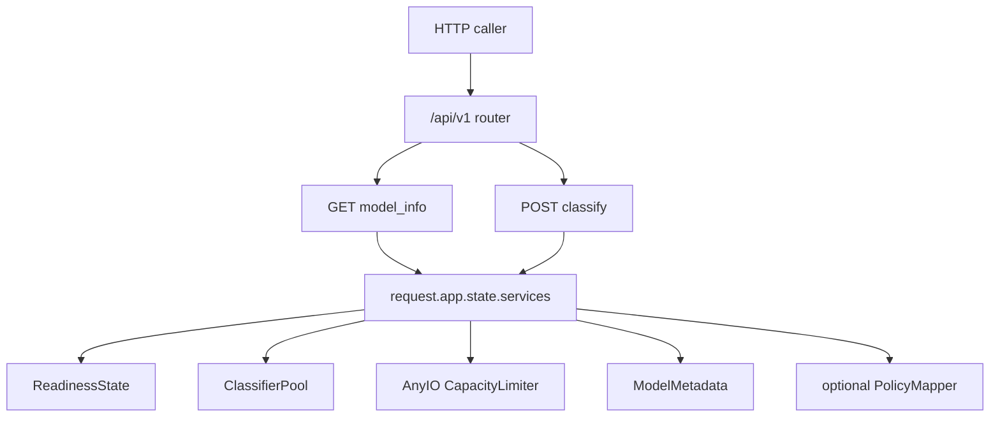
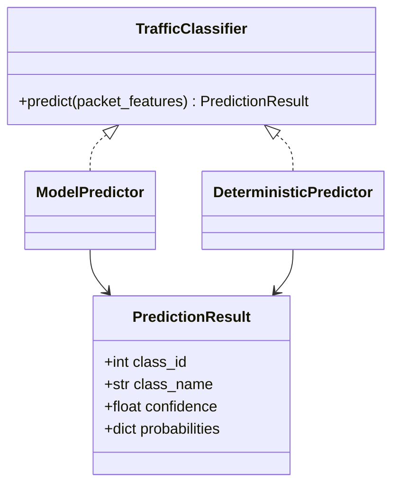

# Application Construction — Inference Module

<show-structure for="chapter" depth="3"/>

The inference module publishes the model metadata and packet-classification operations under the `/api/v1` router prefix.
It consumes the process-wide `AppServices` container created during application startup. The module does not load 
model artifacts, create a classifier for each request, or accept a caller-owned correlation identifier. Those 
boundaries keep HTTP request handling separate from startup construction and give controlled failures a stable 
request identifier.

The implementation is centered on `app/api/sdn_mpls_ml_inference_route.py`.
It combines Pydantic’s structural request validation, a mode-specific EtherType rule, an asynchronous classifier 
lease, thread-limited synchronous prediction, optional policy selection, structured logging, and optional Prometheus 
instrumentation.
The [Python Inference API — API Request Directory](Python-Inference-API-—-API-Request-Directory.md) documents example exchanges.
This page documents how the implementation produces those exchanges.

## Module boundary and published operations {id="inference-module-boundary"}

`router` is an `APIRouter` with the `/api/v1` prefix. It publishes `GET /api/v1/model` and `POST /api/v1/classify`. 
Both handlers receive FastAPI’s `Request` object and read the already-created service container from `request.app.
state.services`. Neither handler accepts startup configuration or artifact paths as HTTP input.

<code-block lang="python" src="../../src/main/python/api/app/api/sdn_mpls_ml_inference_route.py" include-lines="15-56"/>

The route module deliberately owns only request-time coordination. Readiness, classifier construction, model 
compatibility checks, and policy-file validation happen before a ready service container is published. The handlers 
therefore test whether the required ready-state values exist rather than attempting partial recovery during a request.

| Operation | Method | Success response model | Required ready-state dependency |
|---|---|---|---|
| Model metadata | `GET /api/v1/model` | `ModelInfoResponse` | ready state and model metadata |
| Packet classification | `POST /api/v1/classify` | `ClassifyResponse` | settings, pool, limiter, and metadata |

### Endpoint dispatch sequence {id="inference-dispatch-sequence"}

The correlation middleware runs before the route and has already placed the authoritative request identifier on 
request state. FastAPI deserializes a classification body before it calls `classify`. The route then evaluates 
readiness before it acquires a classifier or starts an inference worker.

<code-block lang="mermaid">
sequenceDiagram
    actor Caller
    participant Correlation as Correlation middleware
    participant FastAPI as FastAPI validation
    participant Route as classify
    participant Pool as ClassifierPool
    participant Worker as AnyIO worker thread
    Caller->>Correlation: POST /api/v1/classify
    Correlation->>Correlation: create request ID
    Correlation->>FastAPI: forward request
    FastAPI->>FastAPI: validate ClassifyRequest
    FastAPI->>Route: payload and Request
    Route->>Route: check readiness and EtherType
    Route->>Pool: acquire(timeout)
    Pool-->>Route: leased classifier
    Route->>Worker: run classifier.predict
    Worker-->>Route: PredictionResult
    Route->>Route: resolve policy and build response
    Route-->>Caller: response body and X-Request-ID
</code-block>

The route records a request-scoped `ClassificationObservation` before it checks readiness. Its `finally` block 
finishes that observation once, even when a controlled exception or cancellation bypasses normal response construction.
The in-progress gauge is incremented only when metrics are enabled and is decremented in the same `finally` block.

## Request models and strict input boundary {id="inference-request-models"}

The inference schemas use the project’s strict baseline model and add their own strict configuration where packet 
fields require it. `PacketFeatures` forbids undeclared fields and requires true integer values. Its four fields 
represent the fixed classifier feature contract: EtherType, IP protocol, source port, and destination port.

<code-block lang="python" src="../../src/main/python/api/app/schemas/sdn_mpls_ml_inference_validation_models.py" include-lines="20-85"/>

The bounds are applied before the route executes. `eth_type` is in the inclusive range 0 through 65535. `ip_proto` 
is in the inclusive range 0 through 255. Each port is in the inclusive range 0 through 65535. Values that require 
coercion from strings or floating-point input do not satisfy `StrictInt`.

| Field | Required type | Range | Additional relation |
|---|---|---|---|
| `eth_type` | `StrictInt` | 0–65535 | mode validation applies later |
| `ip_proto` | `StrictInt` | 0–255 | TCP is 6 and UDP is 17 |
| `src_port` | `StrictInt` | 0–65535 | zero for non-TCP and non-UDP |
| `dst_port` | `StrictInt` | 0–65535 | zero for non-TCP and non-UDP |

### Cross-field port rule {id="inference-port-rule"}

The `model_validator` runs after Pydantic has established the strict field types and numeric bounds. When 
`ip_proto` is neither TCP (`6`) nor UDP (`17`), both port values must be zero. The rule prevents a transport-port 
feature vector from describing a protocol for which the implementation does not treat ports as meaningful.

<code-block lang="mermaid">
flowchart TD
    Start[PacketFeatures parsed] --> Proto{ip_proto is 6 or 17?}
    Proto -->|yes| Accept[ports may use their validated ranges]
    Proto -->|no| Zero{both ports are zero?}
    Zero -->|yes| Accept
    Zero -->|no| Reject[Pydantic validation failure]
</code-block>

The validation error is produced by Pydantic before route code receives a `ClassifyRequest` instance. The 
application-wide validation handler converts that failure into the project’s structured HTTP error response. The 
inference route consequently does not duplicate the range or non-TCP/UDP checks.

### Caller payload shape {id="inference-payload-shape"}

`ClassifyRequest` has exactly one declared property, `packet_features`. The same inherited strict configuration 
forbids extra properties at the outer request level. In particular, a client-provided `request_id` is an extra
field and is rejected instead of influencing log or response correlation.

<code-block lang="json">
{
  "packet_features": {
    "eth_type": 2048,
    "ip_proto": 6,
    "src_port": 443,
    "dst_port": 50000
  }
}
</code-block>

This example only illustrates the accepted JSON shape.

### Request ID ownership {id="inference-request-id-ownership"}

`classify` calls `get_request_id(request)` after retrieving the service container. The value was generated by 
correlation middleware and is used in readiness, validation, capacity, logging, and response branches. The route 
never reads an ID from `payload`.

<code-block lang="mermaid">
flowchart TD
    Middleware[Correlation middleware] --> State[request.state.request_id]
    State --> Getter[get_request_id]
    Getter --> Route[classify]
    Route --> Response[ClassifyResponse.request_id]
    Route --> Logs[structured log extra.request_id]
    Middleware --> Header[X-Request-ID header]
</code-block>

The response schema declares `request_id` as a string. It also declares the model name, prediction body, per-class 
probabilities, an optional policy, and the measured processing time. The value is therefore part of the successful 
HTTP contract, not an implementation-only log field.

## Response contracts {id="inference-response-contracts"}

The inference schema module separates nested response concepts so FastAPI can validate the outgoing response shape.
`PredictionBody` carries the selected class identifier, class name, and confidence. `PolicyResponse` carries the 
selected traffic profile and adds fallback state without changing the validated policy file.

<code-block lang="python" src="../../src/main/python/api/app/schemas/sdn_mpls_ml_inference_validation_models.py" include-lines="88-161"/>

The `probabilities` property is a mapping from class name to probability. Its contents are produced by 
`PredictionResult` after model-output validation. The response model does not itself reimplement probability 
normalization or metadata mapping. That responsibility stays in the adapter that produces `PredictionResult`.

| Response component | Source at request time | Meaning |
|---|---|---|
| `request_id` | middleware request state | server correlation value |
| `model_name` | loaded metadata or deterministic fallback | active classifier identity |
| `prediction` | validated `PredictionResult` | winning class and confidence |
| `probabilities` | validated `PredictionResult` | named probability vector |
| `policy` | optional policy mapper | selected profile or `null` |
| `processing_time_ms` | route performance counter | complete route processing duration |

The policy is nullable because policy mapping is optional in the service container. When no mapper was built, 
successful classification still returns a prediction and `policy` is `null`. When a mapper exists but raises during 
resolution, the route treats that as `PolicyMappingFailedError` rather than silently omitting a policy.

## Model metadata operation {id="inference-model-info"}

`model_info` first checks the cached readiness state and whether model metadata is present. It raises 
`ModelNotReadyError` if either condition is not satisfied. It does not acquire from the pool, run a prediction, or 
read the model artifact again.

<code-block lang="python" src="../../src/main/python/api/app/api/sdn_mpls_ml_inference_route.py" include-lines="56-93"/>

The ready branch serializes metadata into `ModelInfoResponse`. It copies model name, target name, schema version, 
and feature order. It converts each `(class_id, class_name)` pair in the metadata class collection into a 
`ModelClassInfo` object.

<code-block lang="mermaid">
flowchart TD
    Request[GET /api/v1/model] --> Ready{readiness ready and metadata present?}
    Ready -->|no| Error[ModelNotReadyError]
    Ready -->|yes| Metadata[ModelMetadata]
    Metadata --> Response[ModelInfoResponse]
    Response --> Classes[list of ModelClassInfo]
</code-block>

The endpoint exposes the loaded contract rather than a file listing. Consumers can discover expected feature 
ordering and registered class identifiers without receiving artifact locations, policy configuration, or runtime 
pool internals.

## Classification ready-state gate {id="inference-ready-state-gate"}

The classification handler derives `classification_mode` from validated settings when available. If settings are  
absent, it uses the cached readiness mode only to initialize the observation labels.  The route then requires a 
ready state, classifier pool, thread limiter, and validated settings before it can execute inference.

<code-block lang="python" src="../../src/main/python/api/app/api/sdn_mpls_ml_inference_route.py" include-lines="128-161"/>

This guarded condition covers both a startup failure and an incomplete dependency graph.
The raised `ModelNotReadyError` includes the request ID and the cached readiness component, stage, check, and retryability information.
It is a controlled operational result, rather than an attribute error caused by a missing runtime dependency.

| Condition | Observation outcome | Request-time action |
|---|---|---|
| readiness false | `not_ready` | raise `ModelNotReadyError` |
| no classifier pool | `not_ready` | raise `ModelNotReadyError` |
| no thread limiter | `not_ready` | raise `ModelNotReadyError` |
| no validated settings | `not_ready` | raise `ModelNotReadyError` |

## Classification-mode EtherType rule {id="inference-ethertype-rule"}

Structural validation cannot decide whether an EtherType is valid for a configured classification mode. The route 
therefore calls `validate_packet_for_classification_mode` after the ready-state check and before pool acquisition. 
It passes the validated mode, the packet EtherType, and the authoritative request ID.

<code-block lang="python" src="../../src/main/python/api/app/api/sdn_mpls_ml_inference_route.py" include-lines="163-186"/>

The model-backed mode validates IPv4 EtherType support at this point. An unsupported EtherType produces 
`ModelEtherTypeUnsupportedError`. The route marks the observation as `rejected`, logs the rejection with structured 
context, and re-raises the controlled error.

<code-block lang="mermaid">
flowchart TD
    Valid[Structurally valid PacketFeatures] --> Mode{classification mode}
    Mode --> Model[MODEL mode]
    Mode --> Deterministic[deterministic test mode]
    Model --> Ether{EtherType is supported IPv4 value?}
    Ether -->|yes| Lease[acquire classifier]
    Ether -->|no| Reject[ModelEtherTypeUnsupportedError]
    Deterministic --> Lease
</code-block>

The route’s warning log includes service name, event name, request ID, classification mode, error code, component, 
failed stage, failed check, and retryability. This is the only specific warning branch in the handler before 
execution. The code does not log packet feature values in this branch.

## Classifier protocol and pool {id="inference-classifier-pool"}

The pool is generic over a classifier type. The surrounding dependency construction supplies instances that 
implement the traffic-classifier prediction contract. The pool itself does not know whether a leased classifier is 
backed by XGBoost or deterministic rules.

<code-block lang="python" src="../../src/main/python/api/app/model/sdn_mpls_ml_classifier_pool.py" include-lines="17-49"/>

`ClassifierPool` requires a non-empty list of classifier instances. It stores them in an `asyncio.Queue` whose 
maximum size equals capacity. The capacity, available count, and borrowed count are derived from that queue and are 
exposed for logs and metrics observers.

<code-block lang="python" src="../../src/main/python/api/app/model/sdn_mpls_ml_classifier_pool.py" include-lines="62-107"/>

The pool observer has three responsibilities: observe queue wait duration and outcome, publish capacity state, and 
record a timeout. Those methods are optional because the pool can operate without an observer. When an observer 
exists, pool construction immediately publishes the initial state.

### Lease lifecycle {id="inference-pool-lease"}

`acquire` is an asynchronous context manager. It waits for `Queue.get()` with `asyncio.wait_for` and the configured 
timeout in seconds. Successful acquisition yields a classifier to the route, then the `finally` block returns that 
same classifier to the queue.

<code-block lang="python" src="../../src/main/python/api/app/model/sdn_mpls_ml_classifier_pool.py" include-lines="109-189"/>

<code-block lang="mermaid">
stateDiagram-v2
    [*] --> Available
    Available --> Waiting : acquire(timeout)
    Waiting --> Borrowed : classifier obtained
    Waiting --> TimedOut : timeout
    Waiting --> Cancelled : task cancelled
    Borrowed --> Available : context finally returns classifier
    TimedOut --> [*]
    Cancelled --> [*]
</code-block>

The pool observes `acquired`, `timeout`, and `cancelled` wait outcomes. On a timeout it records the timeout when an 
observer exists, republishes state, and raises `InferenceCapacityExceededError`. On cancellation it observes 
cancellation, republishes state, and preserves cancellation by re-raising it.

The route uses the pool in an `async with` block. That shape ensures return of a leased classifier when prediction, 
output validation, policy mapping, logging, or response serialization exits the block with an exception. It also 
means pool capacity is a limit on leased classifier objects, while thread capacity is controlled independently.

## AnyIO thread limiter and execution boundary {id="inference-thread-limiter"}

`classify` records a queue-wait start time before acquiring a classifier. After acquisition it calculates 
`queue_wait_ms` from `time.perf_counter`. It delegates synchronous `classifier.predict` work to 
`execute_instrumented_inference` with `to_thread.run_sync` and the application-owned AnyIO limiter.

<code-block lang="python" src="../../src/main/python/api/app/api/sdn_mpls_ml_inference_route.py" include-lines="188-227"/>

The separate limiter protects the asynchronous event loop from direct synchronous prediction execution. It is not a 
substitute for the classifier pool. The pool limits concurrent classifier leases, while the limiter bounds threads 
made available to `to_thread.run_sync` for the synchronous `predict` call.

<code-block lang="python" src="../../src/main/python/api/app/observability/sdn_mpls_ml_classification_metrics.py" include-lines="143-195"/>

<code-block lang="mermaid">
flowchart TD
    Route[async classify handler] --> Lease[ClassifierPool lease]
    Lease --> Instrumented[execute_instrumented_inference]
    Instrumented --> Limiter[AnyIO CapacityLimiter]
    Limiter --> Thread[AnyIO worker thread]
    Thread --> Predict[synchronous classifier.predict]
    Predict --> Result[PredictionResult]
    Result --> Route
</code-block>

`execute_instrumented_inference` starts its own timer for inference-only duration. It returns the predictor result 
on success. It marks `output_invalid` when `ModelOutputInvalidError` is raised, preserves cancellation, and records 
the duration in `finally` only when metrics are enabled.

The route handles `ModelInferenceFailedError` and `ModelOutputInvalidError` after the pool context exits. It marks 
`inference_failed` or `output_invalid` respectively and re-raises the controlled error. The caller receives 
application-level error handling, while the pool’s `finally` block has already returned the classifier.

## Prediction adapters {id="inference-prediction-adapters"}

The prediction result is a structured record with class ID, class name, confidence, and a named probability mapping. 
Both concrete adapters produce this same output shape. The route can therefore serialize a result without branching 
on classifier implementation.

<code-block lang="python" src="../../src/main/python/api/app/model/sdn_mpls_ml_model_predictor.py" include-lines="11-52"/>

The XGBoost adapter owns model-specific work. It creates an input representation in metadata feature order, invokes  
the loaded booster, normalizes supported output shapes, validates probabilities, selects the winning class, and maps 
that class through metadata. An adapter failure is converted to a controlled model-inference or model-output error 
rather than being treated as a valid HTTP response.

The deterministic adapter applies its validated deterministic rule configuration to the same packet-feature dictionary.
It is selected during startup for deterministic-test mode. Its result must still match the common 
`PredictionResult` contract, which keeps route behavior identical after the mode-dependent EtherType check.

### Deterministic mapping behavior {id="inference-deterministic-adapter"}

The deterministic rules file is validated during startup before deterministic predictors are made available through 
the pool. It contains destination and source port class maps plus a general fallback class. The schema requires the 
documented rule version and validates that referenced class names belong to the expected class contract.

<code-block lang="python" src="../../src/main/python/api/app/model/sdn_mpls_ml_deterministic_rules.py" include-lines="20-84"/>

The rules reserve the streaming class as the general fallback. It cannot be assigned as a direct source or 
destination port rule. This establishes a deterministic fallback outcome for traffic that does not match either map,
without letting a direct rule duplicate the fallback role.

## Model metadata contract {id="inference-model-metadata"}

Model metadata separates artifact interpretation from request handling. The metadata contract names the model, 
target, schema version, feature order, feature types, and class mappings. The inference route uses only the public 
fields it needs for metadata output and model name reporting.

<code-block lang="python" src="../../src/main/python/api/app/model/sdn_mpls_ml_metadata.py" include-lines="1-132"/>

Startup uses the metadata contract to reject incompatible artifacts before a pool is published.
The model adapter then uses it to map a valid model class ID to its class name and to name probability entries.
The route assumes this construction-time validation has already succeeded, but it still handles invalid runtime output explicitly.

| Metadata concern | Startup purpose | Request-time consumer |
|---|---|---|
| model name | identifies compatible artifact | model response and completion log |
| feature order | fixes predictor input ordering | XGBoost adapter |
| feature types | establishes integer feature contract | startup compatibility check |
| class-to-ID mapping | validates class domain | XGBoost adapter |
| ID-to-class mapping | validates reverse mapping | prediction response |

### Prediction and output validation {id="inference-output-validation"}

The route only receives a prediction after adapter-level validation. The controlled `ModelOutputInvalidError` 
branch exists because a loaded model can fail at runtime even when startup validation previously succeeded. The 
model-output contract checks the probability vector’s supported shape, exactly one output row, expected count, finite values, bounds, sum within tolerance, and class mapping.

<code-block lang="mermaid">
flowchart TD
    Raw[booster output] --> Shape{supported single-row shape?}
    Shape -->|no| Invalid[ModelOutputInvalidError]
    Shape -->|yes| Count{expected probability count?}
    Count -->|no| Invalid
    Count -->|yes| Finite{all finite and in bounds?}
    Finite -->|no| Invalid
    Finite -->|yes| Sum{sum within tolerance?}
    Sum -->|no| Invalid
    Sum -->|yes| Mapping{winning class maps in metadata?}
    Mapping -->|no| Invalid
    Mapping -->|yes| Result[PredictionResult]
</code-block>

The output validator belongs to the predictor layer because it understands the model’s vector representation and 
metadata mapping. The route’s responsibility is to retain the current request ID on controlled inference errors and 
to record the outcome category. It must not fabricate a confidence, class name, or probability mapping after 
validation fails.

## Policy mapping and fallback {id="inference-policy-mapping"}

Policy mapping is optional at the service-container level. When `services.policy_mapper` exists, the route passes 
the prediction class name and confidence to `resolve`. The mapper chooses the class policy unless a configured 
minimum confidence threshold requires the default profile.

<code-block lang="python" src="../../src/main/python/api/app/policy/sdn_mpls_ml_policy_mapper.py" include-lines="18-103"/>

The returned tuple is a validated `TrafficPolicy`, a fallback Boolean, and an optional reason. The route creates a 
response `PolicyResponse` by copying the policy fields and adding `policy_fallback` plus `policy_fallback_reason`. 
This preserves the validated policy file’s profile content while making the request-time selection visible to callers.

<code-block lang="python" src="../../src/main/python/api/app/api/sdn_mpls_ml_inference_route.py" include-lines="229-278"/>

<code-block lang="mermaid">
flowchart TD
    Prediction[PredictionResult] --> Mapper[PolicyMapper.resolve]
    Mapper --> Threshold{confidence below configured threshold?}
    Threshold -->|yes| Default[default_profile]
    Threshold -->|no| ClassPolicy[class_policies predicted class]
    Default --> Fallback[policy_fallback true]
    ClassPolicy --> Normal[policy_fallback false]
    Fallback --> PolicyResponse
    Normal --> PolicyResponse
</code-block>

If policy resolution throws any exception, the route marks the request observation as `policy_failed` and raises 
`PolicyMappingFailedError`. It does not produce a successful response with a missing policy in a configuration where 
a mapper exists but failed. If no mapper exists, the route skips this branch and leaves `policy` as `null`.

### Policy file validation {id="inference-policy-file-validation"}

The policy file’s Pydantic models are validated before request handling. `TrafficPolicy` has a non-empty profile 
name, DSCP range 0 through 63, MPLS traffic-class range 0 through 7, and path constraints. Path constraints require 
non-negative bandwidth and setup and hold priorities from 0 through 7.

<code-block lang="python" src="../../src/main/python/api/app/policy/sdn_mpls_ml_policy_validation_models.py" include-lines="10-97"/>

`PolicyFile` forbids undeclared fields, requires schema version `1.0`, and contains both the default profile and the 
class-policy mapping. The route relies on the prevalidated mapper, so it does not parse policy JSON or apply 
policy-file schema checks per request.

## Metrics behavior {id="inference-metrics"}

Metrics are conditional on validated settings. The route derives `metrics_enabled` only when validated settings 
exist and `enable_prometheus_metrics` is true. It creates the request observation regardless, allowing the same 
cleanup structure without emitting Prometheus samples when export is disabled.

<code-block lang="python" src="../../src/main/python/api/app/observability/sdn_mpls_ml_classification_metrics.py" include-lines="33-140"/>

On entry, the route increments `CLASSIFICATION_IN_PROGRESS` with the classification-mode label when metrics are 
enabled.  After a valid prediction it increments `CLASSIFICATION_RESULTS_TOTAL` using mode and class name, then 
observes prediction confidence with the same labels.  After policy selection it increments `POLICY_SELECTIONS_TOTAL` 
and increments `POLICY_FALLBACKS_TOTAL` only for a fallback.

| Metric group | Produced when | Labels or purpose |
|---|---|---|
| in-progress gauge | request entry and exit | classification mode |
| request counter and duration | observation finish | mode and outcome |
| inference duration | thread execution finally | mode and inference outcome |
| result counter | valid prediction | mode and class name |
| confidence histogram | valid prediction | mode and class name |
| policy selection counter | policy mapper branch | profile and fallback flag |
| policy fallback counter | fallback branch | reason and predicted class |

The observation starts with `internal_error` as its default outcome. Specific branches overwrite it with `not_ready`,
`rejected`, `capacity_timeout`, `inference_failed`, `output_invalid`, `policy_failed`, `cancelled`, or `success`.
`finish` is idempotent and records the request counter and duration once when metrics are enabled.

## Logging behavior {id="inference-logging"}

The inference route uses the module logger for a rejected model-mode EtherType, an applied policy fallback, and a 
completed classification.  Each event is emitted with an `extra` mapping designed for the application’s structured 
logging configuration.  The response is not derived from any log record.

The rejection log carries service identity, `classification_rejected`, request ID, mode, the controlled error code, 
component, stage, check, and retryability.  The fallback log carries `policy_fallback_applied`, request ID, 
predicted class, confidence, pool state, queue wait, and fallback reason. The completion log carries 
`classification_completed`, request ID, model name, predicted class, confidence, pool state, queue wait, and total 
processing time.

<code-block lang="python" src="../../src/main/python/api/app/api/sdn_mpls_ml_inference_route.py" include-lines="280-321"/>

The route logs a fallback before it logs classification completion. This gives operational consumers a distinct 
event for low-confidence policy selection while retaining a final record for every successful classification. The 
module does not log an arbitrary exception itself for each controlled error branch, because application-level error 
handling owns the normalized error response and associated error observation.

## Complete success path {id="inference-success-path"}

After policy handling, the route measures `processing_time_ms` from the request observation start time.
It logs completion, marks the observation successful, and returns `ClassifyResponse`.
The model name comes from metadata when present and uses `deterministic_test` only as the route-level fallback when 
metadata is absent at this point.

<code-block lang="mermaid">
sequenceDiagram
    participant R as classify
    participant P as predictor
    participant M as policy mapper
    participant L as logger
    participant O as observation
    R->>P: validated feature dictionary
    P-->>R: validated PredictionResult
    opt policy mapper exists
        R->>M: resolve(class name, confidence)
        M-->>R: policy, fallback, reason
    end
    R->>L: classification completed
    R->>O: mark success
    R-->>R: build ClassifyResponse
</code-block>

The response’s prediction fields come from the prediction result without additional scoring. The route retains the 
full named probability mapping from that result. It returns the selected policy response only when mapping is 
enabled and available in services.

## Controlled failure branches {id="inference-failure-branches"}

The route distinguishes failures by their production boundary.
This makes metrics outcomes and exception types reflect whether the request was rejected before execution, could not 
acquire capacity, encountered an inference failure, produced invalid output, or could not resolve policy.

| Branch | Producer | Observation outcome | Route behavior |
|---|---|---|---|
| not ready | service readiness gate | `not_ready` | raises `ModelNotReadyError` with request ID |
| unsupported EtherType | mode validation | `rejected` | warning log then re-raise |
| pool timeout | `ClassifierPool.acquire` | `capacity_timeout` | wraps with request ID |
| inference failure | predictor execution | `inference_failed` | re-raise |
| invalid output | predictor validation | `output_invalid` | re-raise |
| policy failure | policy mapper | `policy_failed` | raises `PolicyMappingFailedError` |
| cancellation | task cancellation | `cancelled` | preserves cancellation |

The capacity-timeout branch catches the pool exception and creates a new `InferenceCapacityExceededError` that 
preserves component, failed stage, failed check, retryability, and adds the current request ID. This is necessary 
because the generic pool cannot know the HTTP middleware’s correlation value.

The route catches `asyncio.CancelledError` separately. It marks the observation cancelled and immediately re-raises.
It does not convert cancellation into a successful response or a normal controlled application error.

The finalizer always calls `observation.finish()`. When metrics are enabled it also decrements the in-progress 
gauge, balancing the entry increment even if a branch raises before a classifier is leased.

## Endpoint coverage summary {id="inference-endpoint-coverage"}

`GET /api/v1/model` has two logical outcomes in this module: a ready metadata response or `ModelNotReadyError`.
`POST /api/v1/classify` has the ready-state, packet validation, lease, prediction, policy, success, cancellation, 
and cleanup branches documented above. The literal `/metrics` route and health operations are mounted elsewhere and 
are not implemented by this module.

<code-block lang="mermaid">
flowchart TB
    Model[GET /api/v1/model] --> ModelReady{ready metadata?}
    ModelReady -->|yes| Info[ModelInfoResponse]
    ModelReady -->|no| NotReady[ModelNotReadyError]
    Classify[POST /api/v1/classify] --> Schema[Pydantic strict validation]
    Schema --> Ready[ready-state gate]
    Ready --> Mode[mode EtherType validation]
    Mode --> Pool[classifier lease]
    Pool --> Predict[thread-limited prediction]
    Predict --> Policy[optional policy resolution]
    Policy --> Success[ClassifyResponse]
</code-block>

The module’s correctness depends on startup construction having supplied a coherent container. Its request-time 
checks still make that dependency explicit, preserve the authoritative request ID, and report every terminal 
classification outcome through the observation lifecycle. The resulting interface remains model-adapter independent 
while enforcing the same request, output, policy, logging, and metrics contracts.

The endpoint boundary is intentionally narrow enough to make each failure attributable. Schema failures occur 
before the handler. Mode failures occur before any lease. Capacity failures occur before worker execution. 
Prediction failures occur inside the adapter and worker boundary. Policy failures occur only after a valid prediction.

That ordering is operationally useful because the request observation names the terminal outcome. It is also 
maintenance useful because a change can preserve the response contract while moving a collaborator’s internal 
implementation. The module itself should continue to coordinate collaborators rather than duplicate their 
validation and state-management responsibilities. The source excerpts in this topic are intentionally linked to 
maintained implementation files. Readers should inspect those source ranges when revising a contract that crosses the 
request-time boundary.
