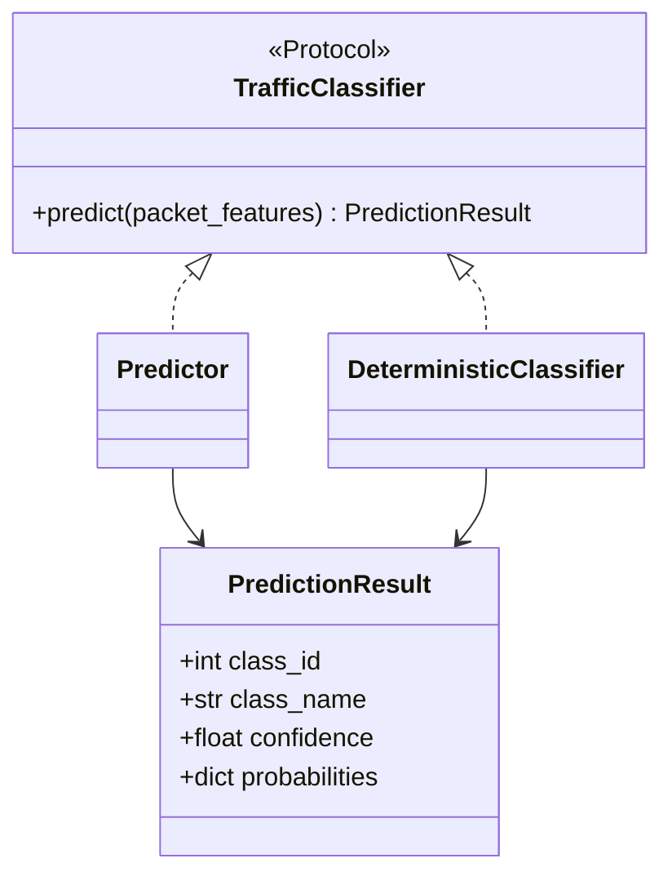

# Application Construction — Model Runtime

<show-structure for="chapter" depth="2"/>

The model-runtime package converts a validated packet-feature mapping into a
normalized traffic classification. It contains the classifier protocol, the bounded
asynchronous pool, XGBoost and deterministic implementations, their contracts, and
the mode-sensitive validation used before the inference route obtains a lease.

This page is backed by <path>src/main/python/api/app/model</path> and its direct
startup, route, schema, exception, and metrics consumers. Startup creates and tests
instances before publication. The request path leases one instance, executes it in the
configured worker-thread path, validates its outcome, and serializes a response.

## Package boundary and classifier contract {id="model-runtime-boundary"}

The initializer is an import-only package boundary. It performs no artifact loading,
instance construction, or state mutation. Runtime construction is owned by the
dependency builder after startup validation has reached the runtime stage.

<code-block lang="python" src="../../src/main/python/api/app/model/__init__.py" include-lines="1-9"/>

<code>TrafficClassifier</code> is a structural protocol. Both concrete classifiers
supply a synchronous <code>predict</code> accepting the same integer mapping and
returning <code>PredictionResult</code>. The pool is therefore unaware of whether a
leased object uses an XGBoost booster or deterministic rules.

<code-block lang="python" src="../../src/main/python/api/app/model/sdn_mpls_ml_protocols.py" include-lines="16-30"/>

<code-block lang="mermaid">
flowchart TB
    Startup["startup dependency builder"] --> Pool["ClassifierPool TrafficClassifier"]
    Pool --> Xgb["Predictor in MODEL mode"]
    Pool --> Rules["DeterministicClassifier in DETERMINISTIC_TEST mode"]
    Route["POST /api/v1/classify"] --> Pool
    Route --> Validation["mode-sensitive EtherType validation"]
    Xgb --> Result["PredictionResult"]
    Rules --> Result
    Result --> Route
</code-block>

| Concern | Owner | Published result |
|---|---|---|
| Classifier shape | <code>TrafficClassifier</code> | synchronous <code>predict</code> |
| Common result | <code>PredictionResult</code> | ID, name, confidence, probabilities |
| Availability | <code>ClassifierPool</code> | a lease or a capacity error |
| Model-mode input rule | mode validation helper | allowed request or typed rejection |
| Instance construction | startup dependency builder | self-tested pool |
| HTTP output | inference route | <code>ClassifyResponse</code> |

## Normalized result and pool state {id="result-and-pool"}

<code>PredictionResult</code> is a slots dataclass with no independent validation.
The predictor creates it after numerical normalization. The deterministic classifier
creates it as a one-hot result. The route later copies its fields into response models
and may resolve an optional policy using the selected class and confidence.

<code-block lang="python" src="../../src/main/python/api/app/model/sdn_mpls_ml_model_predictor.py" include-lines="20-30"/>

The pool rejects an empty list, fixes capacity to the list length, and places every
supplied object in an <code>asyncio.Queue</code> with that maximum size. It publishes
state after initialization. Its derived counts use queue size, so
<code>borrowed = capacity - available</code> rather than a separate mutable counter.

<code-block lang="python" src="../../src/main/python/api/app/model/sdn_mpls_ml_classifier_pool.py" include-lines="31-107"/>

The optional observer receives wait durations and outcomes, complete state, and timeout
events. Without an observer, acquisition behavior does not change. With
<code>BaselineMetrics</code>, state updates become capacity, available, and borrowed
gauges, waits become a histogram labeled by mode and outcome, and timeouts increment a
counter.

<code-block lang="python" src="../../src/main/python/api/app/observability/sdn_mpls_ml_metrics.py" include-lines="103-149"/>

## Lease lifecycle, timeout, and cancellation {id="lease-lifecycle"}

<code>acquire</code> is an asynchronous context manager. It measures wait duration and
awaits <code>Queue.get()</code> with <code>asyncio.wait_for</code>. On success, it records
the <code>acquired</code> outcome, publishes state, and yields exactly one classifier to
the caller. Its <code>finally</code> block puts that classifier back and republishes its state.

<code-block lang="python" src="../../src/main/python/api/app/model/sdn_mpls_ml_classifier_pool.py" include-lines="109-213"/>

A timeout observes <code>timeout</code>, records the observer timeout when present,
publishes state, and raises <code>InferenceCapacityExceededError</code>. It yields no
classifier. Cancellation while waiting observes <code>cancelled</code>, publishes state,
and propagates <code>CancelledError</code>. Cancellation after yielding still crosses the
<code>finally</code> block, returning the leased classifier before propagation.

<code-block lang="mermaid">
stateDiagram-v2
    [*] --> Available
    Available --> Waiting : route calls acquire
    Waiting --> Leased : Queue.get succeeds
    Waiting --> TimedOut : wait_for timeout
    Waiting --> Cancelled : task cancellation
    Leased --> Available : finally puts classifier
    TimedOut --> [*] : capacity error
    Cancelled --> [*] : cancellation re-raised
</code-block>

| Branch | Queue effect | Observer outcome | Caller outcome |
|---|---|---|---|
| immediately available | removes one classifier | acquired and state | leased classifier |
| released before deadline | removes released classifier | acquired and state | leased classifier |
| deadline expires | no item removed | timeout, counter, state | capacity error |
| waiter cancelled | no item removed | cancelled and state | cancellation |
| lease body raises | finally returns item | state after return | original error |
| lease body cancelled | finally returns item | state after return | cancellation |

The route runs this only after readiness and mode validation. It starts a queue-wait
timer, leases with the validated request timeout, then calls the instrumented helper
with the classifier, packet features, mode, AnyIO limiter, and worker-thread runner.
It snapshots pool values while the lease still exists, before context exit returns it.

<code-block lang="python" src="../../src/main/python/api/app/api/sdn_mpls_ml_inference_route.py" include-lines="188-227"/>

<code-block lang="mermaid">
sequenceDiagram
    participant Route
    participant Pool
    participant Limiter as AnyIO limiter
    participant Classifier
    Route->>Pool: acquire(request timeout)
    Pool-->>Route: leased classifier
    Route->>Limiter: execute synchronous prediction
    Limiter->>Classifier: predict(packet features)
    Classifier-->>Limiter: result or AppError
    Limiter-->>Route: result or AppError
    Route->>Pool: context exit
    Pool-->>Pool: return classifier and publish state
</code-block>

## Startup construction and self-test {id="startup-construction"}

Startup constructs every slot locally. It builds a classifier, runs a synthetic
prediction through that instance, appends only a passing instance, and aborts on
<code>StartupValidationError</code>. A partial list is therefore never published as a
pool. Successful construction marks synthetic inference passed before creating the pool.

<code-block lang="python" src="../../src/main/python/api/app/sdn_mpls_ml_dependencies.py" include-lines="1265-1354"/>

Deterministic-test mode asserts a rule model and returns a deterministic classifier.
Model mode loads a predictor, marks model loading, and ensures the synthetic EtherType
is supported. An invalid synthetic EtherType becomes a controlled runtime startup error.

<code-block lang="python" src="../../src/main/python/api/app/sdn_mpls_ml_dependencies.py" include-lines="1357-1416"/>

<code-block lang="mermaid">
flowchart TD
    Begin["classifier pool startup"] --> Slot["construct slot"]
    Slot --> Mode{"classification mode"}
    Mode -->|DETERMINISTIC_TEST| Deterministic["DeterministicClassifier rules"]
    Mode -->|MODEL| Load["load Predictor"]
    Load --> Ether{"synthetic EtherType supported"}
    Ether -->|no| Fail["StartupValidationError"]
    Ether -->|yes| Test["synthetic predict"]
    Deterministic --> Test
    Test --> Pass{"self-test valid"}
    Pass -->|no| Fail
    Pass -->|yes| Append["append instance"]
    Append --> Slot
</code-block>

Model loading imports XGBoost, creates a booster, and loads the configured model path.
Import and artifact-load failures are typed non-retryable startup errors. The loader
then requires exactly four model features, independently of the metadata ordering check.

<code-block lang="python" src="../../src/main/python/api/app/sdn_mpls_ml_dependencies.py" include-lines="1419-1484"/>

Booster configuration inspection is best effort. If configuration is readable, a present
objective must be <code>multi:softprob</code> and a present class count must equal the
fixed mapping cardinality. The loader then creates <code>Predictor</code> with metadata
and configured probability tolerance.

<code-block lang="python" src="../../src/main/python/api/app/sdn_mpls_ml_dependencies.py" include-lines="1486-1518"/>

## Model metadata contract {id="model-metadata"}

Metadata fixes feature ordering and class decoding. The expected order is
<code>eth_type</code>, <code>ip_proto</code>, <code>src_port</code>, then
<code>dst_port</code>. Class IDs zero through six map respectively to DNS, FTP, HTTP,
ICMP, NTP, SSH, and STREAMING.

<code-block lang="python" src="../../src/main/python/api/app/model/sdn_mpls_ml_metadata.py" include-lines="16-32"/>

<code>ModelMetadata</code> is strict and ignores unknown extra fields. It requires schema
version 1.0, the fixed model name, <code>xgboost_booster_json</code>, exact feature order,
identical feature-type keys, and <code>integer</code> values for every feature type.

<code-block lang="python" src="../../src/main/python/api/app/model/sdn_mpls_ml_metadata.py" include-lines="35-109"/>

Both maps must have seven entries. Forward IDs are contiguous and exactly equal the
expected class map. The reverse map exactly inverts it. The <code>classes</code> property
emits ordered ID/name pairs, which is also what the model-information route serializes.

<code-block lang="python" src="../../src/main/python/api/app/model/sdn_mpls_ml_metadata.py" include-lines="110-132"/>

Startup parses JSON then calls <code>ModelMetadata.model_validate</code>. Bad JSON is a
metadata-invalid startup error. A validation error becomes metadata-incompatible when its
text identifies a contract field, otherwise metadata-invalid. This is startup diagnosis,
not a fallback metadata interpretation.

<code-block lang="python" src="../../src/main/python/api/app/sdn_mpls_ml_dependencies.py" include-lines="1128-1184"/>

## Predictor matrix and output normalization {id="predictor-normalization"}

The predictor stores a booster, validated metadata, and probability tolerance. It creates
a one-row <code>float32</code> matrix by iterating metadata feature order. Thus it does
not infer or sort feature names at prediction time.

<code-block lang="python" src="../../src/main/python/api/app/model/sdn_mpls_ml_model_predictor.py" include-lines="45-84"/>

Prediction attempts a lazy XGBoost import and wraps the matrix in <code>DMatrix</code>.
If adaptation fails for a real XGBoost booster, it raises
<code>ModelInferenceFailedError</code>. A test-compatible non-XGBoost booster keeps the
matrix. A failure from the booster's own prediction call also becomes that typed error.

<code-block lang="python" src="../../src/main/python/api/app/model/sdn_mpls_ml_model_predictor.py" include-lines="86-127"/>

Normalization converts raw output to <code>float32</code>. It accepts a one-dimensional
vector or a two-dimensional matrix with exactly one row. It requires the metadata class
count, finite values, values from zero through one, and a probability sum within tolerance.
Every other shape or numerical violation raises <code>ModelOutputInvalidError</code>.

<code-block lang="python" src="../../src/main/python/api/app/model/sdn_mpls_ml_model_predictor.py" include-lines="150-187"/>

After normalization, <code>argmax</code> produces the ID, metadata decodes its name, and
enumeration produces the name-keyed probability map. Confidence is the selected value.

<code-block lang="python" src="../../src/main/python/api/app/model/sdn_mpls_ml_model_predictor.py" include-lines="129-148"/>

<code-block lang="mermaid">
flowchart LR
    Features["validated mapping"] --> Order["metadata feature_order"]
    Order --> Matrix["1 x 4 float32 matrix"]
    Matrix --> DMatrix["DMatrix when available"]
    DMatrix --> Booster["booster.predict"]
    Booster --> Validate["shape and probability validation"]
    Validate --> Decode["argmax and metadata decode"]
    Decode --> Result["PredictionResult"]
</code-block>

| Output condition | Behavior | Error category |
|---|---|---|
| one valid vector | use directly | none |
| valid one-row matrix | select row | none |
| multi-row matrix | reject shape | MODEL_OUTPUT_INVALID |
| unsupported rank | reject shape | MODEL_OUTPUT_INVALID |
| wrong class count | reject cardinality | MODEL_OUTPUT_INVALID |
| NaN or infinity | reject non-finite output | MODEL_OUTPUT_INVALID |
| outside zero through one | reject bounds | MODEL_OUTPUT_INVALID |
| sum outside tolerance | reject distribution | MODEL_OUTPUT_INVALID |
| DMatrix adaptation fails for XGBoost | fail inference | MODEL_INFERENCE_FAILED |
| booster predict raises | fail inference | MODEL_INFERENCE_FAILED |

## Deterministic classifier and rule contract {id="deterministic-runtime"}

The deterministic classifier calls its ordered rule evaluator and builds a one-hot result
using the same expected class map. The chosen class has confidence one and probability one.
Every other expected class has probability zero.

<code-block lang="python" src="../../src/main/python/api/app/model/sdn_mpls_ml_deterministic_predictor.py" include-lines="15-47"/>

ICMP protocol matching has first priority. Destination-port mappings precede source-port
mappings. If neither mapping matches, a destination port above the threshold selects
STREAMING, then a source port above it selects STREAMING, and the final fallback is also
STREAMING.

<code-block lang="python" src="../../src/main/python/api/app/model/sdn_mpls_ml_deterministic_predictor.py" include-lines="49-70"/>

<code-block lang="mermaid">
flowchart TD
    Packet["packet features"] --> Icmp{"configured ICMP protocol"}
    Icmp -->|yes| ICMP["ICMP"]
    Icmp -->|no| Dest{"destination port mapped"}
    Dest -->|yes| DestClass["destination mapped class"]
    Dest -->|no| Source{"source port mapped"}
    Source -->|yes| SourceClass["source mapped class"]
    Source -->|no| High{"port above threshold"}
    High -->|yes| Streaming["STREAMING"]
    High -->|no| Streaming
</code-block>

The rule file forbids extras and uses strict fields. Its threshold is one through 65535,
its IP protocol is zero through 255, and every port-map key must be decimal text naming a
port from zero through 65535. Destination mappings are mandatory. Source mappings default
to an empty map.

<code-block lang="python" src="../../src/main/python/api/app/model/sdn_mpls_ml_deterministic_rules.py" include-lines="20-56"/>

Its contract requires schema version 1.0 and STREAMING as the fallback class. Mapped values
must be known class names. Neither direct port map may select STREAMING because that class
is reserved for the explicit fallback path.

<code-block lang="python" src="../../src/main/python/api/app/model/sdn_mpls_ml_deterministic_rules.py" include-lines="58-84"/>

Startup loads this JSON only in deterministic-test mode. JSON, file, or Pydantic failures
become a structured <code>POLICY_SCHEMA_INVALID</code> startup error for
<code>deterministic_rules</code>.

<code-block lang="python" src="../../src/main/python/api/app/sdn_mpls_ml_dependencies.py" include-lines="1234-1262"/>

## Packet validation and route consumers {id="packet-validation-and-route"}

Pydantic structurally validates four strict integer fields. EtherType and ports are bounded
to zero through 65535, and IP protocol to zero through 255. For protocols other than TCP
or UDP, both ports must be zero. Extra fields are forbidden, including caller request IDs.

<code-block lang="python" src="../../src/main/python/api/app/schemas/sdn_mpls_ml_inference_validation_models.py" include-lines="25-85"/>

The mode helper returns immediately for deterministic-test mode. In model mode it requires
an EtherType in <code>MODEL_SUPPORTED_ETHERTYPES</code> and otherwise raises
<code>ModelEtherTypeUnsupportedError</code> with the authoritative request ID.

<code-block lang="python" src="../../src/main/python/api/app/model/sdn_mpls_ml_input_validation.py" include-lines="11-44"/>

The route checks readiness first, then invokes this helper. It records a rejected outcome
and warning for the typed EtherType error and re-raises it. Unsupported EtherType therefore
does not wait for pool capacity or invoke the thread-limited prediction helper.

<code-block lang="python" src="../../src/main/python/api/app/api/sdn_mpls_ml_inference_route.py" include-lines="128-186"/>

Schema startup selects metadata in MODEL mode and deterministic rules in deterministic-test
mode. It always loads the policy file after that mode-specific selection and marks policy
readiness. The policy mapper is a consumer after prediction rather than a classifier.

<code-block lang="python" src="../../src/main/python/api/app/sdn_mpls_ml_dependencies.py" include-lines="1090-1125"/>

The model-information route requires both ready state and non-null metadata. It serializes
model name, target name, schema version, feature order, and ordered class information. In
deterministic-test mode metadata is absent, so it follows its controlled not-ready branch.

<code-block lang="python" src="../../src/main/python/api/app/api/sdn_mpls_ml_inference_route.py" include-lines="56-93"/>

After a prediction, the route updates class and confidence metrics when enabled. It resolves
an optional policy. Resolver failure maps to <code>PolicyMappingFailedError</code>. The
success path serializes the model name or <code>deterministic_test</code>, result fields,
optional policy, and processing time. Cancellation propagates after observation marking.

<code-block lang="python" src="../../src/main/python/api/app/api/sdn_mpls_ml_inference_route.py" include-lines="229-321"/>

| Outcome | Origin | Route observation | Public category |
|---|---|---|---|
| no ready dependency | service container | not_ready | MODEL_NOT_READY |
| unsupported model EtherType | mode helper | rejected | model EtherType error |
| lease deadline | pool | capacity_timeout | INFERENCE_CAPACITY_EXCEEDED |
| prediction failure | predictor | inference_failed | MODEL_INFERENCE_FAILED |
| invalid probability output | predictor | output_invalid | MODEL_OUTPUT_INVALID |
| policy resolver failure | policy mapper | policy_failed | POLICY_MAPPING_FAILED |
| cancellation | route task | cancelled | cancellation propagates |
| success | all stages | success | ClassifyResponse |

<code-block lang="python" src="../../src/main/python/api/app/sdn_mpls_ml_exceptions.py" include-lines="188-240"/>

## Metrics scrape and invariants {id="metrics-and-invariants"}

The metrics endpoint does not acquire a classifier, read artifacts, or run startup. It
selects the default registry when the multiprocess directory is blank, otherwise attaches
a multiprocess collector. It returns 404 only when initialized services explicitly disable
Prometheus metrics.

<code-block lang="python" src="../../src/main/python/api/app/api/sdn_mpls_ml_metrics_route.py" include-lines="19-56"/>

| Invariant | Enforcing point | Violation consequence |
|---|---|---|
| pool has an instance | constructor | ValueError |
| successful lease is returned | context-manager finally | capacity restored |
| timeout leases nothing | wait_for timeout branch | typed capacity error |
| feature order is exact | metadata validator | startup incompatibility |
| booster has four features | startup loader | startup mismatch |
| output has seven valid probabilities | predictor normalizer | output error |
| direct rule maps exclude STREAMING | rule validator | rule rejection |
| non-TCP/UDP ports are zero | Pydantic validator | request validation error |
| model EtherType is supported | mode helper | pre-lease rejection |

The source does not establish automatic classifier replacement, artifact hot reload, a
retry loop after capacity exhaustion, or scheduling guarantees beyond the queue mechanism.
The implemented guarantees are bounded acquisition, return on context exit after a lease,
startup validation before pool publication, and the typed branches described above.

