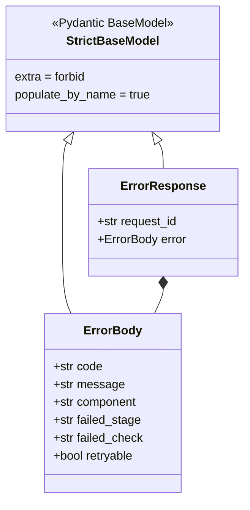

# Application Construction — Schemas

<show-structure for="chapter" depth="3"/>

The <code>app.schemas</code> package owns the Pydantic models that define the Python API's HTTP payload shapes. Its three modules provide a shared strict base and error envelope, health and readiness responses, and the classification and model-information contracts. The package does not perform inference, select policies, allocate classifiers, or create request identifiers. Those operations supply values to the schemas or consume objects that FastAPI has already validated.

The package therefore forms the boundary between transport JSON and typed API data. FastAPI uses <code>ClassifyRequest</code> to parse the classification body before the route runs. Routes construct response models from validated application state and return them through their declared <code>response_model</code> contracts. Central error handlers construct the common error envelope for controlled and request-validation failures.

## Package boundary and schema families {id="schemas-package-boundary"}

The package contains no executable business workflow. <code>sdn_mpls_ml_baseline_validation_models.py</code> defines the strict inheritance rule and error models. <code>sdn_mpls_ml_health_validation_models.py</code> describes the root, liveness, and readiness payloads. <code>sdn_mpls_ml_inference_validation_models.py</code> describes the classification input, prediction result, policy response, and model metadata payloads. The package initializer groups these modules without exporting a separate runtime facade.

<code-block lang="python" src="../../src/main/python/api/app/schemas/__init__.py" include-lines="1-9"/>

<code-block lang="mermaid">
flowchart TB
    FastAPI["FastAPI parsing and response serialization"] --> Schemas["app.schemas"]
    Schemas --> Base["strict base and error envelope"]
    Schemas --> Health["root, liveness, readiness"]
    Schemas --> Inference["classification and model metadata"]
    Middleware["middleware request ID"] --> Routes["health and inference routes"]
    Startup["readiness state"] --> Routes
    Model["prediction result"] --> Routes
    Policy["selected policy"] --> Routes
    Routes --> Schemas
    Errors["central exception handlers"] --> Base
</code-block>

The health and inference route modules are the only direct consumers of these public response models. The shared HTTP response builder consumes the error models. The model package has its own artifact schemas for metadata and deterministic rules, and the policy package has independent file-validation models. Those domains are deliberately distinct from the HTTP schemas here. Their interactions are described in [Application Construction — Model Runtime](Python-Inference-API-—-Application-Construction-Model-Runtime.md#model-metadata) and [Application Construction — Policy](Python-Inference-API-—-Application-Construction-Policy.md#policy-artifact-schema).

| Schema family | Source module | Primary producer | HTTP consumer |
|---|---|---|---|
| strict base and error envelope | <code>sdn_mpls_ml_baseline_validation_models</code> | central error builder | all error handlers and middleware rejections |
| root and liveness | <code>sdn_mpls_ml_health_validation_models</code> | health router | <code>GET /</code> and <code>GET /health/live</code> |
| readiness success and failure | <code>sdn_mpls_ml_health_validation_models</code> | cached startup state in health router | <code>GET /health/ready</code> |
| classification request and response | <code>sdn_mpls_ml_inference_validation_models</code> | FastAPI parser and inference route | <code>POST /api/v1/classify</code> |
| model information | <code>sdn_mpls_ml_inference_validation_models</code> | inference route and loaded metadata | <code>GET /api/v1/model</code> |

## Strict base model and uniform error envelope {id="schemas-strict-base-errors"}

<code>StrictBaseModel</code> inherits Pydantic's <code>BaseModel</code> and configures <code>extra="forbid"</code> with <code>populate_by_name=True</code>. Every HTTP schema in this package inherits that configuration. Consequently, an unrecognized member in a request body is rejected during Pydantic parsing, while a response model cannot be instantiated with undocumented fields. The alias setting preserves name-based construction when a schema later exposes aliases, although the current models declare their fields by their Python names.

<code-block lang="python" src="../../src/main/python/api/app/schemas/sdn_mpls_ml_baseline_validation_models.py" include-lines="14-70"/>

<code>ErrorBody</code> holds the public error code and message, plus optional diagnostic ownership fields. <code>component</code> identifies the subsystem that produced the controlled failure. <code>failed_stage</code> and <code>failed_check</code> locate the failed logical operation. <code>retryable</code> communicates whether retrying can be meaningful. <code>ErrorResponse</code> wraps that body with an optional <code>request_id</code>.

The response builder first creates an <code>ErrorResponse</code> and converts it with <code>model_dump()</code>. It may then append a serializable <code>details</code> member to the resulting dictionary. This is an intentional distinction: <code>details</code> is not declared by <code>ErrorResponse</code>, while the stable envelope fields remain governed by the schema. The request-validation handler uses that extension to return FastAPI validation diagnostics without making arbitrary detail structures part of every typed error model.

<code-block lang="python" src="../../src/main/python/api/app/sdn_mpls_ml_http_responses.py" include-lines="14-71"/>

| Field | Required by the error model | Meaning when present |
|---|---|---|
| <code>request_id</code> | no | correlation value created by middleware or carried by a controlled error |
| <code>error.code</code> | yes | stable application error identifier |
| <code>error.message</code> | yes | public explanation selected by the application |
| <code>error.component</code> | no | producing subsystem, such as request validation or policy |
| <code>error.failed_stage</code> | no | broader processing stage that failed |
| <code>error.failed_check</code> | no | specific failed validation or operation |
| <code>error.retryable</code> | no | retry characteristic reported by the controlled error |
| <code>details</code> | no, outside the typed model | serializable validation metadata supplied by the handler |

The middleware package owns the authoritative transport correlation value and adds <code>X-Request-ID</code> to the response. The schemas merely provide fields where routes and handlers can echo that value. The correlation lifecycle and header injection are documented in [Application Construction — Middleware](Python-Inference-API-—-Application-Construction-Middleware.md#authoritative-request-id).

## Classification input contract {id="schemas-classification-input"}

<code>PacketFeatures</code> is the inner request model for packet classification. It applies <code>extra="forbid"</code> and <code>strict=True</code> in addition to the shared base configuration. Its four fields use <code>StrictInt</code>, so strings, floating-point values, and coercible booleans do not become feature values implicitly. The field bounds cover EtherType, IP protocol number, and the two transport ports.

<code-block lang="python" src="../../src/main/python/api/app/schemas/sdn_mpls_ml_inference_validation_models.py" include-lines="19-85"/>

| Request field | Type and range | Cross-field meaning |
|---|---|---|
| <code>packet_features</code> | required <code>PacketFeatures</code> object | sole permitted member of <code>ClassifyRequest</code> |
| <code>eth_type</code> | strict integer from 0 through 65535 | link-layer protocol value, subject to a later mode-dependent check |
| <code>ip_proto</code> | strict integer from 0 through 255 | IP protocol number used by the port rule |
| <code>src_port</code> | strict integer from 0 through 65535 | must be zero for a non-TCP and non-UDP protocol |
| <code>dst_port</code> | strict integer from 0 through 65535 | must be zero for a non-TCP and non-UDP protocol |

The model-level validator runs after basic Pydantic field validation. TCP protocol number six and UDP protocol number 17 may carry the declared port values. For every other IP protocol, both ports must equal zero. This prevents an ICMP or other non-transport packet from being represented with invented TCP or UDP port information. The rule belongs to the HTTP input contract because it depends only on fields in the submitted payload.

<code-block lang="mermaid">
flowchart TB
    Body["JSON request body"] --> Envelope{"only packet_features?"}
    Envelope -->|no| RejectExtra["FastAPI request validation"]
    Envelope -->|yes| Types["strict integer and range validation"]
    Types -->|invalid| RejectType["REQUEST_VALIDATION_FAILED"]
    Types -->|valid| Protocol{"ip_proto is TCP or UDP?"}
    Protocol -->|yes| Accepted["validated PacketFeatures"]
    Protocol -->|no| Ports{"both ports are zero?"}
    Ports -->|yes| Accepted
    Ports -->|no| RejectPorts["REQUEST_VALIDATION_FAILED"]
    Accepted --> Mode["route applies classification-mode EtherType rule"]
</code-block>

<code>ClassifyRequest</code> contains only <code>packet_features</code>. A caller cannot set <code>request_id</code> in this JSON body because the strict base rejects it as an extra field. The request ID is generated by correlation middleware and later placed into successful or error response payloads by server-side code. The concrete requests and expected validation errors are maintained in [Python Inference API — API Request Directory](Python-Inference-API-—-API-Request-Directory.md#python-api-classify-contract).

The schema does not decide whether the active classifier supports an EtherType. After parsing, the inference route invokes the model package's mode-specific input validator. In <code>MODEL</code> mode, that validator requires a supported EtherType. In deterministic-test mode, it does not impose that additional restriction. This separates static payload integrity from a runtime rule controlled by loaded application settings. See [Model runtime packet validation](Python-Inference-API-—-Application-Construction-Model-Runtime.md#packet-validation-and-route) for that second boundary.

<code-block lang="mermaid">
sequenceDiagram
    participant Caller
    participant Middleware
    participant FastAPI
    participant Schema as ClassifyRequest
    participant Handler as request-validation handler
    participant Route as classify route
    Caller->>Middleware: POST body
    Middleware->>FastAPI: correlated request
    FastAPI->>Schema: parse packet_features
    alt malformed JSON or schema violation
        Schema-->>Handler: RequestValidationError
        Handler-->>Caller: correlated 400 or 422 ErrorResponse
    else valid payload
        Schema-->>Route: typed ClassifyRequest
        Route-->>Caller: continue inference path
    end
</code-block>

## Classification and policy response contract {id="schemas-classification-response"}

The inference route assembles <code>ClassifyResponse</code> after it has completed readiness checks, classifier acquisition, prediction normalization, optional policy selection, and timing. The response schema holds the public result of that workflow. It does not calculate probabilities, derive confidence, or resolve a policy. Those activities are described in [Application Construction — Inference](Python-Inference-API-—-Application-Construction-Inference.md#inference-success-path).

<code-block lang="python" src="../../src/main/python/api/app/schemas/sdn_mpls_ml_inference_validation_models.py" include-lines="88-161"/>

<code-block lang="mermaid">
classDiagram
    class PredictionBody {
        +int class_id
        +str class_name
        +float confidence
    }
    class PathConstraints {
        +int requested_bandwidth_kbps
        +int setup_priority
        +int hold_priority
    }
    class PolicyResponse {
        +str profile_name
        +int dscp
        +int mpls_tc
        +bool policy_fallback
        +str policy_fallback_reason
    }
    class ClassifyResponse {
        +str request_id
        +str model_name
        +dict probabilities
        +float processing_time_ms
    }
    PolicyResponse *-- PathConstraints
    ClassifyResponse *-- PredictionBody
    ClassifyResponse o-- PolicyResponse
</code-block>

<code>PredictionBody</code> exposes the selected <code>class_id</code>, <code>class_name</code>, and numeric confidence. <code>ClassifyResponse.probabilities</code> exposes the complete probability mapping with class names as keys. The package does not independently enforce a sum-to-one invariant on that mapping. Output normalization and probability validation occur in the classifier adapter before the route constructs the response.

<code>PolicyResponse</code> is an optional member of <code>ClassifyResponse</code>. When policy mapping is enabled and resolves successfully, it contains a profile name, DSCP, MPLS traffic class, nested path constraints, and fallback metadata. <code>policy_fallback</code> defaults to <code>false</code>. <code>policy_fallback_reason</code> is absent when no fallback reason exists. The response model uses ordinary <code>int</code> annotations for these already-validated policy values. The policy package owns its stricter artifact ranges and complete-map rules before the route serializes them.

| Response object | Fields | Value origin |
|---|---|---|
| <code>PredictionBody</code> | class ID, class name, confidence | normalized classifier result |
| <code>PathConstraints</code> | requested bandwidth, setup priority, hold priority | selected validated policy |
| <code>PolicyResponse</code> | profile, DSCP, MPLS TC, constraints, fallback fields | policy mapper through the inference route |
| <code>ClassifyResponse</code> | request ID, model, prediction, probabilities, optional policy, elapsed time | route orchestration and response assembly |
| <code>ModelClassInfo</code> | class ID and name | loaded model metadata |
| <code>ModelInfoResponse</code> | model identity, target, schema version, feature order, classes | loaded model metadata |

<code>request_id</code> is required in a successful classification response. The inference route obtains the authoritative value from request state, not the request body. It uses the loaded metadata name in model mode and emits <code>deterministic_test</code> as the model name fallback when metadata is unavailable for deterministic mode. This contract makes a successful response distinguish the active classification source without exposing internal service objects.

<code-block lang="mermaid">
flowchart LR
    Result["normalized PredictionResult"] --> Prediction["PredictionBody"]
    Result --> Probabilities["probabilities map"]
    Mapping["PolicyMapper selection"] --> Policy["PolicyResponse or null"]
    Correlation["middleware request ID"] --> Response["ClassifyResponse"]
    Metadata["loaded model metadata"] --> Response
    Prediction --> Response
    Probabilities --> Response
    Policy --> Response
    Timing["route elapsed time"] --> Response
</code-block>

The response policy represents the selected intent. It does not state that a network device accepted or applied DSCP, MPLS traffic class, bandwidth, or priority values. That downstream distinction is kept explicit in [Policy inference and response boundary](Python-Inference-API-—-Application-Construction-Policy.md#policy-inference-boundary). The inference route records policy selection and fallback metrics after it creates the policy response, as documented in [Inference metrics behavior](Python-Inference-API-—-Application-Construction-Inference.md#inference-metrics).

## Root, liveness, and readiness contracts {id="schemas-health-contracts"}

The health schema module separates process information from service readiness. <code>RootResponse</code> contains the service name, version, running status, and documentation path. <code>LivenessResponse</code> contains only a status string because it answers whether the HTTP process responds. Readiness has two response models because startup may be complete and usable, still initializing, or complete with a cached failure.

<code-block lang="python" src="../../src/main/python/api/app/schemas/sdn_mpls_ml_health_validation_models.py" include-lines="12-82"/>

<code-block lang="mermaid">
stateDiagram-v2
    [*] --> Initializing
    Initializing --> Ready : startup validation publishes services
    Initializing --> NotReady : startup validation fails
    Ready --> ReadyResponse : 200 ReadySuccessResponse
    Initializing --> FailureResponse : 503 ReadyFailureResponse
    NotReady --> FailureResponse : 503 ReadyFailureResponse
    ReadyResponse --> [*]
    FailureResponse --> [*]
</code-block>

<code>ReadySuccessResponse</code> includes the active classification mode and the cached flags that describe model, metadata, policy, synthetic inference, and classifier-pool state. It also exposes optional metadata identity and cardinality fields, plus the UTC completion timestamp. A successful readiness response has no body-level request identifier. Correlation remains in its response header for that branch.

<code>ReadyFailureResponse</code> includes <code>request_id</code>, status, <code>ready=false</code>, classification mode, and an optional nested <code>ReadinessError</code>. The error shape mirrors the common diagnostic fields, but it is a dedicated readiness model rather than <code>ErrorBody</code>. This reflects the route's cached readiness state, which can be <code>initializing</code> without a failure object or <code>not_ready</code> with a structured startup failure.

<code-block lang="python" src="../../src/main/python/api/app/api/sdn_mpls_ml_health_route.py" include-lines="21-143"/>

| Endpoint state | Status code | Schema | Correlation placement |
|---|---|---|---|
| root process description | 200 | <code>RootResponse</code> | <code>X-Request-ID</code> header |
| liveness response | 200 | <code>LivenessResponse</code> | <code>X-Request-ID</code> header |
| startup still running | 503 | <code>ReadyFailureResponse</code> with <code>initializing</code> | header and body <code>request_id</code> |
| startup failed | 503 | <code>ReadyFailureResponse</code> with <code>not_ready</code> and optional error | header and body <code>request_id</code> |
| service ready | 200 | <code>ReadySuccessResponse</code> | <code>X-Request-ID</code> header |

The health router builds these models from <code>app.state.services</code> and its cached readiness state. It does not repeat startup validation during a health request. The startup lifecycle, publication rule, and distinction between liveness and readiness are documented in [Application Construction](Python-Inference-API-—-Application-Construction.md#startup-validation) and [Liveness and readiness](Python-Inference-API-—-Application-Construction.md#liveness-and-readiness).

## Model information contract {id="schemas-model-information"}

<code>ModelClassInfo</code> is the item model for a loaded class identifier and name. <code>ModelInfoResponse</code> exposes the model name, target name, schema version, feature order, and the list of those class items. The metadata route creates this response only after readiness confirms that model metadata is available. It maps the loaded metadata's class pairs into <code>ModelClassInfo</code> instances, preserving the metadata order.

<code-block lang="python" src="../../src/main/python/api/app/api/sdn_mpls_ml_inference_route.py" include-lines="43-93"/>

<code-block lang="mermaid">
sequenceDiagram
    participant Caller
    participant Route as GET /api/v1/model
    participant Services as AppServices
    participant Metadata as ModelMetadata
    participant Schema as ModelInfoResponse
    Caller->>Route: request
    Route->>Services: inspect readiness and model_metadata
    alt service not ready or metadata missing
        Route-->>Caller: controlled MODEL_NOT_READY error
    else metadata available
        Services->>Metadata: expose loaded fields and classes
        Route->>Schema: create response and ModelClassInfo items
        Schema-->>Caller: 200 model information
    end
</code-block>

The model information schema is an HTTP projection of loaded metadata. It does not validate model artifacts from disk, verify feature-order compatibility, or construct the classifier pool. Those operations happen during startup and are covered by [Model runtime startup construction](Python-Inference-API-—-Application-Construction-Model-Runtime.md#startup-construction). The public response and its unavailable-state interaction are shown in the [model metadata request sections](Python-Inference-API-—-API-Request-Directory.md#python-api-model-read).

## Request-validation and exception conversion {id="schemas-validation-exception-conversion"}

FastAPI raises <code>RequestValidationError</code> when JSON cannot be parsed into the declared request schema or when a field, strict type, range, extra member, or cross-field validator fails. The central handler serializes the FastAPI errors, distinguishes the <code>json_invalid</code> marker from a regular schema failure, records request-error evidence, and uses the shared error builder. Malformed JSON becomes the structured <code>INVALID_JSON</code> response with status 400. A well-formed body that violates <code>ClassifyRequest</code> or <code>PacketFeatures</code> becomes the structured request-validation response with status 422.

<code-block lang="python" src="../../src/main/python/api/app/sdn_mpls_ml_main.py" include-lines="529-612"/>

<code-block lang="mermaid">
flowchart TB
    Input["incoming JSON"] --> Parser["FastAPI and Pydantic"]
    Parser -->|json_invalid| Json["INVALID_JSON, 400"]
    Parser -->|field or model violation| Contract["REQUEST_VALIDATION_FAILED, 422"]
    Json --> Builder["build_error_response"]
    Contract --> Builder
    Builder --> Envelope["ErrorResponse plus optional details"]
    Envelope --> Header["middleware adds X-Request-ID"]
</code-block>

The exception handler is responsible for HTTP status, error code selection, logging, and metrics. The schema package is responsible for the Pydantic field and model rules that lead FastAPI to raise the validation exception. Middleware remains responsible for rejecting oversized or invalidly declared bodies before normal request parsing. The separate ownership prevents a successful schema parse from being confused with a successful request when transport limits or readiness fail later in the path.

| Failure boundary | Producing layer | Returned contract | Related topic |
|---|---|---|---|
| malformed JSON | FastAPI parser and central handler | <code>INVALID_JSON</code> error envelope, 400 | [API request directory](Python-Inference-API-—-API-Request-Directory.md#python-api-classify-malformed-json) |
| strict field, range, extra field, or protocol-port rule | Pydantic request schemas and central handler | request-validation error envelope, 422 | [Inference request models](Python-Inference-API-—-Application-Construction-Inference.md#inference-request-models) |
| unsupported model EtherType | model input validator after schema parsing | controlled model error | [Inference EtherType rule](Python-Inference-API-—-Application-Construction-Inference.md#inference-ethertype-rule) |
| body too large or invalid content length | request-size middleware | correlated error envelope before endpoint parsing | [Request-size middleware](Python-Inference-API-—-Application-Construction-Middleware.md#request-size-middleware) |
| startup or classifier unavailability | readiness and inference route | controlled not-ready error envelope | [Inference ready-state gate](Python-Inference-API-—-Application-Construction-Inference.md#inference-ready-state-gate) |

The common error models keep response structure stable across these branches, but they do not erase ownership. A 422 proves that FastAPI could parse the body as JSON and found a contract violation. A 400 <code>INVALID_JSON</code> proves that the body did not reach a valid JSON representation. A 413 body rejection occurs before the route's Pydantic request model is used. The route's later controlled errors also use the error envelope but arise after the classification request has passed schema validation.

## Schema relationships across the application {id="schemas-application-relationships"}

The schemas package is intentionally narrow, but its contracts connect the application construction layers. Middleware establishes correlation first. FastAPI then uses the classification input models. The inference route serializes model and policy results into classification models. The health route serializes cached lifecycle state into health models. Central handlers serialize failures through the common envelope. Observability consumes the surrounding route and handler events rather than treating a Pydantic model itself as a metric producer.

<code-block lang="mermaid">
flowchart LR
    Correlation["correlation middleware"] --> Header["X-Request-ID"]
    Correlation --> Request["ClassifyRequest"]
    Request --> Route["inference route"]
    Route --> Success["ClassifyResponse"]
    Route --> ModelInfo["ModelInfoResponse"]
    Lifecycle["cached readiness"] --> Health["health schemas"]
    Validation["FastAPI validation exception"] --> Error["ErrorResponse"]
    AppError["controlled application error"] --> Error
    Header --> Success
    Header --> Health
    Header --> Error
</code-block>

The public request and response examples remain in [Python Inference API — API Request Directory](Python-Inference-API-—-API-Request-Directory.md). The parent application page explains where schema ownership sits within router registration and central exception handling in [Pydantic models and validation ownership](Python-Inference-API-—-Application-Construction.md#pydantic-validation). Together, these pages distinguish the typed payload contract from the runtime work that supplies or consumes its values.
