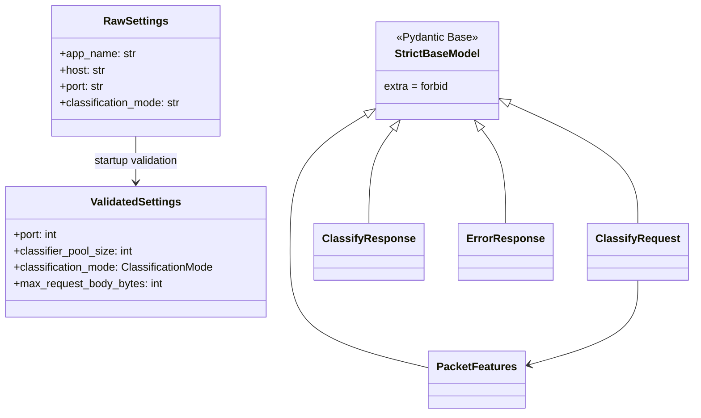

# Python Inference API — Application Construction

<show-structure for="chapter" depth="2"/>

The Python Inference API is a FastAPI process that validates its runtime inputs before it serves model-backed 
classification.Tts construction separates process startup, ASGI request handling, endpoint routing, model execution, 
policy resolution, and observability. This separation lets the process remain reachable while it reports that 
inference is unavailable. Liveness and readiness therefore have distinct operational meanings.

The exported <code>app</code> in <code>app.sdn_mpls_ml_main</code> is the composition root. It defines the FastAPI 
application, the lifespan, the middleware order, the mounted routers, and the central error boundary. The detailed 
public HTTP examples remain in the [Python Inference API — API Request Directory](Python-Inference-API-—-API-Request-Directory.md) topic. This topic 
explains the implementation relationships that produce those contracts.

## Construction boundary and lifecycle {id="construction-boundary"}

Uvicorn imports the application object and FastAPI enters <code>lifespan(app)</code> before it dispatches ordinary 
requests. The lifespan obtains raw environment settings, derives a worker identity, configures structured logging, 
builds the service container, and stores the result in <code>app.state.services</code>. Routes and middleware then 
reach a single application-owned container instead of loading artifacts or constructing a classifier per request.

<code-block lang="mermaid">
flowchart TD
    Container["Container entry point"] --> Uvicorn["Uvicorn ASGI server"]
    Uvicorn --> App["FastAPI app"]
    App --> Lifespan["lifespan(app)"]
    Lifespan --> Raw["get_raw_settings()"]
    Raw --> Identity["initialize_process_identity()"]
    Identity --> Logging["configure_logging()"]
    Logging --> Services["build_services()"]
    Services --> State["app.state.services"]
    State --> Middleware["middleware chain"]
    State --> Routes["health, inference, metrics routers"]
    State --> Handlers["central exception handlers"]
</code-block>

The construction boundary is deliberately narrow. <code>RawSettings</code> reads environment-shaped values. Startup 
validation then creates <code>ValidatedSettings</code>, checks artifacts, validates their schemas, creates the 
classifier pool, and caches either a ready or not-ready outcome. The classification handler can consequently make 
one readiness decision before it attempts a classifier lease.

| Construction concern | Owner | Published result | Runtime consumer |
|---|---|---|---|
| Raw environment loading | <code>sdn_mpls_ml_config</code> | <code>RawSettings</code> | lifespan and startup validation |
| Worker identity | <code>observability.sdn_mpls_ml_identity</code> | <code>ProcessIdentity</code> | logs and metrics |
| Logging configuration | <code>sdn_mpls_ml_logging_config</code> | JSON handlers | all modules |
| Startup validation | <code>sdn_mpls_ml_dependencies</code> | <code>AppServices</code> | routes and middleware |
| Request correlation | <code>app.middleware</code> | server request ID | responses, logs, and metrics |
| Error conversion | <code>sdn_mpls_ml_main</code> | <code>ErrorResponse</code> | failed requests |

### Application object and router mount {id="application-object"}

The application receives the lifespan and a `Starlette` middleware list during construction. It mounts three routers 
immediately afterward. The health router contributes the root, liveness, and readiness paths. On the other hand, the 
inference router contributes the versioned model and classification operations. The metrics router contributes the 
literal <code>/metrics</code> scrape path, which is excluded from OpenAPI. There is no settings field that changes 
that route.

<code-block lang="python" src="../../src/main/python/api/app/sdn_mpls_ml_main.py" include-lines="148-170"/>

<code-block lang="mermaid">
flowchart LR
    App["sdn_mpls_ml_main.app"] --> Health["health_router"]
    App --> Inference["inference_router"]
    App --> Metrics["metrics_router"]
    Health --> Root["GET /"]
    Health --> Live["GET /health/live"]
    Health --> Ready["GET /health/ready"]
    Inference --> Model["GET /api/v1/model"]
    Inference --> Classify["POST /api/v1/classify"]
    Metrics --> Scrape["GET /metrics"]
    Scrape --> Prometheus["Prometheus exposition"]
</code-block>

Router registration describes the published HTTP topology, rather than a request execution order. A request crosses 
all middleware layers before FastAPI resolves a router and validates a body. Startup runs first for the process. Each 
selected endpoint receives the same <code>Request</code> object and can access its owning application state, 
including all middleware-added fields.

### Lifespan source path {id="lifespan-source-path"}

The lifespan derives the application's identity from the configured application name and optional instance identifier 
before it configures logging. This allows logging records to identify the process from which these logs are coming. It 
then builds services and publishes them to the internal application state before endpoints read that state. The startup 
event records whether Prometheus collection is enabled by the validated settings.

<code-block lang="python" src="../../src/main/python/api/app/sdn_mpls_ml_main.py" include-lines="82-139"/>

<code-block lang="plantuml">
@startuml
skinparam shadowing false
hide footbox
actor "ASGI server" as ASGI
participant "FastAPI app" as App
participant "lifespan" as Life
participant "configuration" as Config
participant "identity" as Identity
participant "logging" as Log
participant "dependencies" as Dependencies
participant "AppServices" as Services
ASGI -> App : start process
App -> Life : enter lifespan(app)
Life -> Config : get_raw_settings()
Config --> Life : RawSettings
Life -> Identity : initialize_process_identity(...)
Identity --> Life : ProcessIdentity
Life -> Log : configure_logging(safe level, settings)
Life -> Dependencies : build_services(raw_settings, identity)
Dependencies -> Services : create and initialize
Services --> Life : ready or not-ready container
Life -> App : app.state.services = services
App --> ASGI : application can dispatch requests
@enduml
</code-block>

<code>build_services</code> does not promise that every startup validates successfully. It creates an 
<code>initializing</code> container, performs controlled validation, and caches a failure in 
the <code>ReadinessState</code> data class, instead of leaving a partial runtime graph. A missing model can therefore 
leave <code>/health/live</code> available while <code>/health/ready</code> and inference correctly communicate that 
the process is not ready.

## Application state and startup composition {id="application-state"}

<code>AppServices</code> is the process-wide service container. It holds raw and validated settings, cached 
readiness, the classifier pool, the AnyIO capacity limiter, model metadata, optional policy mapper, body-size limit, 
and baseline metrics recorder. Retaining raw settings is useful because root and readiness diagnostics can still 
describe a controlled validation failure before <code>ValidatedSettings</code> exists.

<code-block lang="python" src="../../src/main/python/api/app/sdn_mpls_ml_dependencies.py" include-lines="89-187"/>

The initial container has no classifier pool, metadata, policy mapper, or limiter. This is a meaningful state. The inference endpoint regards a missing runtime dependency as not ready. The size middleware can nevertheless use the conservative default body limit. The readiness endpoint reads cached state and never reconstructs a classifier or reloads artifacts during a probe.

<code-block lang="mermaid"><![CDATA[
classDiagram
    class AppServices {
        +RawSettings raw_settings
        +ValidatedSettings settings
        +ReadinessState readiness
        +ClassifierPool classifier_pool
        +CapacityLimiter inference_thread_limiter
        +ModelMetadata model_metadata
        +PolicyMapper policy_mapper
        +int request_size_limit_bytes
        +BaselineMetrics baseline_metrics
    }
    class RawSettings
    class ValidatedSettings
    class ReadinessState
    class ClassifierPool
    class ModelMetadata
    class PolicyMapper
    class BaselineMetrics
    class BaseSettings
    AppServices --> RawSettings
    AppServices --> ValidatedSettings
    AppServices --> ReadinessState
    AppServices --> ClassifierPool
    AppServices --> ModelMetadata
    AppServices --> PolicyMapper
    AppServices --> BaselineMetrics
    RawSettings --> BaseSettings
]]>
</code-block>

### Startup validation stages {id="startup-validation"}

The method <code>initialize_services</code> from the <code>Dependencies</code> file, validates app configuration 
before it accesses artifacts or imports model runtime dependencies. Later stages resolve artifacts, parse metadata 
or deterministic rules, load policy, construct every pooled classifier, run synthetic inference, and check that 
policy coverage matches the classification domain. A <code>StartupValidationError</code> records code, component, 
failed stage, failed check, and retryability for cached readiness output.

<code-block lang="mermaid">
stateDiagram-v2
    [*] --> Initializing
    Initializing --> ConfigurationPreflight : validate settings
    ConfigurationPreflight --> ArtifactChecks : settings valid
    ArtifactChecks --> SchemaValidation : artifacts readable
    SchemaValidation --> RuntimeValidation : contracts valid
    RuntimeValidation --> PolicyCoverage : pool and self-test pass
    PolicyCoverage --> Ready : mapping complete
    ConfigurationPreflight --> NotReady : validation error
    ArtifactChecks --> NotReady : validation error
    SchemaValidation --> NotReady : validation error
    RuntimeValidation --> NotReady : validation error
    PolicyCoverage --> NotReady : validation error
</code-block>

| Stage | Operation | Successful evidence | Failure evidence |
|---|---|---|---|
| Configuration preflight | <code>_validate_settings</code> | <code>ValidatedSettings</code> | cached structured failure |
| Artifact checks | <code>_validate_artifacts</code> | <code>ArtifactPaths</code> | unreadable, empty, or absent artifact |
| Schema validation | <code>_validate_schemas</code> | metadata, policy, optional rules | artifact contract failure |
| Runtime compatibility | <code>_build_classifier_pool</code> | complete <code>ClassifierPool</code> | model load or output failure |
| Synthetic output | <code>_run_synthetic_self_test</code> | valid prediction result | synthetic inference failure |
| Policy coverage | <code>_validate_complete_policy_map</code> | complete policy mapper | mapping or bandwidth failure |
| Readiness publication | <code>mark_ready</code> or <code>mark_failed</code> | stable probe state | stable probe state |

The synthetic self-test does not need a packet from a caller. It validates the runtime prediction output before the 
pool is published. This guards against an artifact that can be read but produces a probability vector, class 
identifier, or class name incompatible with loaded metadata.

## Middleware execution boundary {id="middleware"}

The application registers <code>CorrelationIdMiddleware</code> and <code>RequestSizeLimitMiddleware</code>. 
Correlation runs first so its identifier is available to a body-size rejection, FastAPI validation failure, normal 
endpoint response, and central exception handler. The correlation middleware generates the authoritative value, 
stores it in ASGI state, and injects <code>X-Request-ID</code> when the response begins.

<code-block lang="mermaid">
sequenceDiagram
    autonumber
    actor Caller
    participant Corr as CorrelationIdMiddleware
    participant Size as RequestSizeLimitMiddleware
    participant FastAPI as Router and validation
    participant Handler as Endpoint
    participant Response as HTTP response
    Caller->>Corr: HTTP request
    Corr->>Corr: generate request ID and store scope state
    Corr->>Size: forward ASGI scope
    alt invalid or oversized body
        Size->>Response: structured error body
        Response-->>Corr: response start
    else accepted body
        Size->>FastAPI: replay validated bytes
        FastAPI->>Handler: invoke selected route
        Handler-->>FastAPI: endpoint result
        FastAPI-->>Corr: response start
    end
    Corr->>Response: add X-Request-ID if absent
    Response-->>Caller: correlated response
</code-block>

The size middleware reads the effective limit from the services container. It rejects malformed or negative 
<code>Content-Length</code> values as controlled bad requests. It rejects declared or observed bodies beyond the 
configured byte limit. For accepted data, it buffers the request body and supplies a replay receive callable, so 
FastAPI and Pydantic receive the same bytes after the ASGI check. It records body-rejection metrics only when 
Prometheus export is enabled.

| Request condition | Middleware outcome | Contract owner | Correlation result |
|---|---|---|---|
| Non-HTTP scope | passes unchanged | downstream ASGI application | none required |
| Valid body | replays buffered bytes | FastAPI and endpoint | header and request state |
| Invalid <code>Content-Length</code> | early 400 | size middleware | generated ID present |
| Declared body too large | early 413 | size middleware | generated ID present |
| Streamed body too large | early 413 | size middleware | generated ID present |
| Escaped downstream exception | final internal error | correlation middleware | generated ID present |

### Request ID invariant {id="request-id"}

The server owns the request identifier. Route code reads it through <code>get_request_id(request)</code>. Error 
handlers first retain an identifier attached to a controlled exception and otherwise read the request-scoped value. 
A caller can therefore relate a response body, response header, structured logs, and per-request events without 
relying on a client-provided ID.

<code-block lang="mermaid">
flowchart TD
    Generated["UUID generated by correlation middleware"] --> Scope["ASGI scope state"]
    Scope --> Request["FastAPI Request.state"]
    Request --> Route["get_request_id(request)"]
    Request --> Handler["exception handlers"]
    Generated --> Header["X-Request-ID"]
    Route --> Success["successful response request_id"]
    Handler --> Error["error response request_id"]
    Generated --> Logs["structured logs"]
</code-block>

This design also bounds the effect of error handling. An endpoint can attach the current ID to an error such as a 
pool timeout. The application handler retains it. If the exception has none, the handler uses request state. A 
missing ID can only occur outside the normal HTTP middleware path and is not a public API request flow.

## Mounted API router modules {id="router-modules"}

The <path>app/api</path> package contains the three router modules mounted by the application. Its <path>__init__.
py</path> is a namespace documentation anchor, not an additional routing implementation. These modules belong in the 
construction narrative because their mount location, shared state access, correlation behavior, and common error 
normalization all originate in the main application.

| Module | Prefix | Endpoints | Primary state dependency |
|---|---|---|---|
| <code>sdn_mpls_ml_health_route</code> | none | <code>/</code>, <code>/health/live</code>, <code>/health/ready</code> | cached readiness and settings |
| <code>sdn_mpls_ml_inference_route</code> | <code>/api/v1</code> | <code>/model</code>, <code>/classify</code> | pool, limiter, metadata, policy mapper |
| <code>sdn_mpls_ml_metrics_route</code> | none | <code>/metrics</code> | validated metrics setting and registry |

### Health router {id="health-router"}

The health router answers three separate questions. The root route describes the HTTP process and uses raw settings 
as a fallback when validation did not produce validated settings. The liveness route checks only that the HTTP 
process is alive. The readiness route reads the cached startup outcome and does not trigger artifact loading, model 
construction, or synthetic inference during a probe.

<code-block lang="python" src="../../src/main/python/api/app/api/sdn_mpls_ml_health_route.py" include-lines="18-70"/>

Readiness emits a 503 <code>ReadyFailureResponse</code> when initialization is still incomplete or a prior startup 
stage failed. Both failure forms include the generated request ID. A ready response contains startup evidence 
including classification mode, loaded metadata and policy flags, model summary, feature and class counts, pool 
capacity, and validation time.

<code-block lang="python" src="../../src/main/python/api/app/api/sdn_mpls_ml_health_route.py" include-lines="73-144"/>

<code-block lang="mermaid">
flowchart TD
    Probe["GET /health/ready"] --> Services["app.state.services"]
    Services --> Readiness["ReadinessState"]
    Readiness --> Complete{"initialization complete?"}
    Complete -- no --> Initializing["503 initializing with request ID"]
    Complete -- yes --> Ready{"ready?"}
    Ready -- no --> Failed["503 not_ready with cached diagnosis"]
    Ready -- yes --> Success["200 ready with model and pool summary"]
</code-block>

### Inference router {id="inference-router"}

The inference router owns the versioned public operations. <code>GET /api/v1/model</code> requires ready state and 
loaded metadata. If either is absent, it raises <code>ModelNotReadyError</code>. The main application's 
<code>AppError</code> handler then provides the shared error status, error code, request ID, metric, and structured 
log behavior.

<code-block lang="python" src="../../src/main/python/api/app/api/sdn_mpls_ml_inference_route.py" include-lines="52-93"/>

<code>POST /api/v1/classify</code> accepts a Pydantic-validated request. It creates a request observation, checks 
readiness, applies the active model-mode constraint, leases a classifier with a bounded timeout, runs prediction 
through the configured AnyIO limiter, resolves an optional policy, records metrics, and builds 
<code>ClassifyResponse</code>. The dedicated inference topic expands the schema, classifier, policy, and error 
branches in full.

<code-block lang="mermaid">
flowchart TD
    Request["ClassifyRequest"] --> Ready{"services ready?"}
    Ready -- no --> NotReady["ModelNotReadyError"]
    Ready -- yes --> Mode["validate packet mode"]
    Mode --> Lease["ClassifierPool.acquire(timeout)"]
    Lease --> Run["instrumented inference"]
    Run --> Prediction["PredictionResult"]
    Prediction --> Policy["PolicyMapper.resolve"]
    Policy --> Result["ClassifyResponse"]
    Lease --> Capacity["InferenceCapacityExceededError"]
    Run --> ModelError["controlled model errors"]
</code-block>

### Metrics router {id="metrics-router"}

The metrics router returns Prometheus exposition bytes rather than a JSON response model. It uses the default 
registry when <code>PROMETHEUS_MULTIPROC_DIR</code> is absent and creates a multiprocess collector registry when it 
is set. When validated settings explicitly disable Prometheus metrics, the fixed scrape path returns 404. The route 
remains excluded from OpenAPI because it is a scrape interface rather than an application resource contract.

<code-block lang="python" src="../../src/main/python/api/app/api/sdn_mpls_ml_metrics_route.py" include-lines="16-56"/>

## Pydantic models and validation ownership {id="pydantic-validation"}

Pydantic models have separate roles in the application. <code>RawSettings</code> reads environment variables with 
aliases and defaults. HTTP schemas define request and response contracts. Startup helpers perform cross-field, type, 
artifact, and runtime checks that a raw environment model cannot complete. FastAPI invokes HTTP schema validation 
after the size middleware accepts and replays a request body.

The baseline schema module defines strict request and response behavior and the common error envelope. The health 
schema module defines root, liveness, readiness-success, readiness-failure, and nested readiness-error structures. 
The inference schema module defines packet features, their protocol-dependent port rule, classification request and 
response structures, policy representation, and model metadata response structures. Policy and model artifacts have 
independent Pydantic models because they validate startup files rather than HTTP bodies.

| Validation boundary | Input | Validator | Failure destination |
|---|---|---|---|
| Environment shape | environment and <path>.env</path> | <code>RawSettings</code> | startup preflight |
| Startup semantics | raw configuration strings | dependency helpers | cached readiness failure |
| Body size | ASGI headers and bytes | size middleware | 400 or 413 envelope |
| JSON and HTTP schema | replayed request body | FastAPI and Pydantic | 400 or 422 envelope |
| Model-mode input | validated EtherType | input-validation helper | controlled 422 error |
| Model output | prediction vector and metadata | adapters and self-test | startup or runtime error |
| Policy file | JSON artifact | policy models | cached readiness failure |

### Configuration model transition {id="configuration-models"}

<code>RawSettings</code> preserves values as supplied by the process environment. Its aliases include 
<code>APP_NAME</code>, <code>LOG_LEVEL</code>, <code>CLASSIFIER_POOL_SIZE</code>, and 
<code>CLASSIFICATION_MODE</code>. The cached <code>get_raw_settings</code> accessor prevents inconsistent 
independent environment reads within a process. <code>get_safe_log_level</code> provides a controlled fallback 
before the complete settings preflight succeeds.

<code-block lang="python" src="../../src/main/python/api/app/sdn_mpls_ml_config.py" include-lines="55-72"/>

<code-block lang="python" src="../../src/main/python/api/app/sdn_mpls_ml_config.py" include-lines="75-145"/>

<code-block lang="python" src="../../src/main/python/api/app/sdn_mpls_ml_config.py" include-lines="148-207"/>

Validated settings convert values that have operational meaning into their runtime types. Pool size, timeout, 
request body limit, and port become integers. Probability tolerance and policy confidence become floats. 
Classification mode becomes a <code>ClassificationMode</code> enum. The [Python Inference API — Application 
Construction Environment Variables](Python-Inference-API-—-Application-Construction-Environment-Variables.md) topic 
documents defaults and deployment implications.

## Central error boundary {id="error-boundary"}

The main module centralizes conversion of controlled application errors, FastAPI validation errors, JSON decoding 
errors, Starlette HTTP errors, and unexpected exceptions. It delegates response-body construction to 
<code>build_error_response</code>, records the relevant request-error metric, writes a request-scoped structured 
event, and returns JSON. The shared builder accepts component, stage, check, retryability, and safe optional details 
without serializing arbitrary request content or stack traces.

<code-block lang="python" src="../../src/main/python/api/app/sdn_mpls_ml_main.py" include-lines="173-222"/>

The <code>AppError</code> handler retains each controlled error's status, code, public message, component, stage, 
check, and retryability. A pool-capacity timeout adds pool state only to the structured log event. The public body 
remains the common error envelope, which prevents queue internals from becoming a client dependency.

<code-block lang="python" src="../../src/main/python/api/app/sdn_mpls_ml_main.py" include-lines="411-526"/>

FastAPI can represent malformed JSON as a <code>RequestValidationError</code>. The handler checks its normalized 
errors for <code>json_invalid</code>, producing 400 <code>INVALID_JSON</code> for that case and 422 validation 
failure for other schema errors. Its logging metadata contains body type, byte length, a digest where available, and 
error locations. It does not log raw invalid content.

<code-block lang="mermaid">
flowchart TD
    Failure["Exception reaches FastAPI"] --> Kind{"failure family"}
    Kind -->|AppError| AppError["handle_app_error"]
    Kind -->|RequestValidationError| Validation["handle_request_validation"]
    Kind -->|JSONDecodeError| Json["handle_json_error"]
    Kind -->|Starlette HTTP exception| Http["handle_http_exception"]
    Kind -->|other exception| Unknown["handle_unhandled_exception"]
    AppError --> Envelope["build_error_response"]
    Validation --> Envelope
    Json --> Envelope
    Http --> Envelope
    Unknown --> Envelope
    Envelope --> Correlated["correlated JSON error"]
</code-block>

| Handler | Failure source | Public effect | Implementation rule |
|---|---|---|---|
| <code>handle_app_error</code> | domain error | declared status and code | preserves controlled diagnostics |
| <code>handle_request_validation</code> | FastAPI or Pydantic | 400 or 422 | separates malformed JSON |
| <code>handle_json_error</code> | JSON decoding | 400 | retains request ID |
| <code>handle_http_exception</code> | routing or Starlette | structured HTTP error | recognizes 413 and 404 |
| <code>handle_unhandled_exception</code> | escaped failure | 500 <code>INTERNAL_ERROR</code> | no stack trace or body exposure |

The Starlette handler normalizes 413 as <code>REQUEST_TOO_LARGE</code> and 404 as <code>HTTP_NOT_FOUND</code>. Other 
framework HTTP failures use <code>HTTP_ERROR</code>. The final catch-all emits a retryable 
<code>INTERNAL_ERROR</code> while logging bounded metadata only.

<code-block lang="python" src="../../src/main/python/api/app/sdn_mpls_ml_main.py" include-lines="656-790"/>

## End-to-end application flows {id="application-flows"}

The process state changes once at startup. Identity is initialized, logging is configured, and services move from 
initializing to ready or not ready. Routes only read that cached outcome. They do not reload the environment, 
rebuild a pool, or repeat startup validation during an ordinary request.

<code-block lang="mermaid">
stateDiagram-v2
    [*] --> ProcessCreated
    ProcessCreated --> IdentityInitialized
    IdentityInitialized --> LoggingConfigured
    LoggingConfigured --> ServicesInitializing
    ServicesInitializing --> ServingReady : validation succeeds
    ServicesInitializing --> ServingNotReady : validation fails
    ServingReady --> ServingReady : normal requests
    ServingNotReady --> ServingNotReady : health probes
    ServingNotReady --> ServingNotReady : inference not-ready response
</code-block>

A classification request begins at middleware rather than routing. A body rejection does not reach Pydantic. A 
Pydantic rejection does not reach the inference handler. A not-ready inference request does not lease a classifier. 
A capacity timeout does not execute a model. Success leases and releases one classifier through an async context 
manager, then returns prediction and optional policy under the same server-generated correlation identifier.

<code-block lang="plantuml">
@startuml
skinparam shadowing false
hide footbox
actor Caller
participant "Correlation middleware" as Correlation
participant "Size middleware" as Size
participant "FastAPI validation" as Validation
participant "Inference route" as Route
participant "AppServices" as Services
participant "ClassifierPool" as Pool
participant "PolicyMapper" as Policy
participant "Error handlers" as Errors
Caller -> Correlation : POST /api/v1/classify
Correlation -> Size : request ID in ASGI state
Size -> Validation : accepted replayed body
Validation -> Route : ClassifyRequest
Route -> Services : inspect readiness and settings
alt ready
  Route -> Pool : acquire(timeout)
  Pool --> Route : classifier lease
  Route -> Route : instrumented inference
  Route -> Policy : resolve class and confidence
  Policy --> Route : selected policy or fallback
  Route --> Caller : 200 ClassifyResponse + X-Request-ID
else failure
  Route -> Errors : controlled exception
  Errors --> Caller : structured error + X-Request-ID
end
@enduml
</code-block>

## Module map and invariants {id="module-map"}

The source tree follows execution boundaries. The application and router package define HTTP composition. Middleware 
operates on ASGI scopes and messages. Schemas validate HTTP and artifact data. Dependencies construct process-wide 
state. Model and policy modules compute the result. Observability records process, pool, request, and inference 
evidence. Logging and messages preserve consistency without introducing an HTTP dependency into lower layers.

| Module or package | Responsibility | Produced objects | Main consumers |
|---|---|---|---|
| <code>app.sdn_mpls_ml_main</code> | assembly and error normalization | <code>app</code>, lifespan, handlers | Uvicorn and FastAPI |
| <code>app.api</code> | endpoint declarations | routers and endpoint results | main application |
| <code>app.middleware</code> | correlation and body limits | request state and early errors | request chain |
| <code>app.schemas</code> | Pydantic contracts | request and response models | routes and builder |
| <code>app.sdn_mpls_ml_config</code> | configuration declarations | raw and validated settings types | startup |
| <code>app.sdn_mpls_ml_dependencies</code> | service construction | <code>AppServices</code> | lifespan and routes |
| <code>app.sdn_mpls_ml_readiness</code> | cached startup state | readiness diagnostics | health and inference |
| <code>app.model</code> | classifier execution | prediction result | dependencies and inference |
| <code>app.policy</code> | policy selection | policy mapper | dependencies and inference |
| <code>app.observability</code> | metrics and identity | observations and labels | all runtime layers |
| <code>app.sdn_mpls_ml_logging_config</code> | JSON logging | handlers and formatter | lifespan and loggers |
| <code>app.sdn_mpls_ml_exceptions</code> | controlled failure vocabulary | <code>AppError</code> hierarchy | routes and handlers |
| <code>app.sdn_mpls_ml_http_responses</code> | error body construction | JSON response | middleware and handlers |
| <code>app.sdn_mpls_ml_messages</code> | message catalog | public and log messages | application modules |

<code-block lang="mermaid">
flowchart TB
    Main["Application construction"] --> Middleware["Middleware"]
    Middleware --> Schemas["Pydantic schemas"]
    Main --> Dependencies["Startup dependencies"]
    Dependencies --> Readiness["Readiness state"]
    Dependencies --> Model["Model runtime"]
    Dependencies --> Policy["Policy mapping"]
    Schemas --> Routes["Router modules"]
    Readiness --> Routes
    Model --> Routes
    Policy --> Routes
    Routes --> Observability["Metrics and logs"]
    Main --> ErrorBoundary["Error boundary"]
    ErrorBoundary --> Observability
</code-block>

| Invariant | Purpose | Enforced by |
|---|---|---|
| Server owns <code>request_id</code>. | Responses and logs share a trusted token. | correlation middleware, routes, handlers |
| Startup publishes a complete pool or no pool. | Inference never leases partial initialization. | dependencies, readiness, inference route |
| Readiness remains cached. | Probes do not mutate runtime state. | dependencies, readiness, health route |
| Size validation precedes Pydantic. | Oversized data stops before model work. | size middleware and FastAPI |
| Public errors use one envelope. | Callers receive stable error fields. | exceptions, builder, handlers |
| Metrics use fixed <code>/metrics</code>. | Feature gating does not alter route topology. | metrics router and settings |
| Model-mode EtherType check follows schema validation. | Payload structure and model capability remain distinct. | schemas, input validation, inference route |
| Pool lease is context-managed. | Availability is restored after any branch. | pool and inference route |
| Policy fallback preserves a valid prediction. | Low confidence changes policy rather than result validity. | policy mapper and inference route |
| Invalid payload logging is bounded. | Diagnostics avoid raw client body disclosure. | middleware and central handlers |

## Detailed construction decisions {id="construction-decisions"}

The application construction separates data ownership from control flow. The application object owns route 
registration and process state. Router modules own endpoint-level decisions. Middleware owns transport-level guards. 
The dependency module owns the one-time transition from raw configuration to a usable runtime graph. This 
arrangement prevents an endpoint from becoming a second startup path or a middleware layer from knowing 
model-specific business rules.

### Process ownership {id="process-ownership"}

The FastAPI object is process-local. A Uvicorn worker imports the module, builds the FastAPI object, and enters its 
lifespan. The generated <code>ProcessIdentity</code> is also worker-local. If deployment runs multiple workers, each 
worker constructs its own services container and classifier pool. The application does not share Python objects 
across worker processes.

The process identity has two purposes. First, it distinguishes records emitted by concurrent workers, and it provides 
stable labels for worker-level Prometheus evidence. The identity initialization occurs before the dependency builder 
starts because baseline metrics are initialized during startup validation. A log record can therefore identify the 
same worker that exported a readiness or classifier-pool metric.

| Object | Lifetime | Storage location | Recreated by an endpoint? |
|---|---|---|---|
| FastAPI application | Python worker process | module global <code>app</code> | no |
| Process identity | Python worker process | application state and identity module | no |
| Raw settings | Python worker process | cached configuration accessor | no |
| App services | Python worker process | <code>app.state.services</code> | no |
| Readiness result | Python worker process | <code>AppServices.readiness</code> | no |
| Classifier pool | Python worker process | <code>AppServices.classifier_pool</code> | no |
| Classifier lease | one classification request | async context manager | yes, per request |
| Request ID | one HTTP request | ASGI scope and request state | yes, per request |
| Classification observation | one classification request | local route variable | yes, per request |

### Startup is a publish-after-validation operation {id="publish-after-validation"}

Startup validation constructs local objects before it publishes the ready runtime graph. It validates configuration 
and files, creates classifiers, performs synthetic prediction, and checks policy coverage. Only after those 
operations complete does it attach the pool, limiter, metadata, and mapper to the shared services container and mark 
readiness as ready. A failure marks readiness as not ready and leaves the corresponding runtime dependencies 
unavailable.

This distinction matters for partial failure. If a pool of several classifier instances cannot be fully built, the 
implementation does not publish the partially constructed pool for requests to use. A caller sees a not-ready 
response instead of a lower-capacity service that silently violates configured capacity.

<code-block lang="mermaid">
flowchart TD
    Start["create_initial_services"] --> Initial["services: initializing, no pool"]
    Initial --> Settings["validate settings"]
    Settings --> Artifacts["validate artifacts"]
    Artifacts --> Schemas["load and validate contracts"]
    Schemas --> Build["build all classifiers"]
    Build --> SelfTest["run synthetic self-test"]
    SelfTest --> Policies["validate complete policy map"]
    Policies --> Publish["publish pool, limiter, metadata, mapper"]
    Publish --> MarkReady["readiness.mark_ready"]
    Settings --> Failure["readiness.mark_failed"]
    Artifacts --> Failure
    Schemas --> Failure
    Build --> Failure
    SelfTest --> Failure
    Policies --> Failure
</code-block>

### Why liveness and readiness are separate? {id="liveness-and-readiness"}

Liveness is intentionally a shallow process signal. It returns <code>alive</code> without looking at settings, 
artifacts, the classifier pool, or policy data. A platform can use it to determine whether the HTTP process should 
be restarted, rather than treating a configuration or model issue as a process crash.

Readiness is a service-capability signal. It exposes whether initialization completed and whether all required 
runtime components are usable. In a not-ready state, it returns a structured, cached failure diagnosis. This allows 
a platform or operator to keep the process observable while withholding it from traffic that requires inference 
capability.

| Probe | What it proves | What it deliberately does not prove | Typical caller |
|---|---|---|---|
| <code>GET /</code> | the router and service state are reachable | model and policy readiness | operator or discovery client |
| <code>GET /health/live</code> | the HTTP process responds | startup success, pool availability, artifacts | container liveness probe |
| <code>GET /health/ready</code> | cached startup validation result | a fresh model reload or new self-test | readiness probe or orchestrator |
| <code>GET /api/v1/model</code> | metadata can be published by ready services | classification capacity at a later instant | API client |
| <code>POST /api/v1/classify</code> | current request passed all runtime gates | future request capacity | controller-side application |

### Router isolation {id="router-isolation"}

The router modules are intentionally small. They do not mount one another and they do not create a separate FastAPI 
application. This keeps prefixes and OpenAPI registration in one place. It also means the correlation and 
error-handling behavior applies uniformly to every mounted path.

The health router reads cached state. The metrics router reads only the feature gate and registry. The inference 
router coordinates the runtime collaborators that its operation requires. None of them configures logging, parses 
environment variables independently, or registers exception handlers. Those tasks would create different process 
behavior depending on which endpoint a caller reached first.

<code-block lang="mermaid">
flowchart TD
    Main["FastAPI composition root"] --> Shared["app.state.services"]
    Main --> H["health router"]
    Main --> I["inference router"]
    Main --> M["metrics router"]
    H --> Shared
    I --> Shared
    M --> Shared
    H -. no direct dependency .-> I
    I -. no direct dependency .-> M
    M -. no direct dependency .-> H
</code-block>

### Endpoint responsibility matrix {id="endpoint-responsibility"}

Each endpoint has a narrow public responsibility. The root route identifies the service. Liveness identifies an 
active process. Readiness reveals the startup result. Model metadata exposes the loaded model contract. 
Classification performs bounded work. Metrics exports instrumentation under a feature gate. These are not 
interchangeable health indicators.

| Endpoint | Reads | Does not perform | Controlled failure path |
|---|---|---|---|
| <code>GET /</code> | raw or validated service identity | model or policy validation | normal response from available state |
| <code>GET /health/live</code> | no runtime model state | startup validation or artifact access | normal minimal response |
| <code>GET /health/ready</code> | cached readiness | reinitialization | 503 initialization or cached failure |
| <code>GET /api/v1/model</code> | ready metadata | classifier lease or inference | <code>ModelNotReadyError</code> |
| <code>POST /api/v1/classify</code> | all inference collaborators | artifact reload or pool construction | validation, readiness, capacity, model, or policy error |
| <code>GET /metrics</code> | settings and registry | application JSON serialization | 404 when exporter is disabled |

The classification route does more work because it is the only route that consumes a classifier lease. It still does 
not decide how a model artifact is loaded. It consumes a fully prepared classifier through a protocol and returns a 
normalized prediction. This lets deterministic test mode and model mode share the endpoint flow while retaining 
different underlying adapters.

## Configuration and startup contracts {id="configuration-contracts"}

Configuration moves through several representations. Environment aliases select raw values. Settings preflight 
parses values, enforces allowed ranges and relationships, and creates <code>ValidatedSettings</code>. Artifact 
validation resolves the effective model, metadata, policy, and deterministic-rule files. Schema loading maps files 
into typed models. Runtime validation then verifies that a predictor or deterministic classifier can actually 
satisfy its output contract.

<code-block lang="mermaid">
%%| align: center 
flowchart TD
    Env["Environment and .env"] --> Raw["RawSettings"]
    Raw --> Preflight["_validate_settings"]
    Preflight --> Validated["ValidatedSettings"]
    Validated --> Files["ArtifactPaths"]
    Files --> Models["metadata, policy, deterministic rules"]
    Models --> Runtime["predictor or deterministic classifier"]
    Runtime --> Services["ready AppServices"]
</code-block>

The raw setting model has one convenience responsibility: it makes configuration accessible without prematurely 
treating unparsed strings as correct runtime values. The validated setting model has a different responsibility: it 
represents values that passed the startup preflight. This difference is especially important for booleans, timeouts, 
pool size, byte limits, confidence thresholds, port, and the classification mode enum.

| Configuration family | Raw form | Validated form | Consumer after validation |
|---|---|---|---|
| Service identity | strings | strings | root endpoint, logs, metrics |
| Network binding | host and port strings | host string and integer port | Uvicorn deployment configuration |
| Logging | level and file inputs | safe normalized level and validated paths | logging configuration |
| Metrics | environment string | boolean feature gate | metrics route and recorders |
| Artifact locations | directory and file names | resolved required paths | startup loaders |
| Pooling | strings | bounded integer size and timeout | pool and inference route |
| Request limits | string | integer byte limit | size middleware |
| Policy thresholds | strings | floats or optional float | policy mapper |
| Classification mode | string | <code>ClassificationMode</code> | startup and inference guard |

### Configuration failure behavior {id="configuration-failure"}

A configuration failure should be observable without producin a misleading successful readiness response. The 
dependency module translates invalid configuration into a structured startup error, writes a startup event, updates 
baseline metrics when enabled, and caches the failure. The readiness endpoint exposes the error in a bounded 
contract. The classification and metadata endpoints then use the same not-ready domain error behavior.

The application does not attempt to repair invalid configuration during a request. For example, it does not change 
an invalid pool size to an arbitrary fallback value after preflight, and it does not reload an artifact that failed 
schema validation. This protects callers from nondeterministic runtime changes and directs corrective action to 
deployment configuration or mounted artifacts.

## Error and response architecture {id="error-response-architecture"}

The error architecture preserves separation between detection and response formatting. Middleware detects transport 
errors. Pydantic and FastAPI detect parsing and schema errors. Routes detect readiness, capacity, model, and policy 
conditions. The main application translates those conditions into HTTP responses. The response helper constructs the 
shared model. Observability records the matching error category.

<code-block lang="mermaid">
flowchart TB
    Transport["middleware transport check"] --> Main["central handler or direct envelope"]
    Framework["FastAPI and Pydantic validation"] --> Main
    Domain["AppError from route or model"] --> Main
    Routing["Starlette HTTP exception"] --> Main
    Main --> Builder["build_error_response"]
    Builder --> Schema["ErrorResponse and ErrorBody"]
    Main --> Metric["record_request_error"]
    Main --> Log["request-scoped JSON log"]
    Schema --> Client["correlated HTTP JSON"]
</code-block>

This structure prevents error code drift. An endpoint does not handcraft a JSON object for a timeout while 
middleware returns another shape for a body rejection. The response builder uses the same envelope fields. The main 
module supplies the HTTP and observability context around it.

| Failure category | Detector | Error identity | HTTP status family |
|---|---|---|---|
| Invalid JSON | FastAPI validation handler or decoder handler | <code>INVALID_JSON</code> | 400 |
| Invalid body shape | FastAPI validation handler | request validation error | 422 |
| Invalid declared length | size middleware | <code>INVALID_CONTENT_LENGTH</code> | 400 |
| Excessive body | size middleware or handler | <code>REQUEST_TOO_LARGE</code> | 413 |
| Missing route | Starlette handler | <code>HTTP_NOT_FOUND</code> | 404 |
| Missing inference capability | inference route | <code>MODEL_NOT_READY</code> | 503 |
| Pool wait timeout | inference route and pool | capacity exceeded | 503 |
| Inference failure | model adapter | model inference failed | 500 |
| Output contract failure | model adapter | invalid model output | 500 |
| Policy mapping failure | inference route | policy mapping failed | 500 |
| Unexpected failure | catch-all handler | <code>INTERNAL_ERROR</code> | 500 |

## Observability built into construction {id="observability-construction"}

Observability begins during construction rather than after the first successful classification. The lifespan creates 
process identity before services are initialized. The dependency builder creates baseline metrics early enough to 
record startup duration and failure state. Middleware can record body rejections. Central handlers record request 
errors. The inference route creates a classification observation and uses instrumented inference for model execution.

<code-block lang="mermaid">
flowchart TB
    Identity["ProcessIdentity"] --> Logs["JSON log filter"]
    Identity --> Baseline["BaselineMetrics worker labels"]
    Startup["startup validation"] --> Baseline
    Middleware["body limits"] --> Rejections["body rejection counters"]
    Handlers["central handlers"] --> Errors["request error counters"]
    Inference["classification route"] --> Observation["ClassificationObservation"]
    Observation --> Requests["classification counters and duration"]
    Inference --> Instrumented["execute_instrumented_inference"]
    Instrumented --> Latency["inference duration histogram"]
    MetricsRoute["GET /metrics"] --> Baseline
    MetricsRoute --> Rejections
    MetricsRoute --> Errors
    MetricsRoute --> Requests
    MetricsRoute --> Latency
</code-block>

The Prometheus route is a readout, not the implementation of metrics. It returns whatever the current appropriate 
registry exposes. The producer modules own the metric mutations. This distinction helps diagnose a missing metric. A 
200 scrape response only proves the registry was exported. It does not prove that a specific path executed or that 
metrics were enabled in the worker that produced a request.

| Evidence | Producer | Lifecycle point | Correlation relationship |
|---|---|---|---|
| Worker identity fields | identity and logging filter | process startup | identifies worker, not request |
| Readiness gauge | baseline metrics | startup completion or failure | process state |
| Pool state | pool observer | lease and release events | capacity evidence |
| Body rejection counter | size middleware | rejected request | request ID only in logs |
| Request error counter | central handlers | normalized error | request ID only in logs and body |
| Classification counter | observation | request completion | request ID in logs and result |
| Inference duration | instrumented inference | classifier execution | request ID in surrounding logs |
| Policy selection counters | inference route | policy resolution | request ID in route logs |

### Logging configuration relationship {id="logging-relationship"}

Logging configuration is performed in lifespan after identity initialization and before services are built. The safe 
log-level helper gives the root configuration an allowed level even when an external value is malformed. The logging 
module installs JSON formatting and process identity enrichment, while individual modules provide event-specific 
fields such as component, stage, check, status, classification mode, pool counts, and duration.

No route configures a handler. This avoids duplicate handlers or inconsistent formats across endpoint execution. The 
application logs request events through helpers in the main module when it normalizes framework and domain failures. 
The inference route logs its own successful classification and policy fallback events because it owns the result and 
queue context.

## API topology as a component model {id="component-model"}

The following component diagram places the application construction module at the center of the implementation. 
Arrows show direct responsibility and data flow, not network topology. Filesystem artifacts enter during startup. 
Prometheus collectors and structured logs receive evidence from different runtime layers. The controller-side caller 
interacts only through the HTTP boundary.

<code-block lang="mermaid">
flowchart TB
    Caller["Controller-side caller"] --> ASGI["Uvicorn and FastAPI"]
    ASGI --> Main["app.sdn_mpls_ml_main"]
    Main --> Middlewares["Correlation and size middleware"]
    Main --> Routers["Health, inference, metrics routers"]
    Main --> Dependencies["Startup dependency builder"]
    Main --> ErrorHandlers["Central exception handlers"]
    Dependencies --> Config["Raw and validated settings"]
    Dependencies --> Artifacts["model and config artifacts"]
    Dependencies --> Runtime["classifier pool and limiter"]
    Dependencies --> Policy["policy mapper"]
    Routers --> Runtime
    Routers --> Policy
    Middlewares --> ErrorHandlers
    ErrorHandlers --> Responses["ErrorResponse"]
    Routers --> Responses
    Main --> Logging["JSON logging"]
    Dependencies --> Metrics["baseline metrics"]
    Middlewares --> Metrics
    Routers --> Metrics
    ErrorHandlers --> Metrics
    Metrics --> Prometheus["Prometheus scraper"]
</code-block>

## Reading the implementation by data flow {id="reading-by-data-flow"}

An effective implementation review follows the objects that cross module boundaries. Begin with the raw settings 
object and follow it into validated settings and application services. Follow the generated request ID from ASGI 
scope into request state, headers, response bodies, and logs. Follow a valid packet body from the size middleware 
into Pydantic, the inference route, a classifier lease, a prediction result, a policy selection, and a response. 
Follow a failure from its detector into the central handler and common error envelope.

| Data item | Created by | Transformed by | Final consumers |
|---|---|---|---|
| Raw environment values | deployment environment | configuration and startup validation | service builder |
| Validated settings | dependency preflight | none after publication | routes, middleware, metrics |
| Process identity | identity initializer | logging and baseline metrics | operations tooling |
| Request ID | correlation middleware | request context and error fallback | caller, logs, responses |
| Request bytes | ASGI receive | size middleware replay then Pydantic parse | endpoint schema |
| Packet features | Pydantic schema | classification-mode guard | classifier |
| Prediction result | classifier adapter | response and policy mapping | caller and metrics |
| Selected policy | policy mapper | response representation | caller and logs |
| Startup failure | dependency validator | readiness state | probe, metadata, classification |
| Runtime error | route, model, middleware, or framework | central error handler | caller, metrics, logs |

The data-flow approach prevents an inaccurate assumption that the API is merely an endpoint wrapper around a model. 
The endpoint is one stage in a constructed process. It depends on startup evidence, transport guards, strict schema 
input, resource leasing, a normalized model adapter, policy semantics, and common operational reporting. Each later 
module document can remain detailed without repeating the application-wide ownership model established here.

## Documentation boundaries for subsequent module topics {id="subsequent-topics"}

<code-block lang="mermaid">
mindmap
  root((Python API construction))
    Application main
      lifespan
      routers
      handlers
    Middleware
      correlation
      body limits
    Startup
      configuration
      artifacts
      readiness
    Inference
      schemas
      pool
      predictors
      policy
    Observability
      identity
      metrics
      logs
</code-block>

## Terminology used across the application {id="construction-terminology"}

This documentation uses <emphasis>process</emphasis> for one Python worker that imports the FastAPI application and 
enters the lifespan. It uses <emphasis>service container</emphasis> for the <code>AppServices</code> object held by 
that process. It uses <emphasis>ready</emphasis> only for the cached result that startup validation published. A 
running HTTP process can be alive without being ready for inference.

The term <emphasis>request correlation</emphasis> refers to the server-generated identifier that travels from ASGI 
scope to request state, response header, applicable response body, and structured log events. It does not refer to a 
client body field. The term <emphasis>classifier lease</emphasis> refers to one temporary reservation from the 
bounded classifier pool. The lease has a shorter lifetime than the process and must be released even when prediction 
or policy mapping fails.

| Term | Implementation object or behavior | Scope |
|---|---|---|
| Process identity | <code>ProcessIdentity</code> | one worker process |
| Raw settings | <code>RawSettings</code> | startup input |
| Validated settings | <code>ValidatedSettings</code> | usable runtime configuration |
| Service container | <code>AppServices</code> | one worker process |
| Readiness | <code>ReadinessState</code> | cached startup capability |
| Correlation | <code>request_id</code> and <code>X-Request-ID</code> | one HTTP request |
| Classifier lease | <code>ClassifierPool.acquire</code> context | one classification attempt |
| Observation | <code>ClassificationObservation</code> | one classification request |
| Policy fallback | mapper selection below confidence threshold | one successful result |

Using these terms consistently keeps the distinction between process state and request state clear. It also prevents 
a common operational error: interpreting a liveness response as a guarantee that a model is loaded and that 
classifier capacity is available. The ready response, model endpoint, and classification operation each offer 
progressively stronger evidence for their own specific concerns.

## Construction summary {id="construction-summary"}

The complete application is assembled once per worker. Lifespan loads configuration, initializes identity and 
logging, and creates a service container whose readiness result is cached. The main application then exposes a fixed 
router topology, applies correlation and size safeguards before route handling, and centralizes every public error 
representation. These responsibilities explain why the API can report controlled not-ready and validation conditions 
without losing request correlation.

The router modules remain focused on their resources. Health reports process and startup state. Inference consumes 
an already prepared pool, limiter, metadata, and mapper. Metrics exports the registered instrumentation under its 
feature gate. Pydantic models validate only their defined input or output boundary, while dependencies own 
cross-field, artifact, and runtime compatibility validation.

The diagrams and source excerpts on this page form the application-level reference. They should be updated when the 
lifespan order, mounted routers, middleware order, state container, error boundary, or public endpoint topology 
changes. Changes limited to an internal model algorithm or policy field belong chiefly in their owning module 
documentation unless they alter one of these construction contracts.

